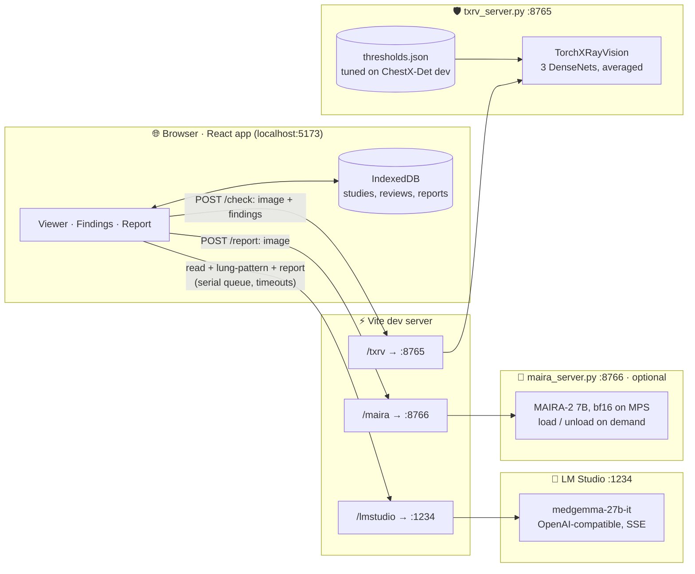
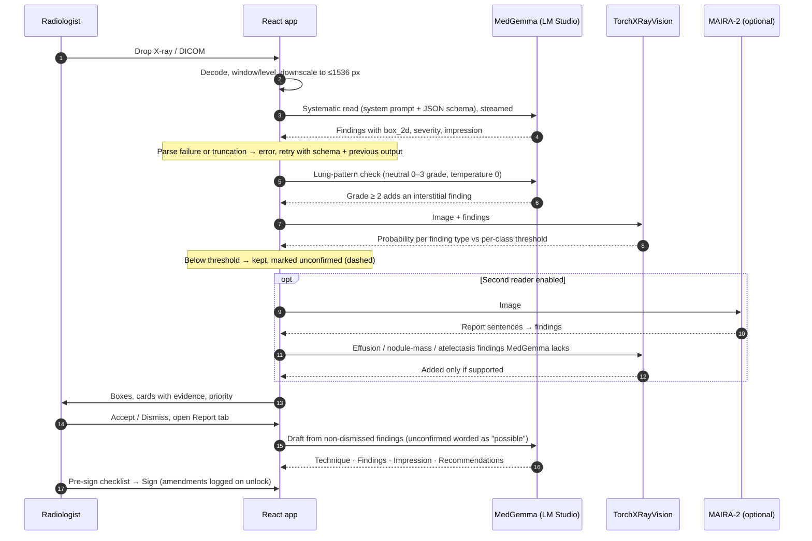

<div align="center">

# 🩻 Skanda Radiology

**AI-assisted chest X-ray reading that runs entirely on your Mac.**

Drop in a radiograph → **MedGemma 27B** performs a systematic read → findings are boxed on the image,<br>
cross-checked by an independent classifier, and drafted into a signable radiology report.

[](https://huggingface.co/google/medgemma-27b-it)
[](https://lmstudio.ai)
[](https://github.com/mlmed/torchxrayvision)
[](https://react.dev)
[](https://vite.dev)
[](https://www.typescriptlang.org)
[](#-architecture)

[Features](#-features) · [Screenshots](#-screenshots) · [Architecture](#-architecture) · [Quick start](#-quick-start) · [Benchmark](#-benchmark) · [Datasets](#-datasets) · [Limitations](#-known-limitations)

<br>


<sub>A ChestX-Det test film (radiologists: consolidation in both lungs, right effusion). MedGemma reads it in 79 s as <i>priority</i>: left lower lobe consolidation, an effusion, perihilar markings and two right-sided opacities. Each card shows the classifier's probability against its tuned threshold and how often that finding type was right on held-out films. MedGemma named the effusion left-sided where radiologists marked it right, and its boxes do not follow its own laterality: boxes are approximate (see <a href="#-benchmark">benchmark</a>).</sub>

</div>

> [!WARNING]
> **Decision support only.** All AI output must be reviewed and verified by a qualified radiologist before any clinical use. This is not a medical device.

---

## ✨ Features

| | |
|---|---|
| 📥 **Intake** | Drag & drop anywhere, paste (⌘V) or file picker. PNG, JPEG, WebP and uncompressed DICOM (correct tag parsing, BitsStored, MONOCHROME1, window/level, downscaling). |
| 🔬 **Diagnostic viewer** | Zoom/pan, window-level (right/⌥-drag) with Lung / Bone / Soft-tissue presets, invert, keyboard shortcuts, numbered severity-coloured boxes linked to the findings list, "not localized" legend. |
| 🧠 **Analysis** | Staged progress with ETA (reading → lung-pattern → cross-check → second reader), urgency, severity breakdown, impression, pertinent negatives, differential. A failed or truncated read is shown as an error, never as "normal". |
| 🛡️ **Cross-check** | Every finding is checked by a local [TorchXRayVision](https://github.com/mlmed/torchxrayvision) classifier (~0.1 s) with per-class thresholds tuned on held-out data. Unsupported findings stay in, drawn dashed and marked **unconfirmed**; the draft words them as *possible*. |
| 🔬 **Second reader** | Optional [MAIRA-2](https://huggingface.co/microsoft/maira-2) service adds effusion, nodule/mass and atelectasis findings MedGemma missed, only where the classifier agrees. On held-out films: right finding type 41% → 47%, effusion 30% → 53%. |
| ✅ **Reviewer in charge** | Accept or dismiss each finding. Dismissed findings leave the draft but are listed in a banner, the report trace line and every export. |
| 📊 **Honest confidence** | Each card shows how often that finding type was right on the ChestX-Det test split (e.g. *pneumothorax: 10 of 36 confirmed — verify carefully*) next to the model's uncalibrated self-stated confidence. |
| 📝 **Report** | AI-drafted structured report, editable, marked stale when images, reviews or patient details change, pre-sign checklist, sign-off with amendment trail, A4 print/PDF with annotated key images, plain-text (optionally anonymised) and JSON export. [Sample PDF](docs/sample-report.pdf). |
| 🔒 **Private by design** | Inference is local (LM Studio + local Python services); studies persist in the browser's IndexedDB. Nothing is uploaded. |
| 🌗 **Apple-style UI** | Light and dark mode, keyboard navigation, WCAG-checked contrast for safety text. |

## 📸 Screenshots

Real runs of the current app on this Mac (Oct 2026), using ChestX-Det test films ([datasets](#-datasets)). Captured with Playwright driving Chrome against the live app, MedGemma 27B and the classifier service.

<table>
<tr>
<td width="50%" valign="top">

<p><b>Cross-check flags a false alarm.</b> Radiologists labelled this film normal (ChestX-Det does not label tubes). MedGemma calls a left apical pneumothorax at 95% self-stated confidence. The classifier gives 38%, under the dev-tuned 39% threshold, so the box is dashed and the card says <i>in draft as unconfirmed — verify</i>, next to the held-out rate: 10 of 36 pneumothorax calls were right.</p>
</td>
<td width="50%" valign="top">

<p><b>Evidence on every finding.</b> Expanded card: classifier probability vs its tuned threshold and calibrated estimate, the held-out confirmation rate for that finding type, the model's own (uncalibrated) confidence, and Accept / Dismiss.</p>
</td>
</tr>
<tr>
<td width="50%" valign="top">

<p><b>Draft report.</b> Drafted in ~40 s from the reviewed findings and the clinical indication. Pinned "unsigned AI draft" bar; every section is editable and the draft goes stale when its inputs change.</p>
</td>
<td width="50%" valign="top">

<p><b>Printable report.</b> A4 preview with patient block, annotated key image and legend. The exported PDF of this study is in <a href="docs/sample-report.pdf"><code>docs/sample-report.pdf</code></a> (3 pages: findings, impression, recommendations, AI findings table with held-out rates, unsigned-draft seal and disclaimer).</p>
</td>
</tr>
<tr>
<td width="50%" valign="top">

<p><b>Staged progress.</b> A read takes ~55–90 s; the panel shows the current stage and an estimate, and survives switching images.</p>
</td>
<td width="50%" valign="top">

<p><b>Light mode.</b> Same study; unconfirmed findings keep a dashed outline in both themes so the meaning survives without colour.</p>
</td>
</tr>
</table>

### Sample report (excerpt from [`docs/sample-report.pdf`](docs/sample-report.pdf))

> **IMPRESSION**
> 1. Significant left lower lobe consolidation with associated moderate pleural effusion, highly suggestive of pneumonia with parapneumonic effusion.
> 2. Minor findings include ill-defined opacities in the right apex and right base, which warrant further evaluation to rule out malignancy or chronic inflammatory processes.
> 3. Increased bronchovascular markings bilaterally may indicate underlying interstitial lung disease or bronchitis.
>
> **RECOMMENDATIONS** Clinical correlation … Consider CT chest to further characterize the consolidation, effusion and the right apical/basal opacities … Follow-up chest radiograph in 6–8 weeks.
>
> *UNSIGNED — PRELIMINARY AI DRAFT · Awaiting radiologist review and signature*

Radiologists marked the effusion on the **right**; the draft says left. This is exactly why the report is a draft for a radiologist, not a result.

## 🏗 Architecture

Everything runs on `localhost`. The browser never talks to the model servers directly: the Vite dev server proxies three paths, so the UI uses relative URLs and needs no CORS setup.



On a 24 GB Mac MedGemma (~14–16 GB) and MAIRA-2 (~14 GB) cannot both be resident: `maira_server.py` refuses `/load` while LM Studio has a model loaded, and the second reader is off by default.

**One analysis, step by step**



| Piece | Where | What it does |
|---|---|---|
| LM Studio client | [`medgemma.ts`](app/src/lib/medgemma.ts) · [`sse.ts`](app/src/lib/sse.ts) · [`queue.ts`](app/src/lib/queue.ts) | Streaming `chat/completions`, a serial queue that honours cancel while waiting, idle/stream timeouts, retry with the schema and previous output, truncation detection |
| Proxy | [`app/vite.config.ts`](app/vite.config.ts) | `/lmstudio` → `:1234`, `/txrv` → `:8765`, `/maira` → `:8766` |
| Prompts | [`prompts.ts`](app/src/lib/prompts.ts) | Radiologist system prompt + JSON schema; report prompt with unconfirmed / second-reader markers |
| Parser | [`parse.ts`](app/src/lib/parse.ts) | JSON tried as-is first, then string-aware repair; `box_2d` → normalised boxes; failures throw |
| Pipeline | [`analysis.ts`](app/src/lib/analysis.ts) | Read → lung pattern → cross-check → second reader → store; report jobs, staged progress |
| Review rules | [`classifier.ts`](app/src/lib/classifier.ts) | `isExcluded` (dismissed), `isUnconfirmed` (unsupported, unreviewed), counts, urgency, report trace lines |
| Cross-check service | [`txrv_server.py`](app/server/txrv_server.py) · [`thresholds.json`](app/server/thresholds.json) | Per-class thresholds and calibration knots from `benchmark/fuse.py` |
| Second reader | [`maira.ts`](app/src/lib/maira.ts) · [`maira_server.py`](app/server/maira_server.py) · [`maira_parse.py`](app/server/maira_parse.py) | Optional MAIRA-2 service; sentence → finding rules shared with the benchmark |
| Reliability | [`reliability.ts`](app/src/lib/reliability.ts) · [`reliability.generated.ts`](app/src/lib/reliability.generated.ts) | Held-out confirmation rate per finding type, generated by `benchmark/score.py --emit-ts` |
| DICOM | [`imageIntake.ts`](app/src/lib/imageIntake.ts) · [`dicomPixels.ts`](app/src/lib/dicomPixels.ts) | Tag parsing, pixel maths (tested), canvas rendering |
| UI | [`app/src/components/`](app/src/components) | `viewer` · `findings` · `report` · `shell` |

The base URL (`/lmstudio/v1`), model id and second-reader settings can be changed in **Settings** (⌘,).

## 🚀 Quick start

**Requirements:** [LM Studio](https://lmstudio.ai) with `medgemma-27b-it` downloaded, and Node.js 20+. Optional: [uv](https://docs.astral.sh/uv/) for the classifier and second reader.

```sh
# 1 · Serve MedGemma (a moderate context; 131k × 4 parallel slots caused "Compute error" on a 24 GB Mac)
lms load medgemma-27b-it --context-length 16384 --gpu max -y
lms server start                                   # http://localhost:1234

# 2 · Run the app
cd app
npm install
npm run dev                                        # http://localhost:5173

# 3 · Cross-check classifier (recommended; first start downloads ~100 MB of weights)
uv run --with torchxrayvision --with scikit-image server/txrv_server.py   # http://localhost:8765

# 4 · Optional MAIRA-2 second reader (needs the weights in ~/.cache/maira-2 and ~14 GB free;
#     load it from Settings only when LM Studio has no model loaded)
uv run --python 3.12 --with "transformers>=4.48,<4.52" --with torch --with pillow --with accelerate server/maira_server.py
```

The status pill in the top right turns green (**Connected**) when LM Studio is reachable. Without the classifier the app still works; each card then says the cross-check did not run, and the pre-sign checklist lists it.

<details>
<summary><b>Development</b></summary>

```sh
npm run build                                          # typecheck + production build
npm run lint                                           # oxlint incl. React rules-of-hooks
npm test                                               # parser, DICOM, pipeline and export tests (node --experimental-strip-types)
python3 server/test_servers.py                         # classifier / MAIRA-2 service tests (no model)
```

`app/SWARM.md`, `app/tasks/` and `app/notes/` document how the first version was built by a 5-agent opencode swarm.
</details>

## 📈 Benchmark

[`benchmark/`](benchmark) runs the app's exact pipeline (same prompts, parser and lung-pattern pass) over public, labelled chest X-rays and scores it.

**Held-out result (Oct 2026):** 111 [ChestX-Det](https://github.com/Deepwise-AILab/ChestX-Det-Dataset) test films labelled by 3 radiologists; every rule and threshold was chosen on a separate 106-film dev split. Wilson 95% CIs.

| | 🧠 MedGemma 27B | 🧠 + 🔬 MAIRA-2 second reader |
|---|:---:|:---:|
| Abnormal films flagged | 74/82 (90%, CI 82–95) | 75/82 (91%, CI 83–96) |
| Normal films called normal | 21/29 (72%, CI 54–85) | 21/29 (72%, CI 54–85) |
| Right finding type, all labels | 90/220 (41%, CI 35–48) | **103/220 (47%, CI 40–53)** |
| Effusion | 13/43 (30%) | **23/43 (53%)** |
| Pneumothorax found / calls correct | 10/10 · 10/36 | 10/10 · 10/36 |
| Box lands on the lesion | 14/85 (16%) | 22/97 (23%) |

Using the classifier to *remove* MedGemma findings lost 17 true abnormal films for 3 more clear normals, so it now marks findings unconfirmed instead. Full tables and the ablation: [benchmark/README.md](benchmark/README.md#results--oct-2026-chestx-det-held-out-test-111-films).

**Original in-sample set:** 56 films (NIH NLP-mined labels + Kermany pediatric). Three approaches were compared on the same images:

| | 🧠 MedGemma 27B | 🧠 + 🛡️ cross-check | 🔬 MAIRA-2 7B |
|---|:---:|:---:|:---:|
| Adult normals called normal (NIH) | 8/12 | **9/12** | 8/12 |
| Adult abnormal flagged (NIH) | 22/32 | 21/32 | **27/32** |
| Right finding type, all labels | **25/49** | **25/49** | 19/49 |
| Pneumonia: pediatric / adult | **5/6 · 2/4** | **5/6 · 2/4** | 0/6 · 0/4 |
| Effusion / nodule+mass | 1/6 · 0/6 | 1/6 · 0/6 | **3/6 · 3/6** |
| Pneumothorax / edema / cardiomegaly | **3/4 · 3/4 · 2/4** | **3/4 · 3/4 · 2/4** | 2/4 · 1/4 · 1/4 |
| Output well-formed | 56/56 JSON | 56/56 | 51/56 |
| Latency per image | ~50 s | ~50 s + 0.1 s | **~8 s** |

NIH labels are NLP-mined (~90% accurate) and per-class counts are small, so treat per-class numbers as directional.

<details>
<summary><b>MedGemma 27B: full results</b> (Sep 2026, LM Studio, 16k ctx)</summary>

| Metric | Result |
|---|---|
| Pediatric pneumonia (Kermany) | 6/6 pneumonia flagged, 6/6 normals clear |
| Adult abnormal flagged (NIH) | 22/32 |
| Adult normals called normal (NIH) | 8/12 |
| JSON parse success | 56/56 |
| Abnormal findings localised with a box | 62/79 |
| Latency | median ~50 s per image |

Sensitivity by label: infiltration 5/6, pneumothorax 3/4, edema 3/4, consolidation 3/4, pneumonia 7/10, cardiomegaly 2/4, atelectasis 1/5, **effusion 1/6, nodule/mass 0/6**.

Precision, meaning how often each *reported* finding type was supported by the labels:

| Reported | Confirmed |
|---|---|
| interstitial / markings | 4/4 |
| consolidation / opacity | 24/31 |
| pneumothorax | 3/7 |
| effusion | 1/9 |
| cardiomegaly | 1/7 |

Self-reported confidence is uncalibrated (false findings are typically stated at 0.90–0.95), and "Right lower lobe consolidation" accounts for 3 of 4 false alarms on normal films.
</details>

<details>
<summary><b>🛡️ TorchXRayVision cross-check</b>: removed 4 findings, all false</summary>

[TorchXRayVision](https://github.com/mlmed/torchxrayvision) is not a report generator: it outputs a probability per pathology in ~0.1 s. The app uses it as a second opinion on each MedGemma finding. Models: the CheXpert, MIMIC and PadChest DenseNets averaged (none trained on NIH, so no test-set leakage). A finding is *unsupported* when its type's probability is < 0.5, the models' own operating point, not tuned on this set.

| | MedGemma alone | MedGemma + cross-check |
|---|---|---|
| Adult normals called normal (NIH) | 8/12 | **9/12** |
| Adult abnormal flagged (NIH) | **22/32** | 21/32 |
| Right finding type, all labels | 25/49 | 25/49 |
| Findings removed | — | 4, **all false**, 0 true |
| Extra latency | — | ~0.1 s |

- Removed: right lower lobe consolidation + bilateral apical fibrosis on a normal film, and a false apical pneumothorax on an effusion film (that film's only finding, hence 22 → 21 flagged).
- Classifier alone, AUC vs normals (2–10 films per label, directional): pneumothorax 1.00, consolidation 0.96, edema 0.94, cardiomegaly 0.93, mass 0.92, nodule 0.90, pneumonia 0.82, atelectasis 0.82, effusion 0.76.
- Caveat: it gave 0.08–0.10 effusion probability on 2 of 6 labelled effusions, so a correct call can be flagged. Unsupported findings therefore stay visible (dashed outline) rather than being deleted.
- Raw outputs: [`benchmark/txrv.jsonl`](benchmark/txrv.jsonl) (probabilities), [`benchmark/results-txrv.jsonl`](benchmark/results-txrv.jsonl) (filtered findings); script [`benchmark/run_txrv.py`](benchmark/run_txrv.py).
</details>

<details>
<summary><b>🔬 Microsoft MAIRA-2 comparison</b>: 6× faster, weaker on pneumonia</summary>

[MAIRA-2](https://huggingface.co/microsoft/maira-2) is a chest-X-ray report generator, not a chat model: it cannot follow the app's prompt, return JSON, or run in LM Studio (no GGUF/MLX build; custom Rad-DINO + Vicuna architecture). [`benchmark/run_maira2.py`](benchmark/run_maira2.py) runs it through transformers on the Mac GPU and turns each generated sentence into a finding (negated sentences and well-positioned devices count as normal), so the same `score.py` applies. MedGemma's scores are unchanged by the synonyms added for MAIRA-2's wording (*opacification*, *alveolar*, *round opacity*).

- MAIRA-2 never names pneumonia; it describes opacities. The pediatric films are outside its training data (adult MIMIC-CXR only): it calls all 6 pediatric pneumonias abnormal, but as cardiomegaly/congestion, and once as bilateral pneumothorax with large effusions.
- It writes more findings per film (92 vs 79) with more incidental ones (tortuous aorta, low volumes), and gives no confidence or severity, so its "flagged" rate is less meaningful than MedGemma's.
- **Conclusion:** MAIRA-2 is ~6× faster and better at effusions and nodules/masses, but weaker on pneumonia, pneumothorax, edema and cardiomegaly, and it does not fit the app's structured-output pipeline. MedGemma stays the app's model. Raw outputs: [`benchmark/results-maira2.jsonl`](benchmark/results-maira2.jsonl).
</details>

**Reproduce or re-score** (requires LM Studio serving `medgemma-27b-it`):

```sh
cd benchmark
python3 fetch.py                             # download images + manifest
node --experimental-strip-types run.mts      # ~1 min/image, resumable → results.jsonl
python3 score.py final results.jsonl         # score (works on the committed results without re-running)
```

Raw model outputs for every image are committed, so every number above can be audited without re-running a model. Methodology, what changed in the app, and approaches that were tried and rejected are in [benchmark/README.md](benchmark/README.md).

The numbers above are in-sample: the prompts and rules were tuned while looking at these 56 films. The held-out protocol (ChestX-Det, 217 radiologist-labelled films split into dev and test, with Wilson CIs) is described in [benchmark/README.md § Methodology](benchmark/README.md#methodology). The cross-check's per-class thresholds are tuned on dev and reported on test, and are stored in [`app/server/thresholds.json`](app/server/thresholds.json) (`python3 benchmark/fuse.py`). The held-out MedGemma and MAIRA-2 results are at the top of this section.

## 🗂 Datasets

Images are **not redistributed** in this repo; [`benchmark/fetch.py`](benchmark/fetch.py) downloads them and [`benchmark/manifest.json`](benchmark/manifest.json) lists the exact 56 images and labels used.

| Dataset | Used | Source | Mirror used by `fetch.py` | License |
|---|---|---|---|---|
| **NIH ChestX-ray14** (Wang et al., CVPR 2017) | 44 adult films (test split): 12 *No Finding* + effusion, cardiomegaly, pneumothorax, edema, consolidation, pneumonia, infiltration, atelectasis, mass, nodule | [NIH Clinical Center](https://nihcc.app.box.com/v/ChestXray-NIHCC) | [🤗 BahaaEldin0/NIH-Chest-Xray-14](https://huggingface.co/datasets/BahaaEldin0/NIH-Chest-Xray-14) | No restrictions; cite NIH CC |
| **Pediatric pneumonia** (Kermany et al., Cell 2018) | 12 films (test split): 6 normal, 6 pneumonia | [Mendeley Data](https://data.mendeley.com/datasets/rscbjbr9sj/2) | [🤗 hf-vision/chest-xray-pneumonia](https://huggingface.co/datasets/hf-vision/chest-xray-pneumonia) | CC BY 4.0 |

Manual test images are public chest radiographs from Wikimedia Commons: [normal PA](https://commons.wikimedia.org/wiki/File:Chest_Xray_PA_3-8-2010.png), [pneumonia](https://commons.wikimedia.org/wiki/File:Pneumonia_x-ray.jpg), [pneumothorax](https://commons.wikimedia.org/wiki/File:Pneumothorax_CXR.jpg), [cardiomegaly](https://commons.wikimedia.org/wiki/File:Cardiomegally.PNG).

**Models:** [google/medgemma-27b-it](https://huggingface.co/google/medgemma-27b-it) · [microsoft/maira-2](https://huggingface.co/microsoft/maira-2) · [TorchXRayVision](https://github.com/mlmed/torchxrayvision) (`densenet121-res224-chex`, `-mimic_ch`, `-pc`)

## 🚧 Known limitations

- MedGemma's bounding boxes are approximate, and **results vary between runs** (see the report screenshot above).
- Self-reported confidence is uncalibrated; finding cards show the held-out confirmation rate for each finding type instead (weak: pneumothorax 10/36, cardiomegaly 3/12 films with that call were right).
- MedGemma misses fractures (0/12) and most pleural thickening (2/16), and its boxes land on the lesion only 16% of the time on radiologist-labelled films.
- Subtle interstitial patterns (prominent bronchovascular markings, perihilar opacities, peribronchial cuffing) are under-called by the main read. A second, neutral graded lung-pattern check (0–3 scale, ~10 s) adds a finding when the grade is ≥ 2; on a 12-film labelled set this raised detection from 6/7 to 7/7 with no false positives on 5 normals. That is a small sample, so treat it as directional.
- Leading yes/no questions ("is X present?") are unreliable: the model tends to agree with whatever is asked, including on normal films.
- The classifier can miss real effusions (0.08–0.10 on 2 of 6), so a dashed finding is a prompt to look again, not a verdict.

<div align="center">
<br>
<sub>Built with MedGemma, LM Studio, TorchXRayVision, React and Vite · For research and decision support only</sub>
</div>
