<div align="center">

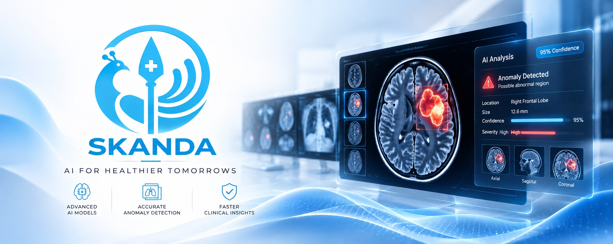

# Skanda Radiology

**AI-assisted chest X-ray reading that runs entirely on your Mac.**

Drop in a radiograph → **MedGemma 27B** performs a systematic read → findings are boxed on the image,<br>
cross-checked by an independent classifier, and drafted into a signable radiology report.

[](https://huggingface.co/google/medgemma-27b-it)
[](https://lmstudio.ai)
[](https://github.com/mlmed/torchxrayvision)
[](https://react.dev)
[](https://vite.dev)
[](https://www.typescriptlang.org)
[](#-architecture)

[Demo](#-demo) · [Features](#-features) · [Screenshots](#-screenshots) · [Architecture](#-architecture) · [Quick start](#-quick-start) · [Setup guide](#-setup-guide) · [Benchmark](#-benchmark) · [CXR model comparison](#model-comparison-cxr) · [Datasets](#-datasets) · [Limitations](#-known-limitations)

<br>

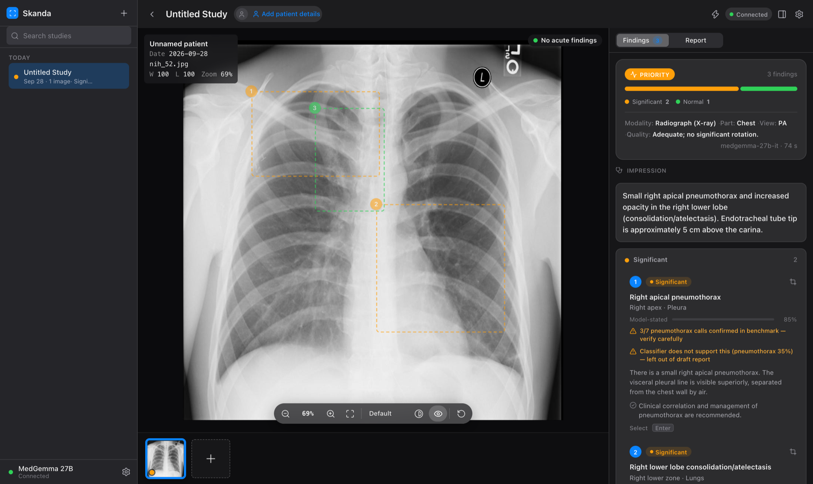

<sub>A ChestX-Det test film (radiologists: consolidation in both lungs, right effusion). MedGemma reads it in 55 s as <i>priority</i>: left lower lobe consolidation, a left pleural effusion and perihilar markings. The heatmap shows, per finding, where the independent classifier found evidence within that finding's region: the opacity findings peak in the patient's left lung (100%), while the effusion box has little effusion evidence (32%). MedGemma calls the effusion left-sided but draws its box over the right base, where radiologists marked it: names and boxes are approximate (see <a href="#-benchmark">benchmark</a>).</sub>

</div>

> [!WARNING]
> **Decision support only.** All AI output must be reviewed and verified by a qualified radiologist before any clinical use. This is not a medical device.

---

## 🎬 Demo

<a href="docs/demo.mp4">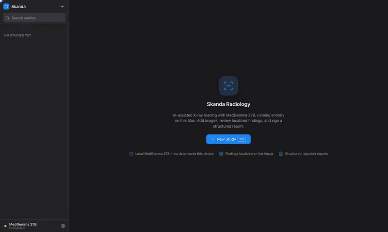</a>

<sub>32 s, recorded from the live app on this Mac ([MP4](docs/demo.mp4)): new study → MedGemma 27B read (108 s, sped up) → findings with per-finding classifier heatmaps → click a finding to zoom in and see its evidence → draft report (42 s, sped up) → print/PDF with one heatmap per finding. Film: ChestX-Det test image.</sub>

## ✨ Features

| | |
|---|---|
| 📥 **Intake** | Drag & drop anywhere, paste (⌘V) or file picker. PNG, JPEG, WebP and uncompressed DICOM (correct tag parsing, BitsStored, MONOCHROME1, window/level, downscaling). |
| 🔬 **Diagnostic viewer** | Zoom/pan, window-level (right/⌥-drag) with Lung / Bone / Soft-tissue presets, invert, keyboard shortcuts, numbered severity-coloured boxes linked to the findings list, "not localized" legend. |
| 🎯 **Localised view** | Classifier **heatmap** painted on the X-ray, **one per finding** (its type's evidence within its own region; jet colour map, hot regions outlined, each peak labelled with the finding number and regional strength): all findings at once, or the selected one; **H** toggles it. The printed report repeats it as one figure per finding. Selecting a finding zooms the viewer onto its box (Esc returns to the whole film) and its card shows a close-up crop. Boxes and heatmaps are approximate: see [localisation](#localisation-held-out). |
| 🧠 **Analysis** | Staged progress with ETA (reading → lung-pattern → cross-check → second reader), urgency, severity breakdown, impression, pertinent negatives, differential. A failed or truncated read is shown as an error, never as "normal". |
| 🛡️ **Cross-check** | Every finding is checked by a local [TorchXRayVision](https://github.com/mlmed/torchxrayvision) classifier (~0.1 s) with per-class thresholds tuned on held-out data. Unsupported findings stay in, drawn dashed and marked **unconfirmed**; the draft words them as *possible*. |
| 🔬 **Second reader** | Optional [MAIRA-2](https://huggingface.co/microsoft/maira-2) service adds effusion, nodule/mass and atelectasis findings MedGemma missed, only where the classifier agrees. On held-out films: right finding type 41% → 47%, effusion 30% → 53%. |
| ✅ **Reviewer in charge** | Accept or dismiss each finding. Dismissed findings leave the draft but are listed in a banner, the report trace line and every export. |
| 📊 **Honest confidence** | Each card shows how often that finding type was right on the ChestX-Det test split (e.g. *pneumothorax: 10 of 36 confirmed — verify carefully*) next to the model's uncalibrated self-stated confidence. |
| 📝 **Report** | AI-drafted structured report with one classifier heatmap figure per finding, editable, marked stale when images, reviews or patient details change, pre-sign checklist, sign-off with amendment trail, A4 print/PDF with annotated key images, plain-text (optionally anonymised) and JSON export. [Sample PDF](docs/sample-report.pdf). |
| 🔒 **Private by design** | Inference is local (LM Studio + local Python services); studies persist in the browser's IndexedDB. Nothing is uploaded. |
| 🌗 **Apple-style UI** | Light and dark mode, keyboard navigation, WCAG-checked contrast for safety text. |

## 📸 Screenshots

Real runs of the current app on this Mac (Oct 2026), using ChestX-Det test films ([datasets](#-datasets)). Captured with Playwright driving Chrome against the live app, MedGemma 27B and the classifier service.

<table>
<tr>
<td width="50%" valign="top">
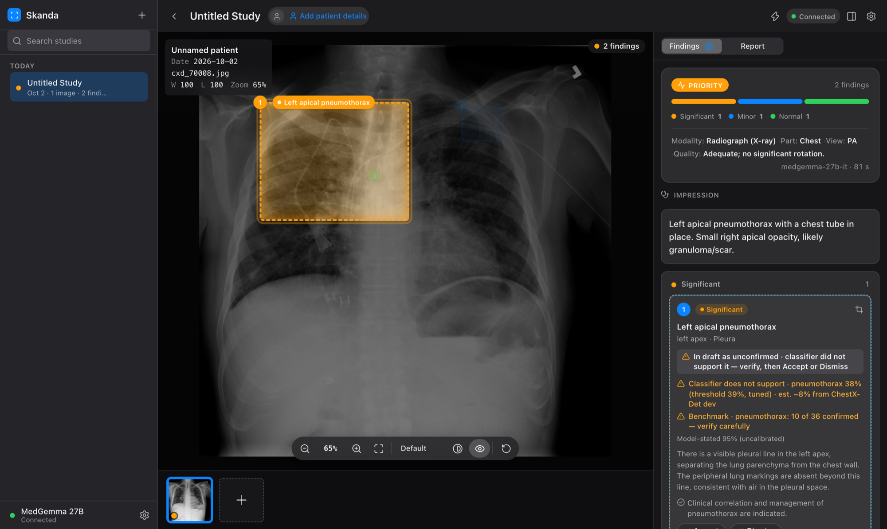
<p><b>Cross-check flags a false alarm.</b> Radiologists labelled this film normal (ChestX-Det does not label tubes). MedGemma calls a left apical pneumothorax at 95% self-stated confidence. The classifier gives 38%, under the dev-tuned 39% threshold, so the box is dashed, the card says <i>in draft as unconfirmed — verify</i>, and the study stays <i>routine</i>; the card also shows that only 10 of 36 pneumothorax calls were right on held-out films. Selecting it zooms in and shows its heatmap.</p>
</td>
<td width="50%" valign="top">

<p><b>Evidence on every finding.</b> Expanded card for the effusion: classifier probability vs its tuned threshold and calibrated estimate, the held-out confirmation rate for that type (12 of 20, verify carefully), the model's own uncalibrated confidence, a close-up of its box, and Accept / Dismiss.</p>
</td>
</tr>
<tr>
<td width="50%" valign="top">
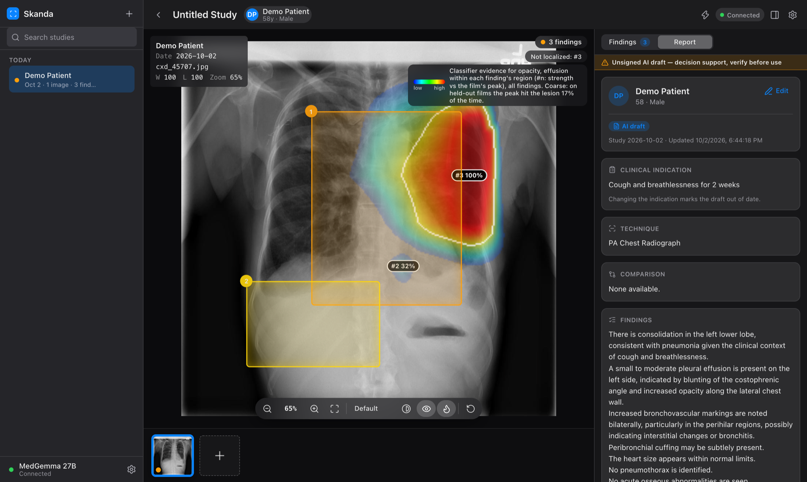
<p><b>Draft report.</b> Drafted in ~50 s from the reviewed findings and the clinical indication, with the heatmaps still on the film. Pinned "unsigned AI draft" bar; every section is editable and the draft goes stale when its inputs change.</p>
</td>
<td width="50%" valign="top">
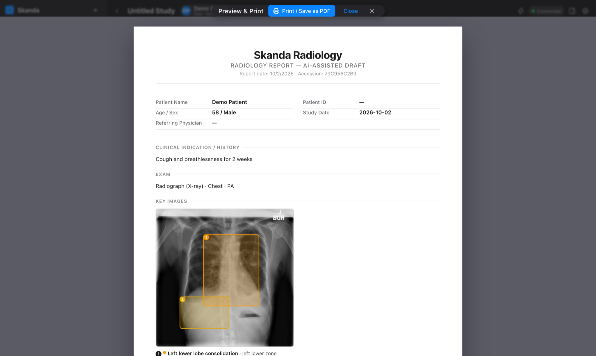
<p><b>Printable report.</b> A4 preview with patient block, annotated key image and legend, followed by one classifier heatmap per finding. An exported example is in <a href="docs/sample-report.pdf"><code>docs/sample-report.pdf</code></a> (findings, impression, recommendations, per-finding heatmaps, AI findings table with held-out rates, unsigned-draft seal and disclaimer).</p>
</td>
</tr>
<tr>
<td width="50%" valign="top">
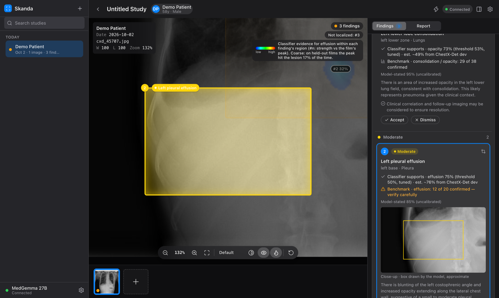
<p><b>Zoom to finding.</b> Selecting a finding zooms and centres the viewer on its box (here the effusion, 65% → 132%) and shows only that finding's heatmap; the expanded card shows a close-up. Esc returns to the whole film.</p>
</td>
<td width="50%" valign="top">
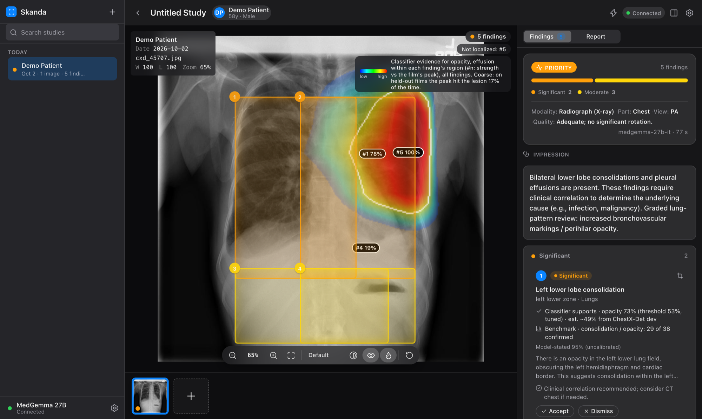
<p><b>Heatmap on the X-ray.</b> One map per finding: the classifier's evidence for its type within the finding's own region, on by default. Each label gives the finding number and its regional strength (#1 78%, #5 100%, #4 19%: the classifier sees little effusion in that box). Hot regions are outlined. Coarse: on held-out films the peak hit the lesion 17% of the time, so it says where to look, not where the lesion is.</p>
</td>
</tr>
<tr>
<td width="50%" valign="top">
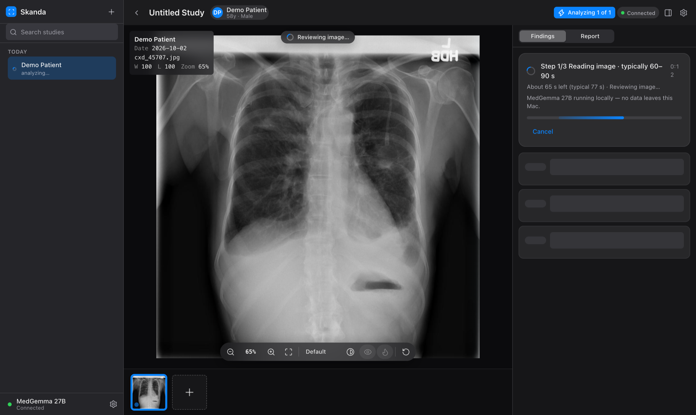
<p><b>Staged progress.</b> A read takes ~55–90 s; the panel shows the current stage (reading → lung pattern → cross-check) and an estimate, and survives switching images.</p>
</td>
<td width="50%" valign="top">
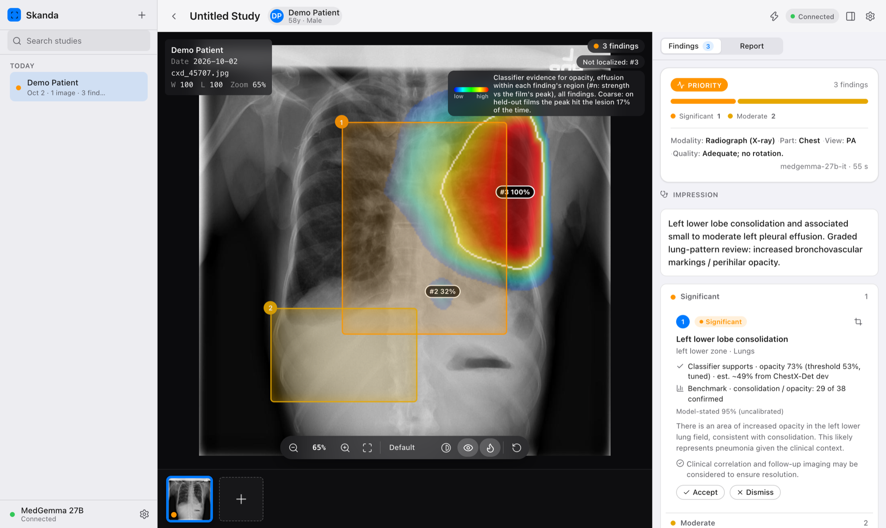
<p><b>Light mode.</b> Same study and heatmaps; unconfirmed findings keep a dashed outline in both themes so the meaning survives without colour.</p>
</td>
</tr>
</table>

### Sample report (excerpt from [`docs/sample-report.pdf`](docs/sample-report.pdf))

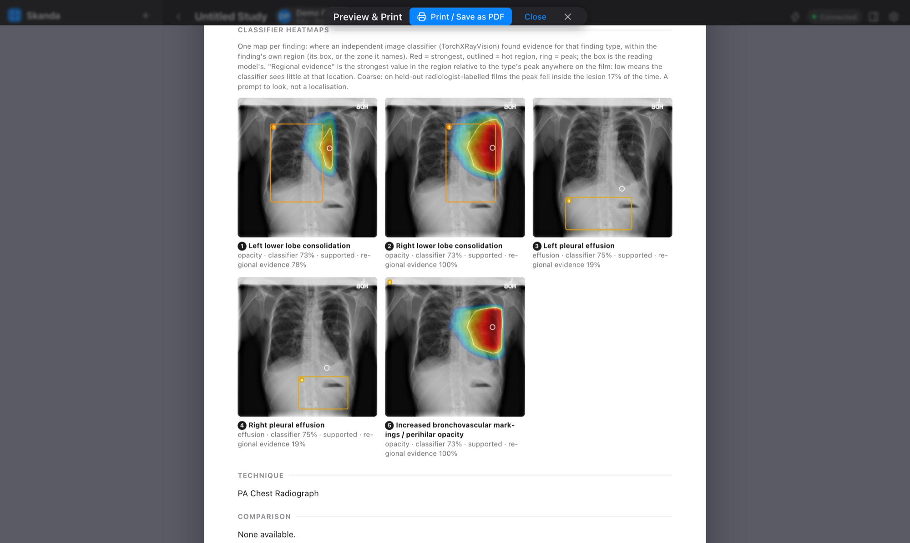

Every report has a **Classifier Heatmaps** section: one figure per finding, showing where the classifier found evidence for that finding type *within the finding's own region*, with its regional strength. Here the two opacity findings on the patient's left are hot (78–100%) while both effusion boxes are cold (19%): the classifier sees little effusion where the model drew them, a cue to look again.

> **IMPRESSION**
> 1. Bilateral lower lobe consolidations and pleural effusions are present, requiring clinical correlation to determine the etiology (e.g., infection, malignancy, fluid overload).
> 2. Increased bronchovascular markings suggest interstitial involvement.
> 3. No pneumothorax or significant mediastinal abnormality identified.
>
> *UNSIGNED — PRELIMINARY AI DRAFT · Awaiting radiologist review and signature*

Radiologists marked consolidation in both lungs and an effusion on the **right only**; the draft calls the effusions bilateral. This is why the report is a draft for a radiologist, not a result.

### Sample test: multiple pulmonary nodules (Oct 2026)

A chest radiograph supplied by the project owner (source not documented; it still carries a phone's image-viewer buttons, left in as-is) was run through the full pipeline: read, cross-check, heatmaps, draft report and PDF export ([`docs/sample-test-report.pdf`](docs/sample-test-report.pdf)). No patient details or reference read were available.

<table>
<tr>
<td width="50%" valign="top">
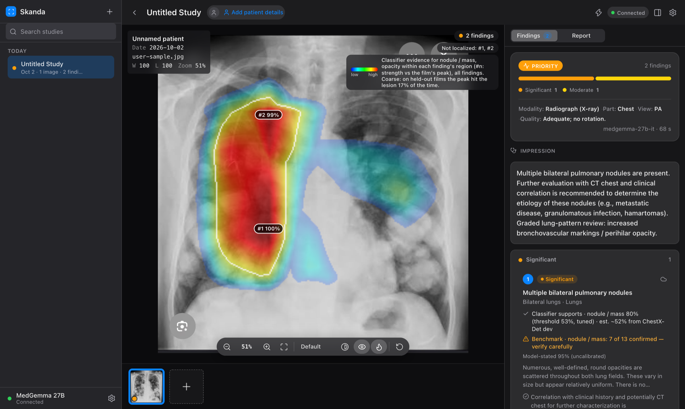
<p><b>Read (68 s, priority).</b> MedGemma reports <i>multiple bilateral pulmonary nodules</i> (significant) with metastatic disease first in its differential, plus perihilar opacity. The classifier supports both (nodule/mass 80%, opacity 82%). Neither finding has a box (diffuse), so the heatmaps cover the whole film.</p>
</td>
<td width="50%" valign="top">
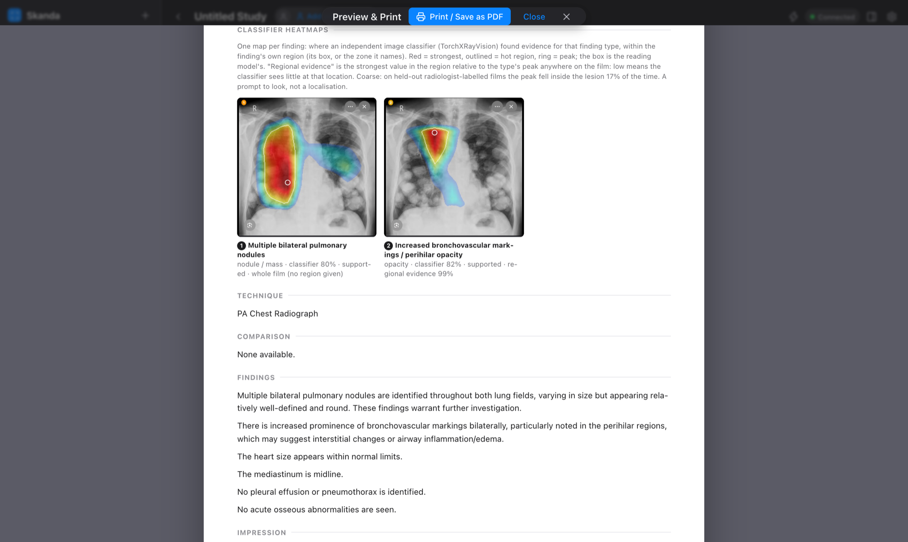
<p><b>Report heatmaps.</b> One figure per finding. The nodule map is hot over the right lung but only cool over the left, although nodules are visible in both: the heatmap shows where the classifier's evidence is strongest, not every lesion.</p>
</td>
</tr>
</table>

What it got right: the dominant pattern and an appropriate differential and recommendation (CT chest). What it missed: the venous catheter in the right upper chest is not mentioned. Run-to-run variation applies (see benchmark).

## 🏗 Architecture

Everything runs on `localhost`. The browser never talks to the model servers directly: the Vite dev server proxies three paths, so the UI uses relative URLs and needs no CORS setup.

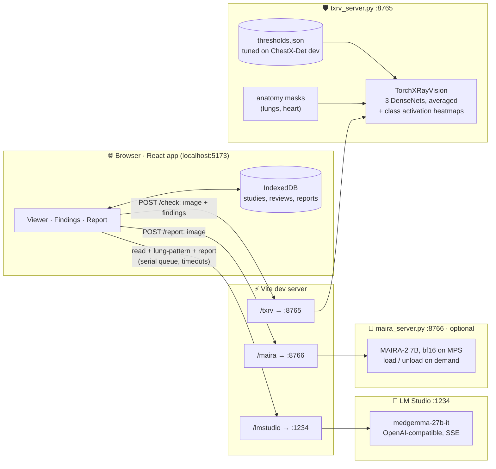

On a 24 GB Mac MedGemma (~14–16 GB) and MAIRA-2 (~14 GB) cannot both be resident: `maira_server.py` refuses `/load` while LM Studio has a model loaded, and the second reader is off by default.

**One analysis, step by step**

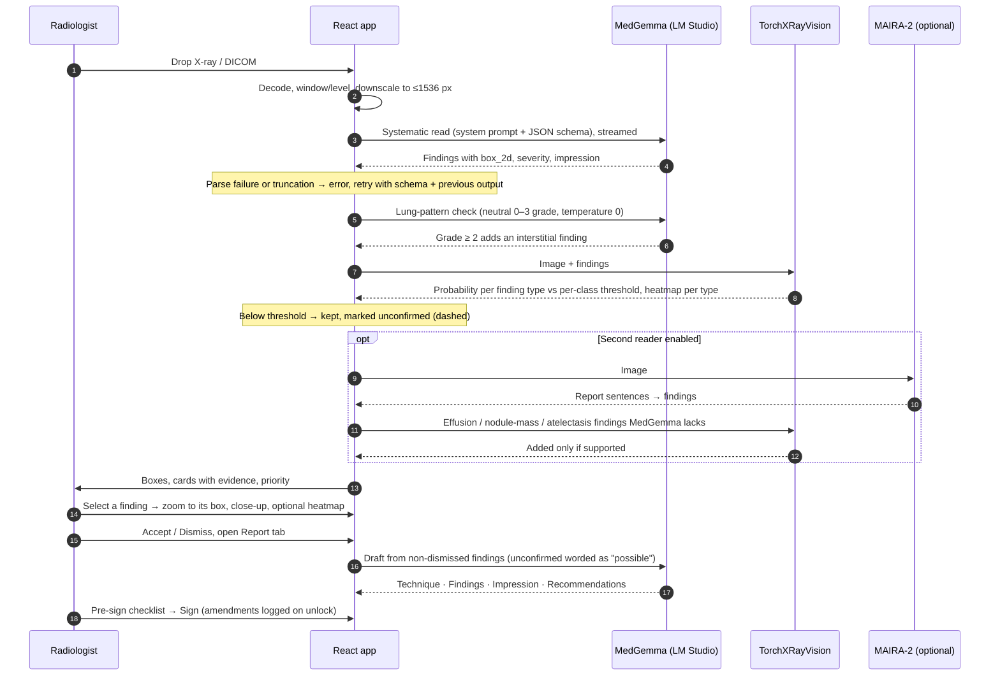

| Piece | Where | What it does |
|---|---|---|
| LM Studio client | [`medgemma.ts`](app/src/lib/medgemma.ts) · [`sse.ts`](app/src/lib/sse.ts) · [`queue.ts`](app/src/lib/queue.ts) | Streaming `chat/completions`, a serial queue that honours cancel while waiting, idle/stream timeouts, retry with the schema and previous output, truncation detection |
| Proxy | [`app/vite.config.ts`](app/vite.config.ts) | `/lmstudio` → `:1234`, `/txrv` → `:8765`, `/maira` → `:8766` |
| Prompts | [`prompts.ts`](app/src/lib/prompts.ts) | Radiologist system prompt + JSON schema; report prompt with unconfirmed / second-reader markers |
| Parser | [`parse.ts`](app/src/lib/parse.ts) | JSON tried as-is first, then string-aware repair; `box_2d` → normalised boxes; failures throw |
| Pipeline | [`analysis.ts`](app/src/lib/analysis.ts) | Read → lung pattern → cross-check → second reader → store; report jobs, staged progress |
| Review rules | [`classifier.ts`](app/src/lib/classifier.ts) | `isExcluded` (dismissed), `isUnconfirmed` (unsupported, unreviewed), counts, urgency, report trace lines |
| Cross-check service | [`txrv_server.py`](app/server/txrv_server.py) · [`thresholds.json`](app/server/thresholds.json) | Per-class thresholds and calibration knots from `benchmark/fuse.py`; lung-masked class activation heatmaps |
| Second reader | [`maira.ts`](app/src/lib/maira.ts) · [`maira_server.py`](app/server/maira_server.py) · [`maira_parse.py`](app/server/maira_parse.py) | Optional MAIRA-2 service; sentence → finding rules shared with the benchmark |
| Reliability | [`reliability.ts`](app/src/lib/reliability.ts) · [`reliability.generated.ts`](app/src/lib/reliability.generated.ts) | Held-out confirmation rate per finding type, generated by `benchmark/score.py --emit-ts` |
| DICOM | [`imageIntake.ts`](app/src/lib/imageIntake.ts) · [`dicomPixels.ts`](app/src/lib/dicomPixels.ts) | Tag parsing, pixel maths (tested), canvas rendering |
| UI | [`app/src/components/`](app/src/components) | `viewer` · `findings` · `report` · `shell` |

The base URL (`/lmstudio/v1`), model id and second-reader settings can be changed in **Settings** (⌘,).

## 🚀 Quick start

Already have LM Studio, Node and uv? These are the commands. First time, or something not working: follow the [setup guide](#-setup-guide).

```sh
# 1 · Serve MedGemma (a moderate context; 131k × 4 parallel slots caused "Compute error" on a 24 GB Mac)
lms load medgemma-27b-it --context-length 16384 --gpu max -y
lms server start                                   # http://localhost:1234

# 2 · Run the app
cd app
npm install
npm run dev                                        # http://localhost:5173

# 3 · Cross-check classifier (recommended; first start downloads ~620 MB of weights)
uv run --with torchxrayvision --with scikit-image server/txrv_server.py   # http://localhost:8765

# 4 · Optional MAIRA-2 second reader (needs the weights in ~/.cache/maira-2 and ~14 GB free;
#     load it from Settings only when LM Studio has no model loaded)
uv run --python 3.12 --with "transformers>=4.48,<4.52" --with torch --with pillow --with accelerate --with protobuf --with sentencepiece server/maira_server.py
```

The status pill in the top right turns green (**Connected**) when LM Studio is reachable. Without the classifier the app still works; each card then says the cross-check did not run, and the pre-sign checklist lists it.

<details>
<summary><b>Development</b></summary>

```sh
npm run build                                          # typecheck + production build
npm run lint                                           # oxlint incl. React rules-of-hooks
npm test                                               # parser, DICOM, pipeline and export tests (node --experimental-strip-types)
python3 server/test_servers.py                         # classifier / MAIRA-2 service tests (no model)
```

`app/SWARM.md`, `app/tasks/` and `app/notes/` document how the first version was built by a 5-agent opencode swarm.
</details>

## 🧰 Setup guide

Step by step from a fresh Mac. Total download is about 15 GB (about 41 GB with the optional MAIRA-2 second reader).

### 1 · Check the machine

| | Needed | Tested on |
|---|---|---|
| Mac | Apple Silicon (M1 or later) | M5 Pro |
| Memory | **24 GB** unified memory minimum. MedGemma uses ~14 GB; close VMs and heavy browser tabs while reading, or the Mac swaps and a read slows from ~55 s to several minutes | 24 GB |
| Disk | ~15 GB free (MedGemma 13.9 GB, classifier + anatomy model 0.4 GB, app 0.2 GB). +26 GB for MAIRA-2 | — |
| macOS | A version current LM Studio supports | macOS 26.6 |

### 2 · Install the tools

| Tool | Version | Install |
|---|---|---|
| [LM Studio](https://lmstudio.ai) | current | Download the app, open it once, then enable the `lms` command line: run `~/.lmstudio/bin/lms bootstrap` and open a new terminal |
| [Node.js](https://nodejs.org) | **20.19+ or 22.12+** (Vite 8) | `brew install node` or the installer from nodejs.org |
| [uv](https://docs.astral.sh/uv/) | any recent | `curl -LsSf https://astral.sh/uv/install.sh \| sh` (runs the Python services with their own dependencies; no global Python packages needed) |
| git | any | `xcode-select --install` |

Check:

```sh
lms version && node -v && uv --version && git --version
```

### 3 · Get the code

```sh
git clone https://github.com/Hitheshkaranth/skanda-radiology.git
cd skanda-radiology/app
npm install
```

### 4 · Download and serve MedGemma

The benchmark numbers in this README were measured with **`unsloth/medgemma-27b-it-GGUF`, quantisation `Q3_K_S` (13.9 GB)**.

1. In LM Studio open **Discover**, search `unsloth/medgemma-27b-it-GGUF` and download **Q3_K_S**. A larger quantisation (e.g. Q4_K_M) needs more memory and has not been benchmarked here.
2. Load it with a moderate context and start the server:

   ```sh
   lms ls                                                     # note the model identifier, normally medgemma-27b-it
   lms load medgemma-27b-it --context-length 16384 --gpu max -y
   lms server start                                           # http://localhost:1234
   curl -s localhost:1234/v1/models                           # should list medgemma-27b-it
   ```

   A 131k context with 4 parallel slots caused "Compute error" on a 24 GB Mac; 16k is plenty (a read uses a few thousand tokens). If your identifier differs, change **Model id** in the app's Settings (⌘,); it must match exactly.

### 5 · Start the app

```sh
cd app
npm run dev                                                   # http://localhost:5173
```

Open <http://localhost:5173>. The pill at the bottom of the sidebar and in the toolbar should read **Connected**. Vite listens on `localhost` only and proxies `/lmstudio`, `/txrv` and `/maira` to the local services.

### 6 · Start the cross-check classifier (recommended)

In a second terminal:

```sh
cd app
uv run --with torchxrayvision --with scikit-image server/txrv_server.py
curl -s localhost:8765/health                                 # {"ok": true, ... "thresholds": {...ChestX-Det dev...}}
```

The first start downloads three DenseNet classifiers (~85 MB) and, on the first heatmap, the anatomy segmentation model (~270 MB), cached in `~/.torchxrayvision`. Per-class thresholds load from `app/server/thresholds.json`. Without this service the app still works, but no finding can be marked supported or unconfirmed, and the pre-sign checklist says the cross-check did not run.

### 7 · Try it

1. **New Study** (⌘N) → add patient details (age, sex, clinical indication improve the read).
2. Drop a chest X-ray (PNG, JPEG, WebP or uncompressed DICOM) onto the viewer → **Analyze Image**. A read takes ~55–90 s.
3. The heatmap shows the weighted regions for all findings; click a finding to zoom onto it and see only its region (Esc for the whole film; **H** toggles the heatmap). **Accept** or **Dismiss** it. Dashed boxes are *unconfirmed* by the classifier.
4. **Report** tab → **Draft Report** (~40 s) → edit → **Sign**. **Preview & Print / PDF** for the A4 report.

No X-ray to hand? The benchmark films are public: `cd benchmark && python3 fetch.py chestxdet` downloads 217 radiologist-labelled films into `benchmark/img/` (labels in `manifest-cxd.json`).

### 8 · Optional: MAIRA-2 second reader

Adds effusion, nodule/mass and atelectasis findings MedGemma misses (held-out: right finding type 41% → 47%). It needs ~14 GB while loaded, so on a 24 GB Mac it cannot run at the same time as MedGemma.

1. Accept the licence at <https://huggingface.co/microsoft/maira-2> (gated), then download the weights (~26 GB):

   ```sh
   uvx --from huggingface_hub hf auth login
   uvx --from huggingface_hub hf download microsoft/maira-2 --local-dir ~/.cache/maira-2
   ```

2. Start the service (weights are **not** loaded at start):

   ```sh
   cd app
   uv run --python 3.12 --with "transformers>=4.48,<4.52" --with torch --with pillow --with accelerate \
     --with protobuf --with sentencepiece server/maira_server.py          # http://localhost:8766
   ```

3. Settings (⌘,) → **Second reader (MAIRA-2)** → turn on **Use second reader** → **Load**. Loading is refused while LM Studio has a model resident, so on a 24 GB Mac run `lms unload --all` first, read with MAIRA-2, then **Unload** and reload MedGemma. With 48 GB or more both fit.

### Everyday start and stop

```sh
lms load medgemma-27b-it --context-length 16384 --gpu max -y && lms server start
cd app && npm run dev                                                    # terminal 1
cd app && uv run --with torchxrayvision --with scikit-image server/txrv_server.py   # terminal 2
# stop: Ctrl-C in each terminal, then `lms unload --all` to free ~14 GB
```

### Troubleshooting

| Symptom | Cause and fix |
|---|---|
| Pill says **Offline** or **Not connected** | LM Studio server not running: `lms server start`. Check Settings → base URL is `/lmstudio/v1` |
| Pill says **Model not loaded** | Load it (`lms load medgemma-27b-it …`), or the identifier differs from Settings → **Model id** (exact match required). Use the name from `lms ps` |
| "Compute error" from LM Studio | Context too large for memory: reload with `--context-length 16384` and a single model loaded |
| A read takes minutes instead of ~1 | Memory pressure. Check `sysctl vm.swapusage`; close VMs, browser tabs and other loaded models (`lms ps`) |
| Cards say "Classifier not running — not cross-checked" | `txrv_server.py` not running, or port 8765 in use: `lsof -i :8765` |
| MAIRA-2 **Load** says "LM Studio has … loaded; unload it first" | Intended on 24 GB: `lms unload --all`, then Load |
| "The model output was cut off at the token limit…" or an unreadable-output error | Shown as an error, never as normal. The app already retried once with the schema; raise **Max tokens** in Settings if it was cut off, then **Re-analyze** |
| "Compressed DICOM (transfer syntax …) is not supported" | JPEG / JPEG 2000 inside DICOM is not decoded: export as uncompressed DICOM or PNG |
| `npm run dev` fails on Node version | Vite 8 needs Node 20.19+ or 22.12+: `node -v` |

### Privacy checklist

- Everything above runs on `localhost` only. The app contains no calls to external hosts; studies live in the browser's IndexedDB.
- Internet is used only to download the tools, model weights and the public benchmark films.
- Do not commit real patient images, screenshots or exported reports to a git remote, and do not paste them into cloud AI assistants.

## 📈 Benchmark

[`benchmark/`](benchmark) runs the app's exact pipeline (same prompts, parser and lung-pattern pass) over public, labelled chest X-rays and scores it.

<p align="center">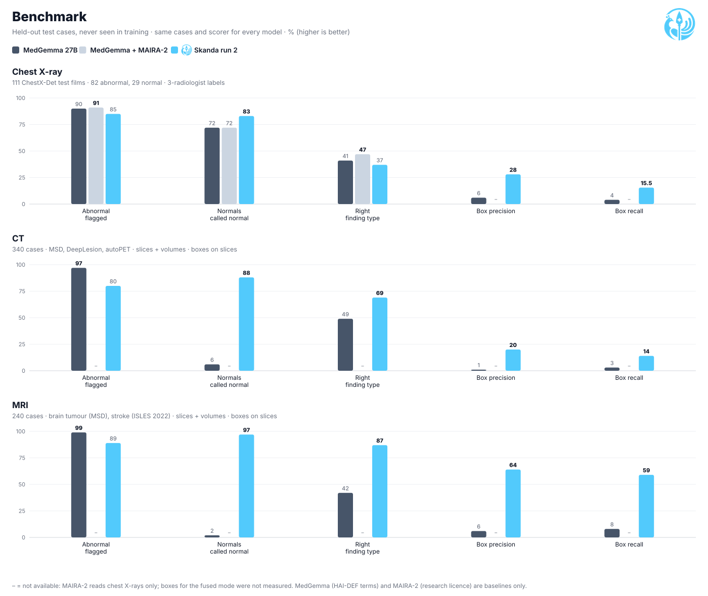</p>

| 🩻 Chest X-ray (111) | MedGemma 27B | MedGemma + MAIRA-2 | Skanda run 2 |
|---|---:|---:|---:|
| Abnormal flagged | 90 | **91** | 85 |
| Normals called normal | 72 | 72 | **83** |
| Right finding type | 41 | **47** | 37 |
| Box precision | 6 | – | **28** |
| Box recall | 4 | – | **15.5** |

| 🫁 CT (340) | MedGemma 27B | MedGemma + MAIRA-2 | Skanda run 2 |
|---|---:|---:|---:|
| Abnormal flagged | **97** | – | 80 |
| Normals called normal | 6 | – | **88** |
| Right finding type | 49 | – | **69** |
| Box precision | 1 | – | **20** |
| Box recall | 3 | – | **14** |

| 🧠 MRI (240) | MedGemma 27B | MedGemma + MAIRA-2 | Skanda run 2 |
|---|---:|---:|---:|
| Abnormal flagged | **99** | – | 89 |
| Normals called normal | 2 | – | **97** |
| Right finding type | 42 | – | **87** |
| Box precision | 6 | – | **64** |
| Box recall | 8 | – | **59** |

Percent, higher is better; **bold** = best. **Skanda** is our own grounding model ([skanda-grounding](https://github.com/Hitheshkaranth/skanda-grounding)), run 2.
X-ray: this app's benchmark below, same runner for every model. CT and MRI: 580 held-out slices and volumes, lesion and
lesion-free, one scorer for every model. MAIRA-2 reads chest X-rays only. On CT and MRI MedGemma calls almost every case
abnormal (6% / 2% of normals cleared), while Skanda clears 88% / 97% and names the right finding far more often.

### 🦠 Detection by disease

How often each model names each kind of finding, on the same held-out cases as the table above.

<p align="center"></p>

- 🩻 **X-ray:** MedGemma names pneumothorax, atelectasis, nodule, mass and emphysema far more often; Skanda leads on
  effusion and cardiomegaly. MAIRA-2 adds effusions and nodules to MedGemma's read (30% → 53%, 42% → 53%).
- 🫁 **CT:** Skanda leads on every organ except colon. MedGemma never names a pancreatic lesion (0 of 28).
- 🧠 **MRI:** MedGemma never names an acute stroke (0 of 60); Skanda finds 45. Brain tumour: 96% vs 74%.
- Groups under about 15 cases (kidney, mediastinum, colon, most rare X-ray labels) are directional only.
  Built in [skanda-grounding](https://github.com/Hitheshkaranth/skanda-grounding) (`docs/build_disease_chart.py`).

### 🔍 Side by side: X-ray, CT and MRI

The same held-out image read by each model. Each figure shows the radiologist's outline, MedGemma 27B's read and
Skanda's read, with that modality's benchmark bars above. For an abnormal case, each panel lists **what was found and on
what grounds**, using the report's own fields:
- **Type:** the finding's title, e.g. "Liver lesion".
- **Where:** side and zone, or organ.
- **Severity.**
- **Evidence:** what is seen, with size in mm, volume in mL and how far it extends.

The radiologist's panel shows the same fields, measured from the radiologist's outline. Skanda's panel also shows its
abnormality score. These are the saved benchmark reads; nothing was re-run for
the figures. The cases are chosen by a fixed rule:
- **Abnormal case:** the one where Skanda's box best overlaps the radiologist's.
- **Normal case:** a random pick (seed 0) from the lesion-free cases Skanda cleared.

Both rules favour Skanda: the images show what a good read looks like, and the bars show how often one happens.

<details open>
<summary><b>🩻 Chest X-ray</b></summary>

<p align="center">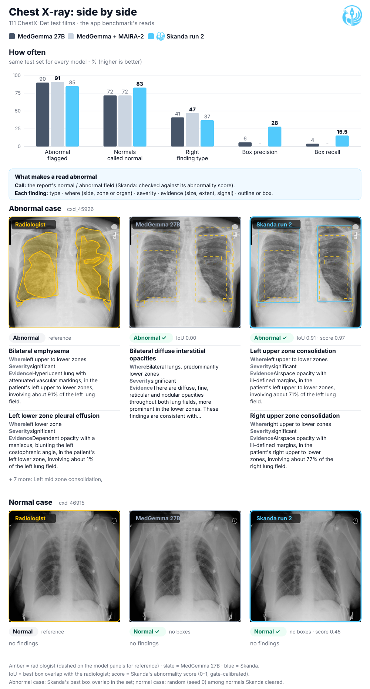</p>
</details>

<details open>
<summary><b>🫁 CT</b></summary>

<p align="center">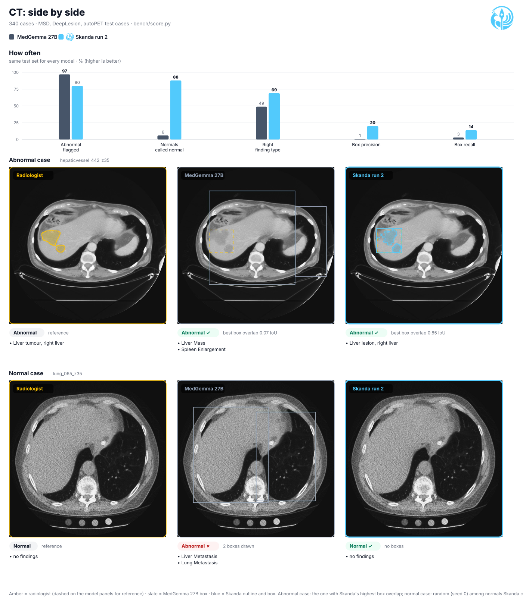</p>
</details>

<details open>
<summary><b>🧠 MRI</b></summary>

<p align="center">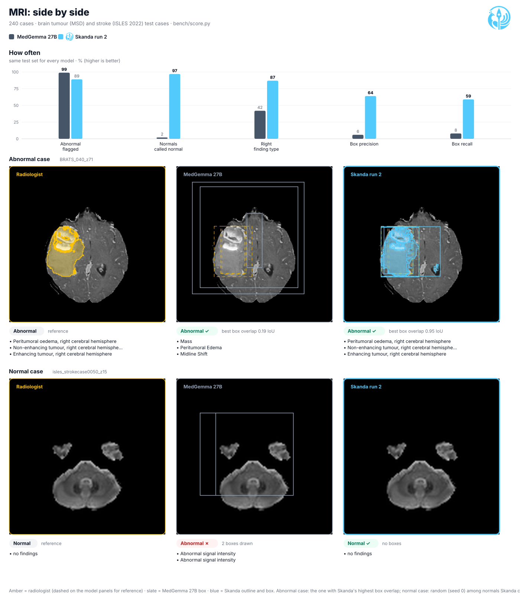</p>
</details>

Built by `docs/build_examples.py` in [skanda-grounding](https://github.com/Hitheshkaranth/skanda-grounding).

<details>
<summary><b>Skanda: run 1 → run 2</b></summary>

<p align="center">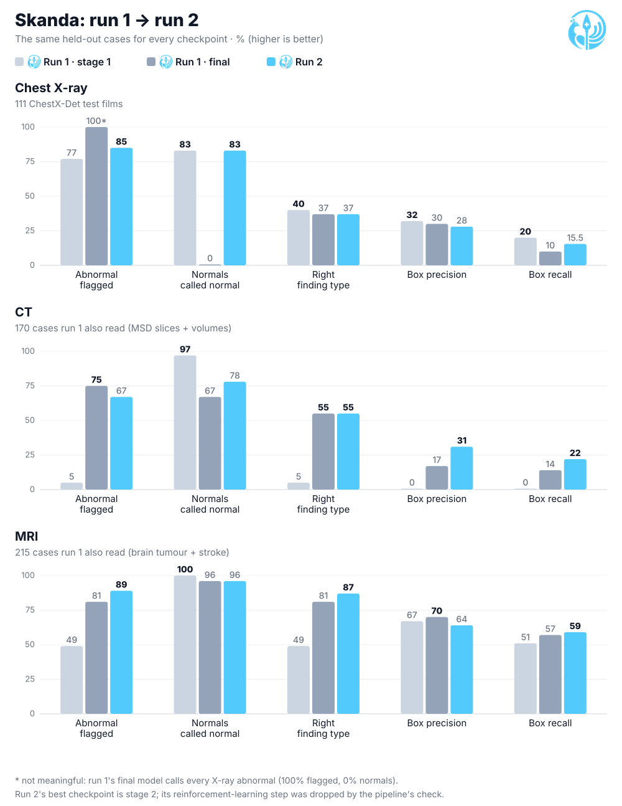</p>
</details>

**Held-out result (Oct 2026):** 111 [ChestX-Det](https://github.com/Deepwise-AILab/ChestX-Det-Dataset) test films labelled by 3 radiologists; every rule and threshold was chosen on a separate 106-film dev split. Wilson 95% CIs.

| | 🧠 MedGemma 27B | 🧠 + 🔬 MAIRA-2 second reader |
|---|:---:|:---:|
| Abnormal films flagged | 74/82 (90%, CI 82–95) | 75/82 (91%, CI 83–96) |
| Normal films called normal | 21/29 (72%, CI 54–85) | 21/29 (72%, CI 54–85) |
| Right finding type, all labels | 90/220 (41%, CI 35–48) | **103/220 (47%, CI 40–53)** |
| Effusion | 13/43 (30%) | **23/43 (53%)** |
| Pneumothorax found / calls correct | 10/10 · 10/36 | 10/10 · 10/36 |
| Box lands on the lesion | 14/85 (16%) | 22/97 (23%) |

Using the classifier to *remove* MedGemma findings lost 17 true abnormal films for 3 more clear normals, so it now marks findings unconfirmed instead.

<a id="localisation-held-out"></a>**Localisation (held-out test, [`benchmark/localise.py`](benchmark/localise.py)):** does the marker land on the radiologist-boxed lesion?

| | Box touches the lesion | Box centre / heatmap peak inside the lesion |
|---|:---:|:---:|
| MedGemma boxes | 94/137 (69%, CI 60–76) | 19/137 (14%, CI 9–21) |
| MAIRA-2 boxes | 65/82 (79%, CI 69–87) | 36/82 (44%, CI 34–55) |
| Classifier heatmap (lung-masked) | — | 26/152 (17%, CI 12–24) |

MedGemma's boxes are usually in the right region but large and off-centre; the heatmap is coarser still. The app therefore zooms to the box and shows the heatmap as a labelled hint, and every finding still needs the radiologist's eye. Full tables and the ablation: [benchmark/README.md](benchmark/README.md#results--oct-2026-chestx-det-held-out-test-111-films).

<a id="model-comparison-cxr"></a>
### 🔁 Model comparison: MedGemma CXR fine-tune and Skanda (Oct 2026)

The CXR fine-tune of MedGemma 27B ([`medgemma-27b-it-cxr`](benchmark/README.md#model-comparison--medgemma-cxr-fine-tune-chestx-det-held-out-test-111-films)) was run on the same 111 held-out ChestX-Det test films, with the same prompts and the same scorer, at two quantisations:

<picture>
  <source media="(prefers-color-scheme: dark)" srcset="docs/benchmark/cxr-comparison-dark.png">
  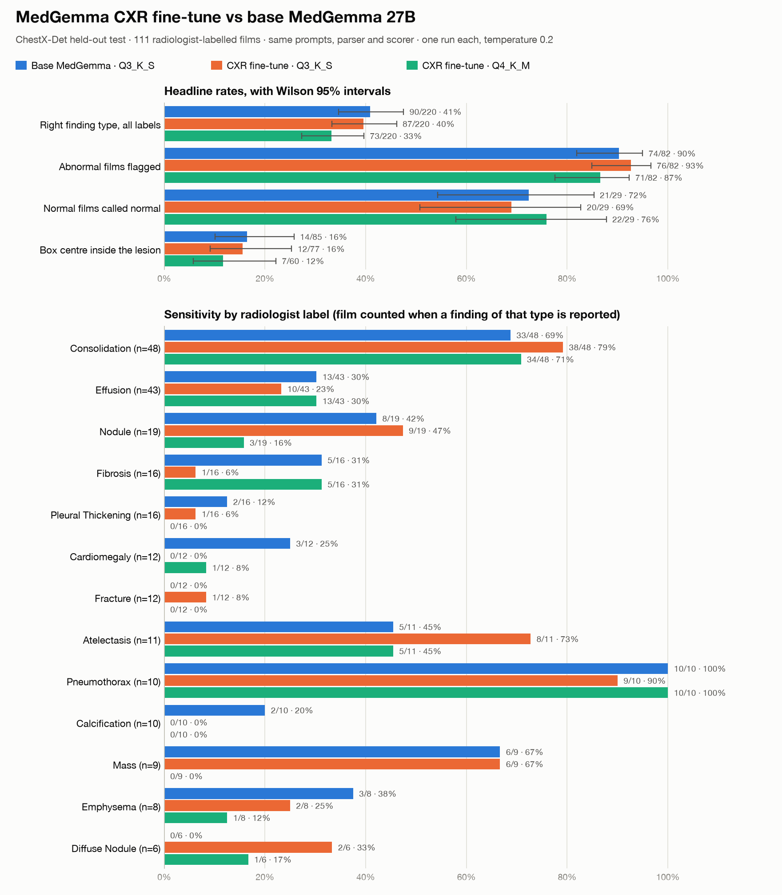
</picture>

| | Abnormal flagged | Normals clear | Right type | Mass | Nodule |
|---|---|---|---|---|---|
| Base MedGemma · Q3_K_S | 74/82 | 21/29 | 90/220 (41%) | 6/9 | 8/19 |
| CXR fine-tune · Q3_K_S (matched) | 76/82 | 20/29 | 87/220 (40%) | 6/9 | 9/19 |
| CXR fine-tune · Q4_K_M | 71/82 | 22/29 | 73/220 (33%) | 0/9 | 3/19 |
| Skanda run 2 · pass 1 / pass 2 | 70/82 · 70/82 | 24/29 · 24/29 | 81/220 (37%) · 81/220 | 1/9 · 3/9 | 3/19 · 2/19 |

Skanda run 2 ([skanda-grounding](https://github.com/Hitheshkaranth/skanda-grounding)) is on the chart too: most normals
called normal (83%), box centre inside the lesion 49–55% (MedGemma 16%), effusion 56–63% and cardiomegaly 83% (MedGemma
30% and 25%). MedGemma is far ahead on pneumothorax (100% vs 20%), atelectasis, nodule, mass and emphysema.

At the same quantisation the fine-tune matches the base model (p = 0.79, paired McNemar). The Q4_K_M run's lower score did not replicate, so it is most likely run-to-run variance. The app keeps the base model. Details and setup caveats: [benchmark/README.md](benchmark/README.md#model-comparison--medgemma-cxr-fine-tune-chestx-det-held-out-test-111-films).

### 🧪 Original in-sample set (Sep 2026)

**Original in-sample set:** 56 films (NIH NLP-mined labels + Kermany pediatric). Three approaches were compared on the same images:

| | 🧠 MedGemma 27B | 🧠 + 🛡️ cross-check | 🔬 MAIRA-2 7B |
|---|:---:|:---:|:---:|
| Adult normals called normal (NIH) | 8/12 | **9/12** | 8/12 |
| Adult abnormal flagged (NIH) | 22/32 | 21/32 | **27/32** |
| Right finding type, all labels | **25/49** | **25/49** | 19/49 |
| Pneumonia: pediatric / adult | **5/6 · 2/4** | **5/6 · 2/4** | 0/6 · 0/4 |
| Effusion / nodule+mass | 1/6 · 0/6 | 1/6 · 0/6 | **3/6 · 3/6** |
| Pneumothorax / edema / cardiomegaly | **3/4 · 3/4 · 2/4** | **3/4 · 3/4 · 2/4** | 2/4 · 1/4 · 1/4 |
| Output well-formed | 56/56 JSON | 56/56 | 51/56 |
| Latency per image | ~50 s | ~50 s + 0.1 s | **~8 s** |

NIH labels are NLP-mined (~90% accurate) and per-class counts are small, so treat per-class numbers as directional.

<details>
<summary><b>MedGemma 27B: full results</b> (Sep 2026, LM Studio, 16k ctx)</summary>

| Metric | Result |
|---|---|
| Pediatric pneumonia (Kermany) | 6/6 pneumonia flagged, 6/6 normals clear |
| Adult abnormal flagged (NIH) | 22/32 |
| Adult normals called normal (NIH) | 8/12 |
| JSON parse success | 56/56 |
| Abnormal findings localised with a box | 62/79 |
| Latency | median ~50 s per image |

Sensitivity by label: infiltration 5/6, pneumothorax 3/4, edema 3/4, consolidation 3/4, pneumonia 7/10, cardiomegaly 2/4, atelectasis 1/5, **effusion 1/6, nodule/mass 0/6**.

Precision, meaning how often each *reported* finding type was supported by the labels:

| Reported | Confirmed |
|---|---|
| interstitial / markings | 4/4 |
| consolidation / opacity | 24/31 |
| pneumothorax | 3/7 |
| effusion | 1/9 |
| cardiomegaly | 1/7 |

Self-reported confidence is uncalibrated (false findings are typically stated at 0.90–0.95), and "Right lower lobe consolidation" accounts for 3 of 4 false alarms on normal films.
</details>

<details>
<summary><b>🛡️ TorchXRayVision cross-check</b>: removed 4 findings, all false</summary>

[TorchXRayVision](https://github.com/mlmed/torchxrayvision) is not a report generator: it outputs a probability per pathology in ~0.1 s. The app uses it as a second opinion on each MedGemma finding. Models: the CheXpert, MIMIC and PadChest DenseNets averaged (none trained on NIH, so no test-set leakage). A finding is *unsupported* when its type's probability is < 0.5, the models' own operating point, not tuned on this set.

| | MedGemma alone | MedGemma + cross-check |
|---|---|---|
| Adult normals called normal (NIH) | 8/12 | **9/12** |
| Adult abnormal flagged (NIH) | **22/32** | 21/32 |
| Right finding type, all labels | 25/49 | 25/49 |
| Findings removed | — | 4, **all false**, 0 true |
| Extra latency | — | ~0.1 s |

- Removed: right lower lobe consolidation + bilateral apical fibrosis on a normal film, and a false apical pneumothorax on an effusion film (that film's only finding, hence 22 → 21 flagged).
- Classifier alone, AUC vs normals (2–10 films per label, directional): pneumothorax 1.00, consolidation 0.96, edema 0.94, cardiomegaly 0.93, mass 0.92, nodule 0.90, pneumonia 0.82, atelectasis 0.82, effusion 0.76.
- Caveat: it gave 0.08–0.10 effusion probability on 2 of 6 labelled effusions, so a correct call can be flagged. Unsupported findings therefore stay visible (dashed outline) rather than being deleted.
- Raw outputs: [`benchmark/txrv.jsonl`](benchmark/txrv.jsonl) (probabilities), [`benchmark/results-txrv.jsonl`](benchmark/results-txrv.jsonl) (filtered findings); script [`benchmark/run_txrv.py`](benchmark/run_txrv.py).
</details>

<details>
<summary><b>🔬 Microsoft MAIRA-2 comparison</b>: 6× faster, weaker on pneumonia</summary>

[MAIRA-2](https://huggingface.co/microsoft/maira-2) is a chest-X-ray report generator, not a chat model: it cannot follow the app's prompt, return JSON, or run in LM Studio (no GGUF/MLX build; custom Rad-DINO + Vicuna architecture). [`benchmark/run_maira2.py`](benchmark/run_maira2.py) runs it through transformers on the Mac GPU and turns each generated sentence into a finding (negated sentences and well-positioned devices count as normal), so the same `score.py` applies. MedGemma's scores are unchanged by the synonyms added for MAIRA-2's wording (*opacification*, *alveolar*, *round opacity*).

- MAIRA-2 never names pneumonia; it describes opacities. The pediatric films are outside its training data (adult MIMIC-CXR only): it calls all 6 pediatric pneumonias abnormal, but as cardiomegaly/congestion, and once as bilateral pneumothorax with large effusions.
- It writes more findings per film (92 vs 79) with more incidental ones (tortuous aorta, low volumes), and gives no confidence or severity, so its "flagged" rate is less meaningful than MedGemma's.
- **Conclusion:** MAIRA-2 is ~6× faster and better at effusions and nodules/masses, but weaker on pneumonia, pneumothorax, edema and cardiomegaly, and it does not fit the app's structured-output pipeline. MedGemma stays the app's model. Raw outputs: [`benchmark/results-maira2.jsonl`](benchmark/results-maira2.jsonl).
</details>

**Reproduce or re-score** (requires LM Studio serving `medgemma-27b-it`):

```sh
cd benchmark
python3 fetch.py                             # download images + manifest
node --experimental-strip-types run.mts      # ~1 min/image, resumable → results.jsonl
python3 score.py final results.jsonl         # score (works on the committed results without re-running)
```

Raw model outputs for every image are committed, so every number above can be audited without re-running a model. Methodology, what changed in the app, and approaches that were tried and rejected are in [benchmark/README.md](benchmark/README.md).

The numbers above are in-sample: the prompts and rules were tuned while looking at these 56 films. The held-out protocol (ChestX-Det, 217 radiologist-labelled films split into dev and test, with Wilson CIs) is described in [benchmark/README.md § Methodology](benchmark/README.md#methodology). The cross-check's per-class thresholds are tuned on dev and reported on test, and are stored in [`app/server/thresholds.json`](app/server/thresholds.json) (`python3 benchmark/fuse.py`). The held-out MedGemma and MAIRA-2 results are at the top of this section.

## 🗂 Datasets

Images are **not redistributed** in this repo; [`benchmark/fetch.py`](benchmark/fetch.py) downloads them and [`benchmark/manifest.json`](benchmark/manifest.json) lists the exact 56 images and labels used.

| Dataset | Used | Source | Mirror used by `fetch.py` | License |
|---|---|---|---|---|
| **NIH ChestX-ray14** (Wang et al., CVPR 2017) | 44 adult films (test split): 12 *No Finding* + effusion, cardiomegaly, pneumothorax, edema, consolidation, pneumonia, infiltration, atelectasis, mass, nodule | [NIH Clinical Center](https://nihcc.app.box.com/v/ChestXray-NIHCC) | [🤗 BahaaEldin0/NIH-Chest-Xray-14](https://huggingface.co/datasets/BahaaEldin0/NIH-Chest-Xray-14) | No restrictions; cite NIH CC |
| **Pediatric pneumonia** (Kermany et al., Cell 2018) | 12 films (test split): 6 normal, 6 pneumonia | [Mendeley Data](https://data.mendeley.com/datasets/rscbjbr9sj/2) | [🤗 hf-vision/chest-xray-pneumonia](https://huggingface.co/datasets/hf-vision/chest-xray-pneumonia) | CC BY 4.0 |

Manual test images are public chest radiographs from Wikimedia Commons: [normal PA](https://commons.wikimedia.org/wiki/File:Chest_Xray_PA_3-8-2010.png), [pneumonia](https://commons.wikimedia.org/wiki/File:Pneumonia_x-ray.jpg), [pneumothorax](https://commons.wikimedia.org/wiki/File:Pneumothorax_CXR.jpg), [cardiomegaly](https://commons.wikimedia.org/wiki/File:Cardiomegally.PNG).

**Models:** [google/medgemma-27b-it](https://huggingface.co/google/medgemma-27b-it) · [microsoft/maira-2](https://huggingface.co/microsoft/maira-2) · [TorchXRayVision](https://github.com/mlmed/torchxrayvision) (`densenet121-res224-chex`, `-mimic_ch`, `-pc`)

## 🚧 Known limitations

- MedGemma's bounding boxes are approximate, and **results vary between runs** (see the report screenshot above).
- Self-reported confidence is uncalibrated; finding cards show the held-out confirmation rate for each finding type instead (weak: pneumothorax 10/36, cardiomegaly 3/12 films with that call were right).
- MedGemma misses fractures (0/12) and most pleural thickening (2/16). Its boxes touch the lesion 69% of the time but are centred on it only 14%; the heatmap peak hits it 17%. Zoom-to-finding and the heatmap show where to look, not where the lesion is.
- Subtle interstitial patterns (prominent bronchovascular markings, perihilar opacities, peribronchial cuffing) are under-called by the main read. A second, neutral graded lung-pattern check (0–3 scale, ~10 s) adds a finding when the grade is ≥ 2; on a 12-film labelled set this raised detection from 6/7 to 7/7 with no false positives on 5 normals. That is a small sample, so treat it as directional.
- Leading yes/no questions ("is X present?") are unreliable: the model tends to agree with whatever is asked, including on normal films.
- The classifier can miss real effusions (0.08–0.10 on 2 of 6), so a dashed finding is a prompt to look again, not a verdict.

<div align="center">
<br>
<sub>Built with MedGemma, LM Studio, TorchXRayVision, React and Vite · For research and decision support only</sub>
</div>
