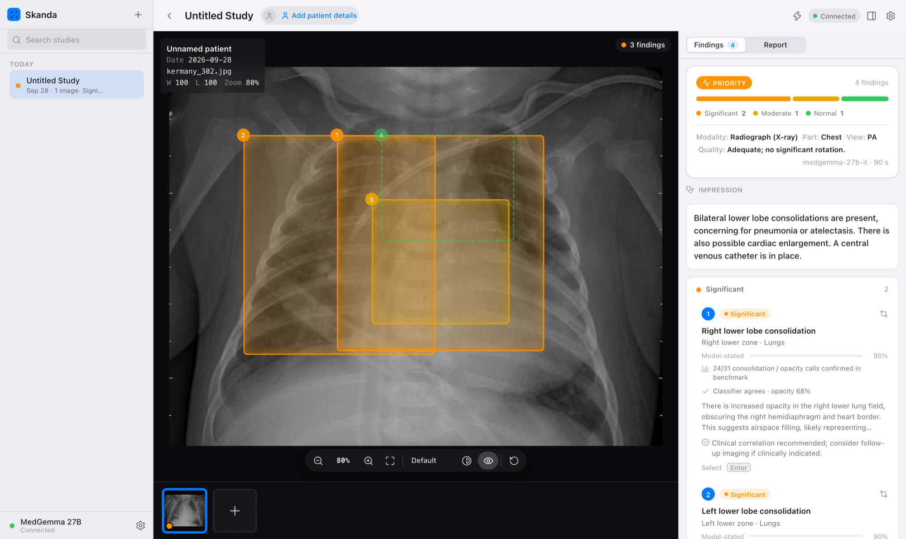
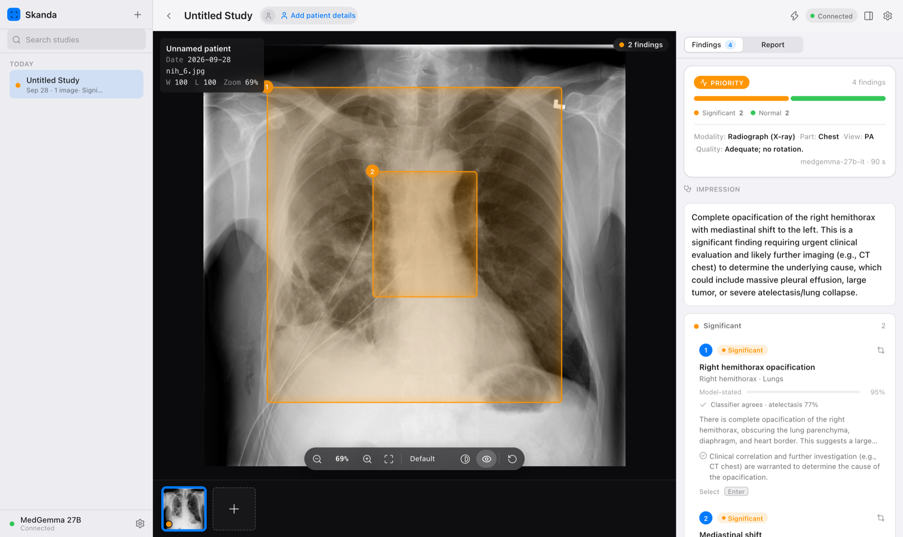
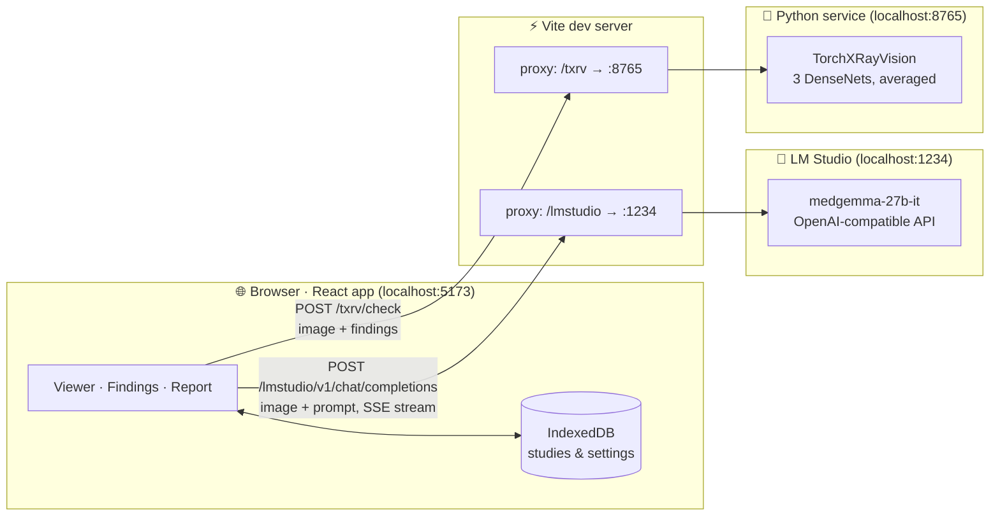
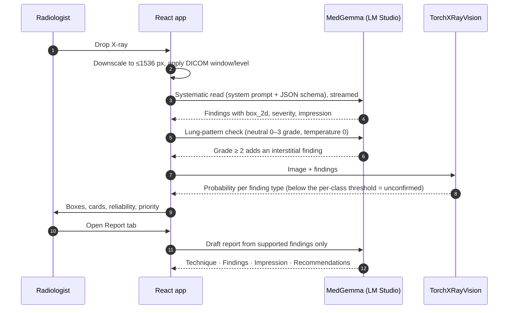

<div align="center">

# 🩻 Skanda Radiology

**AI-assisted chest X-ray reading that runs entirely on your Mac.**

Drop in a radiograph → **MedGemma 27B** performs a systematic read → findings are boxed on the image,<br>
cross-checked by an independent classifier, and drafted into a signable radiology report.

[](https://huggingface.co/google/medgemma-27b-it)
[](https://lmstudio.ai)
[](https://github.com/mlmed/torchxrayvision)
[](https://react.dev)
[](https://vite.dev)
[](https://www.typescriptlang.org)
[](#-architecture)

[Features](#-features) · [Screenshots](#-screenshots) · [Architecture](#-architecture) · [Quick start](#-quick-start) · [Benchmark](#-benchmark) · [Datasets](#-datasets) · [Limitations](#-known-limitations)

<br>


<sub>An NIH film labelled <i>effusion + atelectasis</i>. MedGemma called a right apical pneumothorax and a right lower lobe opacity; the classifier supported neither, so both are drawn dashed and flagged on their cards as unconfirmed.</sub>

</div>

> [!WARNING]
> **Decision support only.** All AI output must be reviewed and verified by a qualified radiologist before any clinical use. This is not a medical device.

---

## ✨ Features

| | |
|---|---|
| 📥 **Intake** | Drag & drop anywhere, paste (⌘V) or file picker. PNG, JPEG, WebP and uncompressed DICOM (window/level + rescale applied). |
| 🔬 **Diagnostic viewer** | Zoom/pan, window-level (right/⌥-drag) with Lung / Bone / Soft-tissue presets, invert, keyboard shortcuts, numbered severity-coloured finding boxes linked to the findings list. |
| 🧠 **Analysis** | Streamed progress, urgency (routine / priority / urgent), severity breakdown, impression, findings, pertinent negatives, differential, recommendations, raw model output for audit. |
| 🛡️ **Second opinion** | Every finding is cross-checked by a local [TorchXRayVision](https://github.com/mlmed/torchxrayvision) classifier (~0.1 s). Unsupported findings stay in, drawn dashed and marked *unconfirmed*; the draft words them as possible and the pre-sign checklist lists them. Optional MAIRA-2 second reader for effusion, nodule/mass and atelectasis. |
| 📊 **Honest confidence** | Each card shows how often that finding type was confirmed in the benchmark (e.g. *3/7 pneumothorax calls confirmed — verify carefully*) next to the model's self-stated confidence. |
| 📝 **Report** | AI-drafted structured report (technique, comparison, findings, impression, recommendations), fully editable, sign-off, A4 print/PDF with annotated key images, plain-text and JSON export. |
| 🔒 **Private by design** | Inference is local (LM Studio + a local Python service); studies persist in the browser's IndexedDB. Nothing is uploaded. |
| 🌗 **Apple-style UI** | Light and dark mode. |

## 📸 Screenshots

All screenshots are real runs of the app on this Mac, using films from the benchmark set ([datasets](#-datasets)).

<table>
<tr>
<td width="50%" valign="top">

<p><b>Cross-check catching a false alarm.</b> An NIH film labelled <i>No Finding</i>. MedGemma reports a right lower lobe consolidation at 95% self-stated confidence; the classifier gives opacity only 36%, so the box is dashed and the finding is marked unconfirmed.</p>
</td>
<td width="50%" valign="top">

<p><b>Pediatric pneumonia.</b> A Kermany film labelled <i>pneumonia</i>. MedGemma finds bilateral lower lobe consolidation, and the classifier agrees (opacity 68%).</p>
</td>
</tr>
<tr>
<td width="50%" valign="top">

<p><b>Draft report.</b> Structured, editable and printable. MedGemma's reads vary between runs: on this run of the same pediatric film it missed the pneumonia, which is why every draft needs a radiologist.</p>
</td>
<td width="50%" valign="top">

<p><b>Localisation.</b> An NIH film labelled <i>pneumothorax</i>. MedGemma reports right hemithorax opacification with mediastinal shift (priority), but not the labelled pneumothorax.</p>
</td>
</tr>
</table>

## 🏗 Architecture

Everything runs on `localhost`. The browser never talks to LM Studio directly: the Vite dev server proxies two paths, so the UI uses relative URLs and needs no CORS setup.



**One analysis, step by step**



| Piece | Where | What it does |
|---|---|---|
| LM Studio client | [`app/src/lib/medgemma.ts`](app/src/lib/medgemma.ts) | OpenAI-compatible `chat/completions` with SSE streaming, a serial queue (one inference at a time), retry, image re-encoding |
| Proxy | [`app/vite.config.ts`](app/vite.config.ts) | `/lmstudio` → `localhost:1234`, `/txrv` → `localhost:8765` |
| Prompts | [`app/src/lib/prompts.ts`](app/src/lib/prompts.ts) | Radiologist system prompt + JSON schema |
| Parser | [`app/src/lib/parse.ts`](app/src/lib/parse.ts) | Robust JSON extraction/repair, `box_2d` → normalised boxes |
| Pipeline | [`app/src/lib/analysis.ts`](app/src/lib/analysis.ts) | Read → cross-check → store; report jobs |
| Cross-check | [`app/src/lib/classifier.ts`](app/src/lib/classifier.ts) · [`app/server/txrv_server.py`](app/server/txrv_server.py) | Optional; if the service is down the analysis is returned unchanged |
| Reliability | [`app/src/lib/reliability.ts`](app/src/lib/reliability.ts) | Benchmark confirmation rate per finding type |
| UI | [`app/src/components/`](app/src/components) | `viewer` · `findings` · `report` · `shell` |

The base URL (`/lmstudio/v1`) and model id can be changed in **Settings** (⌘,), e.g. to point at LM Studio on another machine.

## 🚀 Quick start

**Requirements:** [LM Studio](https://lmstudio.ai) with `medgemma-27b-it` downloaded, and Node.js 20+. Optional: [uv](https://docs.astral.sh/uv/) for the classifier.

```sh
# 1 · Serve MedGemma (a moderate context; 131k × 4 parallel slots caused "Compute error" on a 26 GB Mac)
lms load medgemma-27b-it --context-length 16384 --gpu max -y
lms server start                                   # http://localhost:1234

# 2 · Run the app
cd app
npm install
npm run dev                                        # http://localhost:5173

# 3 · Optional second opinion (first start downloads ~100 MB of weights)
uv run --with torchxrayvision --with scikit-image server/txrv_server.py   # http://localhost:8765
```

The status pill in the top right turns green (**Connected**) when LM Studio is reachable. Without the classifier service the app works exactly as before, just without the cross-check line on each card.

<details>
<summary><b>Development</b></summary>

```sh
npm run build                                          # typecheck + production build
npm run lint                                           # oxlint incl. React rules-of-hooks
node --experimental-strip-types scripts/test-parse.ts  # model-output parser tests
```

`app/SWARM.md`, `app/tasks/` and `app/notes/` document how the first version was built by a 5-agent opencode swarm.
</details>

## 📈 Benchmark

[`benchmark/`](benchmark) runs the app's exact pipeline (same prompts, parser and lung-pattern pass) over public, labelled chest X-rays and scores it.

**Held-out result (Oct 2026):** 111 [ChestX-Det](https://github.com/Deepwise-AILab/ChestX-Det-Dataset) test films labelled by 3 radiologists; every rule and threshold was chosen on a separate 106-film dev split. Wilson 95% CIs.

| | 🧠 MedGemma 27B | 🧠 + 🔬 MAIRA-2 second reader |
|---|:---:|:---:|
| Abnormal films flagged | 74/82 (90%, CI 82–95) | 75/82 (91%, CI 83–96) |
| Normal films called normal | 21/29 (72%, CI 54–85) | 21/29 (72%, CI 54–85) |
| Right finding type, all labels | 90/220 (41%, CI 35–48) | **103/220 (47%, CI 40–53)** |
| Effusion | 13/43 (30%) | **23/43 (53%)** |
| Pneumothorax found / calls correct | 10/10 · 10/36 | 10/10 · 10/36 |
| Box lands on the lesion | 14/85 (16%) | 22/97 (23%) |

Using the classifier to *remove* MedGemma findings lost 17 true abnormal films for 3 more clear normals, so it now marks findings unconfirmed instead. Full tables and the ablation: [benchmark/README.md](benchmark/README.md#results--oct-2026-chestx-det-held-out-test-111-films).

**Original in-sample set:** 56 films (NIH NLP-mined labels + Kermany pediatric). Three approaches were compared on the same images:

| | 🧠 MedGemma 27B | 🧠 + 🛡️ cross-check | 🔬 MAIRA-2 7B |
|---|:---:|:---:|:---:|
| Adult normals called normal (NIH) | 8/12 | **9/12** | 8/12 |
| Adult abnormal flagged (NIH) | 22/32 | 21/32 | **27/32** |
| Right finding type, all labels | **25/49** | **25/49** | 19/49 |
| Pneumonia: pediatric / adult | **5/6 · 2/4** | **5/6 · 2/4** | 0/6 · 0/4 |
| Effusion / nodule+mass | 1/6 · 0/6 | 1/6 · 0/6 | **3/6 · 3/6** |
| Pneumothorax / edema / cardiomegaly | **3/4 · 3/4 · 2/4** | **3/4 · 3/4 · 2/4** | 2/4 · 1/4 · 1/4 |
| Output well-formed | 56/56 JSON | 56/56 | 51/56 |
| Latency per image | ~50 s | ~50 s + 0.1 s | **~8 s** |

NIH labels are NLP-mined (~90% accurate) and per-class counts are small, so treat per-class numbers as directional.

<details>
<summary><b>MedGemma 27B: full results</b> (Sep 2026, LM Studio, 16k ctx)</summary>

| Metric | Result |
|---|---|
| Pediatric pneumonia (Kermany) | 6/6 pneumonia flagged, 6/6 normals clear |
| Adult abnormal flagged (NIH) | 22/32 |
| Adult normals called normal (NIH) | 8/12 |
| JSON parse success | 56/56 |
| Abnormal findings localised with a box | 62/79 |
| Latency | median ~50 s per image |

Sensitivity by label: infiltration 5/6, pneumothorax 3/4, edema 3/4, consolidation 3/4, pneumonia 7/10, cardiomegaly 2/4, atelectasis 1/5, **effusion 1/6, nodule/mass 0/6**.

Precision, meaning how often each *reported* finding type was supported by the labels:

| Reported | Confirmed |
|---|---|
| interstitial / markings | 4/4 |
| consolidation / opacity | 24/31 |
| pneumothorax | 3/7 |
| effusion | 1/9 |
| cardiomegaly | 1/7 |

Self-reported confidence is uncalibrated (false findings are typically stated at 0.90–0.95), and "Right lower lobe consolidation" accounts for 3 of 4 false alarms on normal films.
</details>

<details>
<summary><b>🛡️ TorchXRayVision cross-check</b>: removed 4 findings, all false</summary>

[TorchXRayVision](https://github.com/mlmed/torchxrayvision) is not a report generator: it outputs a probability per pathology in ~0.1 s. The app uses it as a second opinion on each MedGemma finding. Models: the CheXpert, MIMIC and PadChest DenseNets averaged (none trained on NIH, so no test-set leakage). A finding is *unsupported* when its type's probability is < 0.5, the models' own operating point, not tuned on this set.

| | MedGemma alone | MedGemma + cross-check |
|---|---|---|
| Adult normals called normal (NIH) | 8/12 | **9/12** |
| Adult abnormal flagged (NIH) | **22/32** | 21/32 |
| Right finding type, all labels | 25/49 | 25/49 |
| Findings removed | — | 4, **all false**, 0 true |
| Extra latency | — | ~0.1 s |

- Removed: right lower lobe consolidation + bilateral apical fibrosis on a normal film, and a false apical pneumothorax on an effusion film (that film's only finding, hence 22 → 21 flagged).
- Classifier alone, AUC vs normals (2–10 films per label, directional): pneumothorax 1.00, consolidation 0.96, edema 0.94, cardiomegaly 0.93, mass 0.92, nodule 0.90, pneumonia 0.82, atelectasis 0.82, effusion 0.76.
- Caveat: it gave 0.08–0.10 effusion probability on 2 of 6 labelled effusions, so a correct call can be flagged. Unsupported findings therefore stay visible (dashed outline) rather than being deleted.
- Raw outputs: [`benchmark/txrv.jsonl`](benchmark/txrv.jsonl) (probabilities), [`benchmark/results-txrv.jsonl`](benchmark/results-txrv.jsonl) (filtered findings); script [`benchmark/run_txrv.py`](benchmark/run_txrv.py).
</details>

<details>
<summary><b>🔬 Microsoft MAIRA-2 comparison</b>: 6× faster, weaker on pneumonia</summary>

[MAIRA-2](https://huggingface.co/microsoft/maira-2) is a chest-X-ray report generator, not a chat model: it cannot follow the app's prompt, return JSON, or run in LM Studio (no GGUF/MLX build; custom Rad-DINO + Vicuna architecture). [`benchmark/run_maira2.py`](benchmark/run_maira2.py) runs it through transformers on the Mac GPU and turns each generated sentence into a finding (negated sentences and well-positioned devices count as normal), so the same `score.py` applies. MedGemma's scores are unchanged by the synonyms added for MAIRA-2's wording (*opacification*, *alveolar*, *round opacity*).

- MAIRA-2 never names pneumonia; it describes opacities. The pediatric films are outside its training data (adult MIMIC-CXR only): it calls all 6 pediatric pneumonias abnormal, but as cardiomegaly/congestion, and once as bilateral pneumothorax with large effusions.
- It writes more findings per film (92 vs 79) with more incidental ones (tortuous aorta, low volumes), and gives no confidence or severity, so its "flagged" rate is less meaningful than MedGemma's.
- **Conclusion:** MAIRA-2 is ~6× faster and better at effusions and nodules/masses, but weaker on pneumonia, pneumothorax, edema and cardiomegaly, and it does not fit the app's structured-output pipeline. MedGemma stays the app's model. Raw outputs: [`benchmark/results-maira2.jsonl`](benchmark/results-maira2.jsonl).
</details>

**Reproduce or re-score** (requires LM Studio serving `medgemma-27b-it`):

```sh
cd benchmark
python3 fetch.py                             # download images + manifest
node --experimental-strip-types run.mts      # ~1 min/image, resumable → results.jsonl
python3 score.py final results.jsonl         # score (works on the committed results without re-running)
```

Raw model outputs for every image are committed, so every number above can be audited without re-running a model. Methodology, what changed in the app, and approaches that were tried and rejected are in [benchmark/README.md](benchmark/README.md).

The numbers above are in-sample: the prompts and rules were tuned while looking at these 56 films. The held-out protocol (ChestX-Det, 217 radiologist-labelled films split into dev and test, with Wilson CIs) is described in [benchmark/README.md § Methodology](benchmark/README.md#methodology). The cross-check's per-class thresholds are tuned on dev and reported on test, and are stored in [`app/server/thresholds.json`](app/server/thresholds.json) (`python3 benchmark/fuse.py`). The held-out MedGemma and MAIRA-2 results are at the top of this section.

## 🗂 Datasets

Images are **not redistributed** in this repo; [`benchmark/fetch.py`](benchmark/fetch.py) downloads them and [`benchmark/manifest.json`](benchmark/manifest.json) lists the exact 56 images and labels used.

| Dataset | Used | Source | Mirror used by `fetch.py` | License |
|---|---|---|---|---|
| **NIH ChestX-ray14** (Wang et al., CVPR 2017) | 44 adult films (test split): 12 *No Finding* + effusion, cardiomegaly, pneumothorax, edema, consolidation, pneumonia, infiltration, atelectasis, mass, nodule | [NIH Clinical Center](https://nihcc.app.box.com/v/ChestXray-NIHCC) | [🤗 BahaaEldin0/NIH-Chest-Xray-14](https://huggingface.co/datasets/BahaaEldin0/NIH-Chest-Xray-14) | No restrictions; cite NIH CC |
| **Pediatric pneumonia** (Kermany et al., Cell 2018) | 12 films (test split): 6 normal, 6 pneumonia | [Mendeley Data](https://data.mendeley.com/datasets/rscbjbr9sj/2) | [🤗 hf-vision/chest-xray-pneumonia](https://huggingface.co/datasets/hf-vision/chest-xray-pneumonia) | CC BY 4.0 |

Manual test images are public chest radiographs from Wikimedia Commons: [normal PA](https://commons.wikimedia.org/wiki/File:Chest_Xray_PA_3-8-2010.png), [pneumonia](https://commons.wikimedia.org/wiki/File:Pneumonia_x-ray.jpg), [pneumothorax](https://commons.wikimedia.org/wiki/File:Pneumothorax_CXR.jpg), [cardiomegaly](https://commons.wikimedia.org/wiki/File:Cardiomegally.PNG).

**Models:** [google/medgemma-27b-it](https://huggingface.co/google/medgemma-27b-it) · [microsoft/maira-2](https://huggingface.co/microsoft/maira-2) · [TorchXRayVision](https://github.com/mlmed/torchxrayvision) (`densenet121-res224-chex`, `-mimic_ch`, `-pc`)

## 🚧 Known limitations

- MedGemma's bounding boxes are approximate, and **results vary between runs** (see the report screenshot above).
- Self-reported confidence is uncalibrated; finding cards show the held-out confirmation rate for each finding type instead (weak: pneumothorax 10/36, cardiomegaly 3/12 films with that call were right).
- MedGemma misses fractures (0/12) and most pleural thickening (2/16), and its boxes land on the lesion only 16% of the time on radiologist-labelled films.
- Subtle interstitial patterns (prominent bronchovascular markings, perihilar opacities, peribronchial cuffing) are under-called by the main read. A second, neutral graded lung-pattern check (0–3 scale, ~10 s) adds a finding when the grade is ≥ 2; on a 12-film labelled set this raised detection from 6/7 to 7/7 with no false positives on 5 normals. That is a small sample, so treat it as directional.
- Leading yes/no questions ("is X present?") are unreliable: the model tends to agree with whatever is asked, including on normal films.
- The classifier can miss real effusions (0.08–0.10 on 2 of 6), so a dashed finding is a prompt to look again, not a verdict.

<div align="center">
<br>
<sub>Built with MedGemma, LM Studio, TorchXRayVision, React and Vite · For research and decision support only</sub>
</div>
