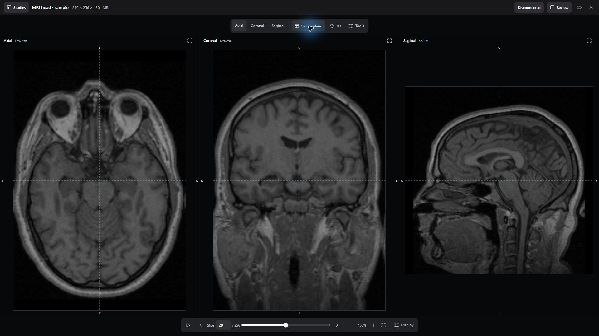
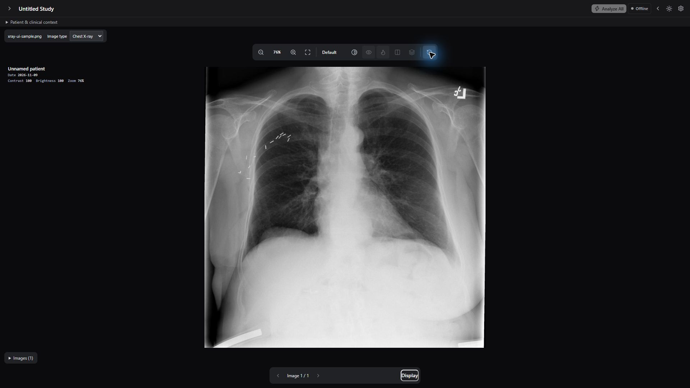
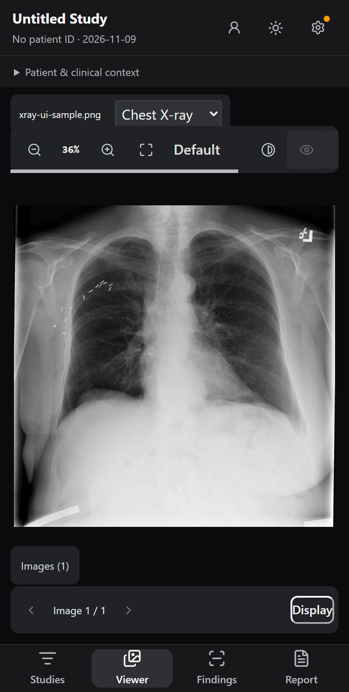
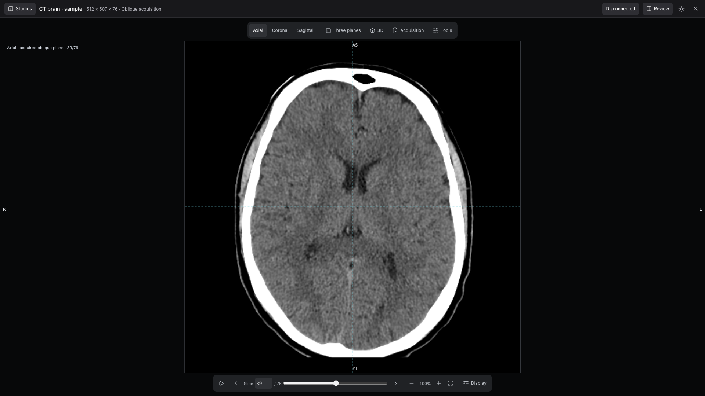
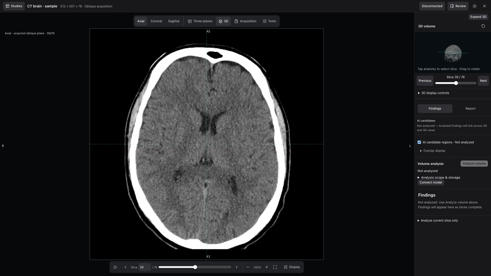
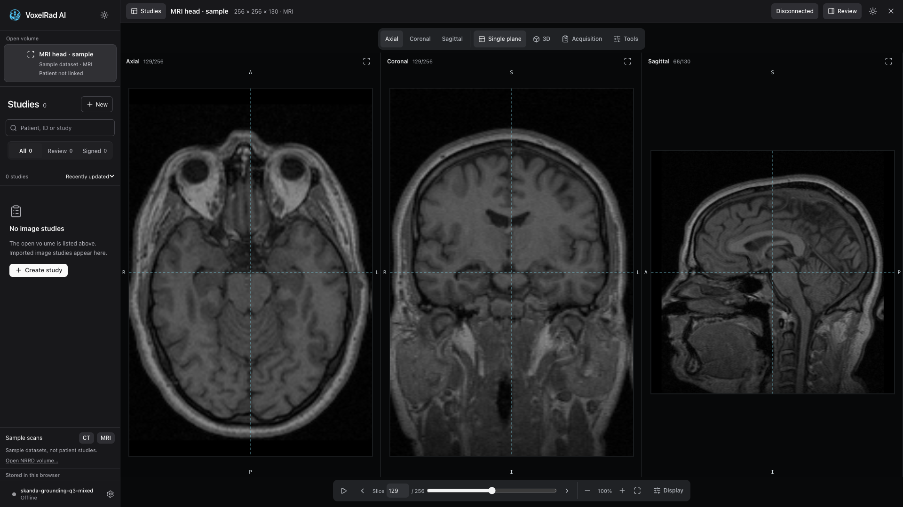
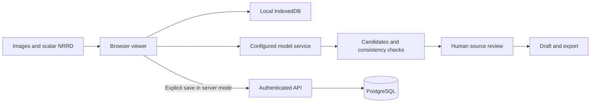

<div align="center">


# Skanda Radiology

**A browser workspace for X-ray, CT and MRI review.**

Open a scan. Explore the anatomy. Review model candidates against their source. Prepare a report.

[Download beta](https://github.com/Hitheshkaranth/skanda-radiology/releases/tag/v0.2.0-beta.2) · [Quick start](#quick-start) · [Workspace](#workspace) · [Deployment](docs/deployment.md) · [Model evidence](docs/reading-with-skanda.md)

</div>



*Current interface, captured November 10, 2026. Public teaching samples; model service offline. These screenshots demonstrate navigation and layout, not model findings or diagnostic performance.*

## What's in this release

**v0.2.0-beta.2** gives scans more of the browser: a full-width canvas, floating control docks, optional study/review panels, and equal-width MRI/CT plane views. Buttons, popovers and tooltips use editable shadcn components backed by Radix. Loading feedback uses Thinking Orbs from the Libraries.dev collection.

| Capability | Available now |
| --- | --- |
| X-ray workspace | Image stepping, pan/zoom, brightness/contrast, candidate overlays and finding review |
| CT and MRI | Scalar NRRD import, axial/coronal/sagittal views, synchronized crosshairs, windowing and cine playback |
| Spatial context | Optional voxel-derived 3D locator and source-plane navigation |
| Review and reporting | Accept/dismiss candidates, track coverage, draft from reviewed findings and export |
| Private server mode | Sign-in, administrator tools, saved image studies and expiring/revocable share links |
| Local mode | Browser storage and a separately configured model service |

This is research and review-support software. Model findings require qualified review. The interface and its consistency checks do not establish diagnostic correctness; see [evaluation and limitations](#evaluation-and-limitations).

## Quick start

### Explore locally

Use **Node.js 24+**. A model server is not needed to open samples and use the viewer.

```sh
git clone https://github.com/Hitheshkaranth/skanda-radiology.git
cd skanda-radiology/app
npm ci
npm run dev
```

Open **http://localhost:5173**. Choose **CT** or **MRI** under Sample scans. This mode stores studies in the browser; it does not enable server accounts or hosted storage.

### Connect a reader

Run a compatible model service separately on port **1234**. In Settings, select the exact model ID returned by:

```sh
curl http://localhost:1234/v1/models
```

The development proxy uses `/lmstudio/v1`. Selecting a model ID does not download or load weights. For a remote inference machine, configure the proxy or service endpoint explicitly.

The [Skanda reader guide](docs/reading-with-skanda.md) covers bf16 serving, hardware observations, modality inputs, outlines and recorded evaluation results. GGUF serving through LM Studio does not run Skanda's outline model. Model weights and GPU services are not bundled here.

### Run with accounts and PostgreSQL

From the repository root, copy `config.example` to `.env`, fill the database password and bootstrap administrator credentials, then run:

```sh
docker compose up -d --build
```

Open **http://localhost:8088**. Compose builds authenticated server mode. Follow the [deployment guide](docs/deployment.md) for configuration, bootstrap cleanup, HTTPS, persistence and backup/restore. Browser-local studies are uploaded only through an explicit save action; full NRRD volume hosting is not included.

### Release packages

Get [v0.2.0-beta.2](https://github.com/Hitheshkaranth/skanda-radiology/releases/tag/v0.2.0-beta.2):

- **Source ZIP:** application, API, Dockerfiles and Compose configuration.
- **Web ZIP:** prebuilt local-only frontend. Serve it over HTTP; opening `index.html` directly is unsupported. API/model proxy services must be configured separately.
- **SHA256SUMS.txt:** checksums for both archives.

The beta packages contain the tagged application. The main branch may include newer documentation and packaging-helper fixes.

## Workspace

### X-ray on desktop and mobile





Public ChestX-Det test image 36199, imported through the file picker. Image-type selection, brightness, zoom, fit, reset and mobile navigation were checked; no inference was run. [Follow-up verification](docs/validation/2026-11-10-swarm-followup.md).

### A larger scan canvas



Plane selection and layout controls sit at the top of the canvas. Slice navigation, playback, zoom, fit and **Display** sit along the bottom. Open Display for windowing controls and Tools for sample switching, workspace reset and shortcuts.

### Context when you need it



Toggle **3D** to relate the current plane to the loaded voxels. Toggle **Review** for findings and report tools. The 3D display uses reduced resolution and is a navigation aid, not validated lesion segmentation. The screenshot's empty findings state is intentional: no inference was run.

### Studies alongside the image



Open **Studies** to search and filter the worklist, create an image study, or load a teaching sample. The open-volume card distinguishes a sample from a linked patient study. Mobile layouts provide separate Studies, Viewer, Findings and Report destinations.

## Review workflow

**X-ray:** Create a study, add a supported PNG/JPEG/WebP or uncompressed DICOM image, confirm the model connection, and analyze. Review each candidate against the source before accepting or dismissing it. Draft and edit the report; the image-study workflow includes signing checks and amendment history. A classifier heatmap is separate evidence, not a confirmed lesion boundary.

**CT/MRI:** Open a sample or scalar NRRD volume, choose the plane and display window, then open Review. Analyze an acquired-slice job or explicitly choose current-slice analysis. Inspect coverage and failures, return to each candidate's source, then draft from accepted findings. A reviewed volume draft remains unsigned and is distinct from image-study signing.

Volume analysis sends acquired slices as individual requests. It is not native whole-volume inference. Use **Acquisition** to explicitly enter modality, region, sequence and contrast for an imported NRRD. CT HU confirmation requires a calibrated source; checking the option does not calibrate voxel values. Changing context invalidates incompatible analysis/resume identities.

| Volume shortcut | Action |
| --- | --- |
| Space | Play / pause |
| F | Fit image |
| P / W | Pan / window |
| M | Single / three-plane layout |
| H / hold Alt | Toggle / temporarily hide overlays |
| J / K | Next / previous pending finding |
| A / R | Accept / reject selected finding |
| ? | Shortcut help |

Shortcuts depend on the active viewer; text inputs retain editing behavior.

## Architecture and data



Inference sends images to the configured model host. Optional TorchXRayVision and MAIRA services are separate chest-X-ray tools. In server mode, explicitly saved image studies, sessions and share snapshots persist in PostgreSQL. Hosted share links are bearer links until expiration or revocation. This is not a PACS or a multi-tenant clinical archive.

| Code | Responsibility |
| --- | --- |
| [Viewer](app/src/components/viewer) | Image rendering, volume navigation and review controls |
| [Shell](app/src/components/shell) | Worklist, settings, sessions and administration |
| [UI primitives](app/src/components/ui) | Editable shadcn components |
| [Volume jobs](app/src/lib/volumeJobs.ts) | Coverage, progress, retries and resume |
| [Validation](app/src/lib/volumeValidation.ts) | Limited source-consistency rules |
| [API](server) | Authentication, study storage, sharing and migrations |

## Evaluation and limitations

The release build and application tests pass; all ten server tests pass. Browser inspection covered CT/MRI views, display popovers and responsive CT controls. [Workspace verification](docs/validation/2026-11-10-scan-workspace.md) and [platform QC](docs/validation/2026-11-10-platform-qc.md) separate completed checks from gaps.

**Swarm follow-up:** X-ray visual import/display verification is complete. Acquisition metadata editing, multi-frame DICOM intake, keyboard/modal improvements, account recovery, process metrics and transport failure checks are implemented. See the [swarm verification record](docs/validation/2026-11-10-swarm-followup.md).

**Still outstanding:** comprehensive accessibility/physical-device testing, live inference, geometric DICOM-series/PACS integration, SSO/MFA, full-volume hosted storage, multi-tenant isolation and durable server inference jobs. The user confirmed no inference engine is currently set up. The [deployment capability manifest](server/capabilities.json) distinguishes available functionality from these integrations.

Historical labeled tests exposed substantial localization errors: five of six positive-slice GGUF boxes had zero reference overlap. The bf16 Skanda rerun improved selected MRI outlines, while CT tumour outlines remained poor. These small, selected-slice evaluations are not full-volume or clinical validation.

- [Detailed model setup, rerun evidence and historical demo](docs/reading-with-skanda.md)
- [Labeled-case failure report](docs/validation/2026-11-02-labeled-case-failure-report.md)
- [Reproduction protocol and saved results](benchmark/volume-validation/README.md)
- [Historical CXR benchmarks](benchmark/README.md)

## Development

```sh
# Frontend, from app/
npm test
npm run lint
npm run build
python server/test_servers.py

# API, from server/
npm ci
npm test
```

The API integration harness creates synthetic records and must target a disposable deployment. See [server documentation](server/README.md). To package a clean tagged release after building the frontend, run `python scripts/package-release.py` from the repository root; archives are written under ignored `output/releases/`.

## Attribution

The screenshots use built-in public Slicer teaching volumes: [sample provenance](app/public/samples/provenance.json). They are not expert-labeled validation cases. See [pydicom fixture attribution](app/public/samples/README.md) and [evaluation provenance](benchmark/volume-validation/provenance.json) for other datasets.

UI components derive from [shadcn/ui](https://github.com/shadcn-ui/ui), with the [MIT notice](app/src/components/ui/LICENSE). [Libraries.dev](https://github.com/Jakubantalik/Libraries.dev) informed the loading-indicator choice. Figtree is self-hosted with its [SIL Open Font License](app/public/fonts/Figtree-OFL.txt). Release web packages include dependency license notices.
