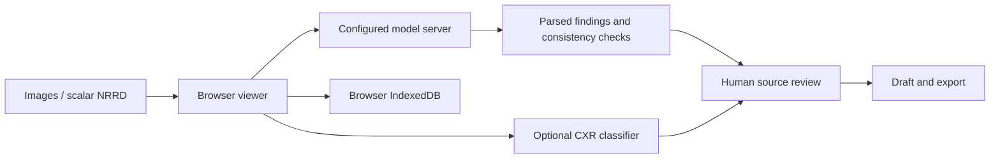

<div align="center">


# Skanda Radiology

**An image-first workspace for X-ray, CT and MRI review.**

View the source image, navigate the volume, inspect model candidates, and keep review decisions tied to their evidence.

[Current interface](#current-interface) · [Radiologist workflow](#radiologist-workflow) · [Quick start](#quick-start) · [Evaluation](#evaluation) · [Development](#development)

</div>


*Current application, captured during the November 2026 labeled-case evaluation. The MRI result shown is for axial slice 97 only. The three-plane viewer and 3D locator show navigation, not validated lesion segmentation.*

> **Research and review support.** Model findings require qualified review. In the latest targeted CT/MRI tests, five of six positive-slice boxes had zero overlap with their reference regions. [Read the detailed fault report](docs/validation/2026-11-02-labeled-case-failure-report.md).

## Current interface

The workspace now supports CT and MRI volume review alongside the X-ray workflow. Dark and light themes, a translucent material option, reading mode, and collapsible panels let the image take priority. The screenshots below show actual application states, including incomplete or flagged model output.

### X-ray: image and findings together


Select findings from the image or inspector, zoom to their locations, and accept or dismiss them. Box, outline and fill controls apply when the reader returns suitable coordinates or masks. Missing localization is disclosed. The colored heatmap is coarse **classifier evidence**, not a confirmed lesion boundary.

*Shown: ChestX-Det `cxd_69598`. This run reported atelectasis, matching one of four reference categories by name. It omitted consolidation, effusion and fibrosis and returned no usable reader box or outline.*

### CT: full slice with spatial context


Keep the axial image large while using the right-side 3D volume to locate the plane. Browse slices with the slider, number field, previous/next buttons or cine playback. Show the review panel when needed, or collapse it for reading. The visible warning in this example identifies an unsupported model measurement; the candidate overlay is withheld.

### MRI: the same volume controls

CT and MRI share the same volume viewer: axial/coronal/sagittal selection, synchronized three-plane layout, crosshair navigation, windowing, fit/pan/zoom, review tools and the right-side 3D locator. A finding retains its source plane and slice; its candidate region can be projected into other views where it intersects the displayed plane.

The locator is reconstructed from the loaded volume's voxels. It is not a generic anatomical model. Click or touch the volume to navigate, drag to rotate, and use **Expand 3D** to enlarge it. This display uses reduced resolution; it does not establish the correctness of a finding or its extent across slices.

### Mobile: direct access to the reading task


The mobile layout provides **Studies**, **Viewer**, **Findings** and **Report** navigation, with a direct **Analyze & findings** action for volumes. This gives findings and analysis a dedicated screen instead of squeezing every desktop panel beside the image. The screenshot shows the built-in public MRI sample before analysis.

## Radiologist workflow

### What was added for easier access

| Reading task | Current UI access | Practical benefit |
| --- | --- | --- |
| Find the right study | Search by patient, ID or study; All / Review / Signed filters; recent or AI-priority sorting | Locate studies without scanning the entire list. AI priority remains a model-derived cue. |
| Keep the open volume in context | Open-volume entry in the worklist, patient-link state and volume identity details | Distinguish a sample or unlinked volume from a patient study. |
| Give the scan more space | Reading mode, collapsible studies/review panels, fit controls and maximizable plane views | Reduce surrounding controls while inspecting anatomy. |
| Keep CT and MRI behavior consistent | Shared volume toolbar and review components | Use the same navigation and review actions across both modalities. |
| Move between anatomical planes | Axial / Coronal / Sagittal controls, Three planes layout and synchronized crosshairs | Inspect the same position without manually searching each plane. |
| Understand the slice position | Right-side voxel-derived 3D locator, touch navigation and Expand 3D | Relate the displayed plane to the loaded volume. |
| Inspect a candidate at its source | Finding selection with source plane/slice navigation and linked locations | Return to the image supporting the model claim. Spatial linking does not validate that claim. |
| Work through pending findings | Review actions, pending-finding navigation and keyboard shortcuts | Keep the review sequence explicit. |
| See analysis coverage | Volume jobs, completed/total slice counts, progress, pause/resume and failed-read status | Distinguish partial work from completed coverage. |
| Inspect anatomy beneath overlays | Overlay visibility/opacity controls; hold Alt in the volume viewer | Compare a candidate with the unobscured source image. |
| Prepare a volume draft | Draft from accepted findings, source-evidence navigation, stale-draft warnings and text export | Keep the draft tied to reviewed evidence and current coverage. |
| Continue on a small screen | Dedicated mobile navigation and Analyze & findings action | Reach the reading task without a crowded desktop sidebar. |

### X-ray review

1. Create a study and enter its patient/context information.
2. Drop, paste or select an image. Supported intake includes PNG, JPEG, WebP and supported uncompressed DICOM.
3. Confirm the model connection and image type, then run **Analyze Image**.
4. Review each finding against the source. Inspect any available classifier evidence separately from the reader's location.
5. Accept or dismiss findings, then draft and edit the report. The image-study workflow includes print/PDF and structured exports, signing checks and an amendment trail.

### CT and MRI review

1. Open a built-in CT/MRI sample or choose **Open NRRD volume…**. Imported NRRD files initially receive generic `Volume` metadata; the ordinary upload control does not yet collect structured modality, sequence and contrast information. This is a [documented gap](docs/validation/2026-11-02-labeled-case-failure-report.md#f06-acquisition-metadata-is-not-represented-sufficiently-in-the-validation-path).
2. Set the viewing window and use a single plane or **Three planes**. Keep the source plane/index visible while browsing.
3. Use **Analyze volume** for the acquired-slice review job, or expand **Analyze current slice only** for a single-image request. These have different scopes.
4. Check coverage and errors, then inspect each candidate at its source. Rule-flagged claims remain available for audit, with overlays/report acceptance restricted.
5. Create a draft from accepted findings. Marking a volume draft reviewed requires completed coverage, resolved finding review and an up-to-date draft. A reviewed volume draft remains **unsigned**; it is distinct from the image-study signing workflow.

Volume analysis sends acquired slices as individual requests at the selected display window. It is not a native whole-volume inference or validated 3D segmentation model.

### Volume reading shortcuts

| Key | Action |
| --- | --- |
| `Space` | Play / pause slices |
| `F` | Fit the full image |
| `P` / `W` | Pan / window tool |
| `M` | Single / three-plane layout |
| `H` | Toggle overlays |
| Hold `Alt` | Temporarily hide overlays |
| `J` / `K` | Next / previous pending finding |
| `A` / `R` | Accept / reject the selected finding |
| `?` | Show shortcuts |

Shortcuts are context-specific: for example, `M` in the X-ray viewer cycles overlay styles. Text inputs retain their normal editing behavior. See the on-screen shortcut help for the active viewer.

## Quick start

The app connects to a separately hosted vision-language model. Model weights are not bundled with this repository. The current default model identifier is **`skanda-grounding-q3-mixed`**, which was also used for the latest labeled CT/MRI tests. A model alias does not identify an exact weight revision or guarantee modality performance.

### 1. Start the model server

In LM Studio, load your installed compatible vision model and start its API server on port **1234**. Check the available identifiers:

```sh
curl http://localhost:1234/v1/models
```

In the app's **Settings**, use the exact served model ID. With the default Vite proxy, the base URL is `/lmstudio/v1`. Selecting an identifier in Settings does not download or load its weights.

### 2. Start the app

Use Node.js 24+ for the development and TypeScript test commands documented here.

```sh
git clone https://github.com/Hitheshkaranth/skanda-radiology.git
cd skanda-radiology/app
npm ci
npm run dev
```

Open **http://localhost:5173** and confirm that the connection status reads **Connected**. Memory requirements and latency depend on the model, quantization, context length and inference host; the interface alone does not determine them.

### 3. Optional X-ray services

The local TorchXRayVision service supplies chest-X-ray classifier evidence. It is not a CT/MRI validator. From a second terminal:

```sh
cd app
uv run --with torchxrayvision --with scikit-image server/txrv_server.py
```

MAIRA-2 is an optional chest-X-ray second reader, disabled by default. Its weights and service are separate from LM Studio. See [the service implementation](app/server/maira_server.py) and [historical benchmark documentation](benchmark/README.md) for its evaluated setup. Do not transfer its CXR results to CT or MRI.

### Common setup and reading issues

| Symptom | Check |
| --- | --- |
| Disconnected / model not loaded | Start the model server and match the Settings model ID to `/v1/models`. |
| Remote inference host | Configure the backend/proxy for that host; connecting Tailscale alone does not change the repository's localhost proxy target. |
| No overlay on a reported finding | The model may have returned no usable coordinates, or the app may have withheld a rule-flagged candidate. Inspect the finding explanation. |
| Result is for a different slice/window | Return to the result's source slice or analyze the current image. Do not interpret it against the new view. |
| Incomplete volume review | Inspect completed/total coverage and the failed-read reason before resuming. Incomplete coverage is not a normal result. |
| Unsupported compressed DICOM | Export a supported uncompressed image. The intake is not a general DICOM-series/PACS importer. |
| Whole-volume import needed | Use a supported scalar NRRD volume; NIfTI conversion was performed separately for the labeled evaluation. |

## Evaluation

### Latest labeled CT/MRI check

One labeled case per modality, with three target-positive and one target-negative axial slice selected before inference. Reference masks were not sent to the model.

| Case | Observed result |
| --- | --- |
| CT liver (`liver_0`) | Lesion descriptions on all three positive slices, but all three boxes missed the reference tumors. A lesion was also reported on the reference-negative slice. |
| MRI brain (`BraTS-GLI-00000-000`) | Lesion descriptions on all three positive slices. One box partially overlapped the reference region (box-mask IoU 0.074); two had zero overlap. No abnormality was reported on the reference-negative slice. |

**Four selected slices per case are not full-volume validation.** These public training cases have unknown overlap with the reader's training data. Rule checks caught some unsupported claims, but incorrect locations also passed. Self-reported confidence was not a reliable localization score.

- [Detailed report: 13 observed fault categories and remediation criteria](docs/validation/2026-11-02-labeled-case-failure-report.md)
- [Saved outputs, reference comparisons and reproduction instructions](benchmark/volume-validation/README.md)
- [Machine-readable scores](benchmark/volume-validation/scores.json)
- [Historical CXR benchmarks and model comparisons](benchmark/README.md)

The historical CXR results involve different reader versions and protocols. They are not performance claims for the current CT/MRI workflow. The revised narrated demo uses the latest labeled comparisons; its script and captions are in [the evidence package](benchmark/volume-validation/README.md). Rendered videos remain local under `output/`.

## Architecture and data handling



| Component | Responsibility |
| --- | --- |
| [Viewer components](app/src/components/viewer) | X-ray viewer, volume navigation, three-plane views, 3D display and review panels |
| [Shell components](app/src/components/shell) | Worklist, study context, model connection, responsive navigation and settings |
| [Volume geometry](app/src/lib/volume.ts) | Scalar NRRD decoding, LPS coordinates and slice rendering |
| [Volume jobs](app/src/lib/volumeJobs.ts) | Acquired-slice review, persisted progress, bounded transient-error retries and review state |
| [Consistency checks](app/src/lib/volumeValidation.ts) | Limited context, background boxes and selected unsupported/contradictory claims |
| [Model client](app/src/lib/medgemma.ts) | Streaming requests, parsing, retries and modality-aware prompt selection |
| [Vite proxy](app/vite.config.ts) | `/lmstudio` → localhost:1234; `/txrv` → localhost:8765; `/maira` → localhost:8766 |

Studies and review state are stored in browser IndexedDB. Inference images are sent to the configured model/services. The default proxy targets local services; using another host changes where data travels. This is browser-local storage, not a hospital PACS, shared worklist service or managed clinical archive.

## Development

From `app/`:

```sh
npm test
npm run lint
npm run build
python3 server/test_servers.py
```

Verify the saved labeled-case evidence without running a model:

```sh
python3 -m venv benchmark/volume-validation/.venv
benchmark/volume-validation/.venv/bin/pip install -r benchmark/volume-validation/requirements.txt
benchmark/volume-validation/.venv/bin/python benchmark/volume-validation/verify.py
```

Run that block from the repository root. [Live evaluation instructions](benchmark/volume-validation/README.md#optional-live-reproduction) document the development-harness dependencies and limitations.

## Sample data and attribution

Built-in Slicer CT/MRI volumes are teaching/demo data, not expert-labeled validation cases. Their source URLs, geometry and hashes are recorded in [sample provenance](app/public/samples/provenance.json). The small pydicom fixtures exercise decoding; see [their attribution](app/public/samples/README.md).

The labeled evaluation uses MSD/LiTS liver CT and BraTS 2023 glioma MRI. Source links, mask definitions, hashes and mirror-declared licenses are recorded in [evaluation provenance](benchmark/volume-validation/provenance.json). Derived display slices and comparisons are committed for audit; full downloaded evaluation volumes are not. The X-ray screenshot uses ChestX-Det; see [the benchmark documentation](benchmark/README.md).
