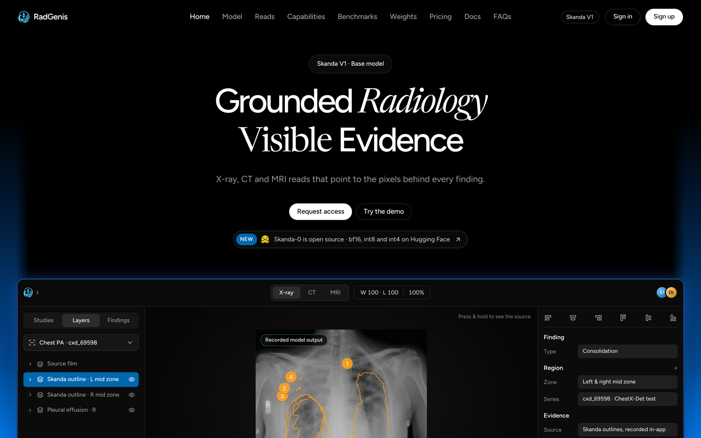
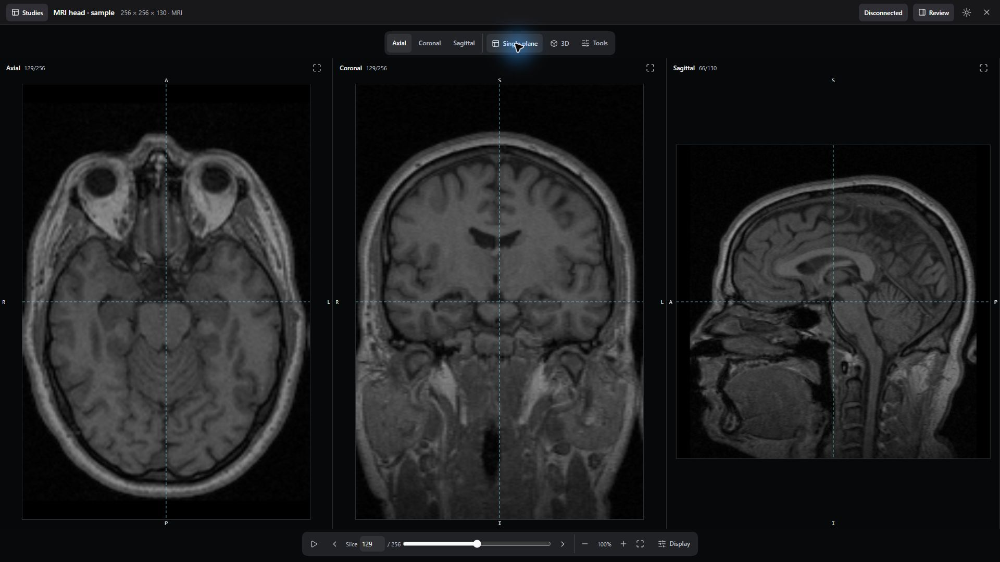
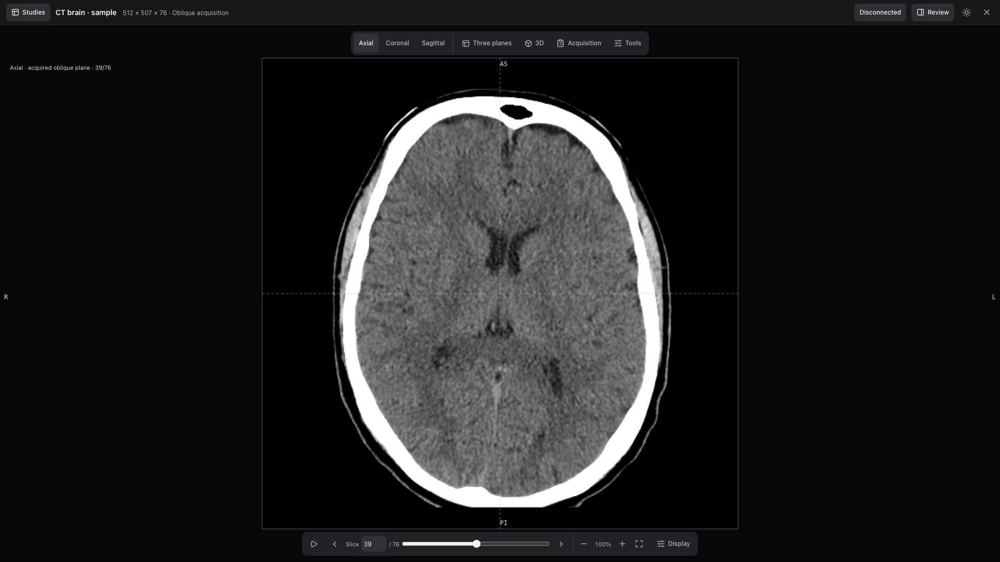
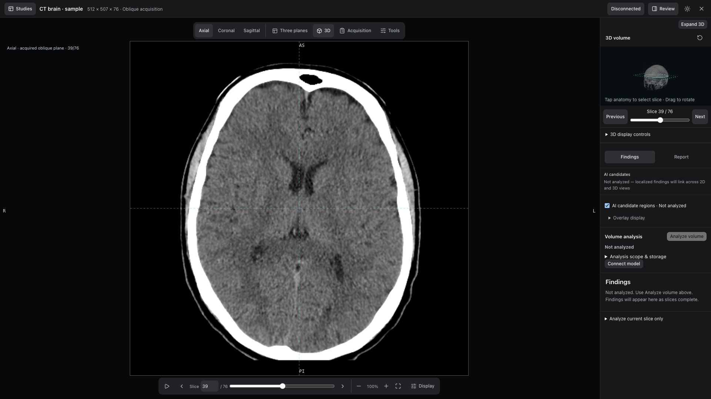
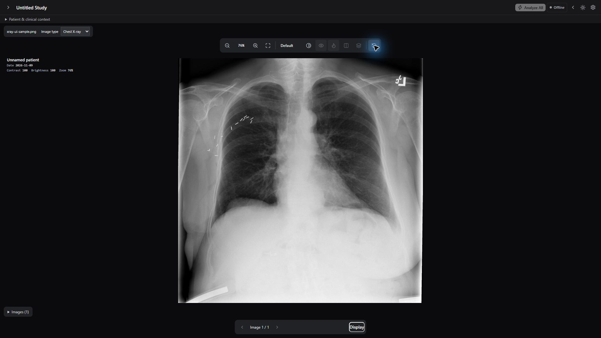
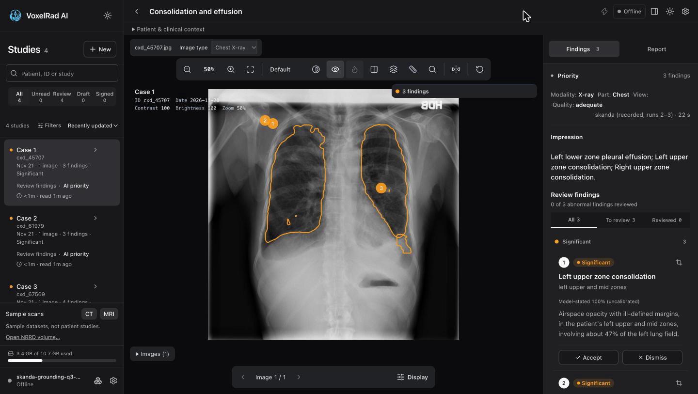
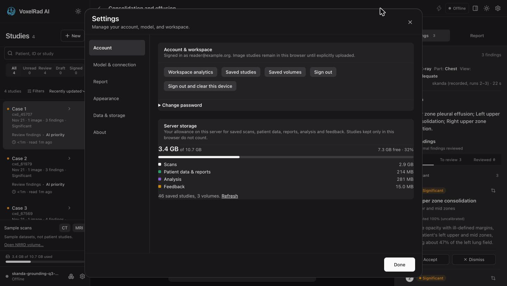
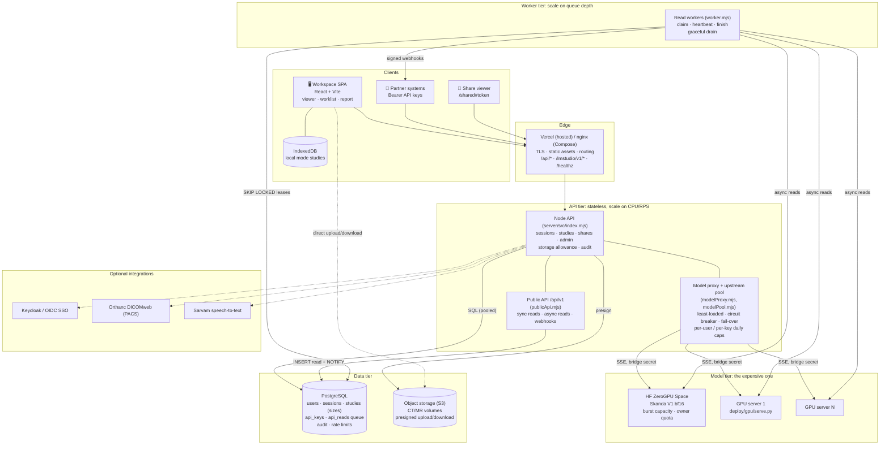
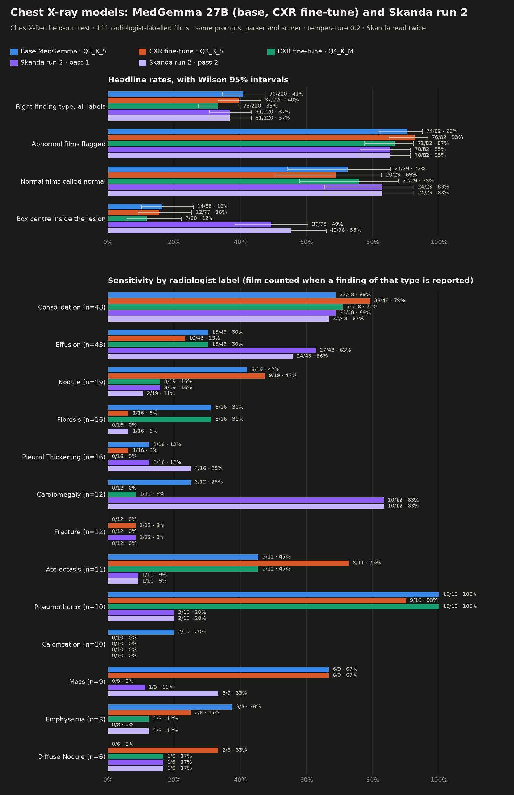

<div align="center">


# VoxelRad AI

### Grounded radiology. Visible evidence.

A browser workspace for X-ray, CT and MRI reading, where every model finding points back to the pixels behind it.

[](https://voxelradai.com)
[](https://github.com/Hitheshkaranth/VoxelRadAI_Terminal/releases)
[](#-quick-start)
[](app)
[](server)
[](#-evaluation-and-limitations)

[**Live site**](https://voxelradai.com) · [**Download beta**](https://github.com/Hitheshkaranth/VoxelRadAI_Terminal/releases/tag/v0.2.0-beta.2) · [Quick start](#-quick-start) · [Benchmarks](#-benchmarks) · [Docs](#-documentation)

<br>

<a href="https://voxelradai.com"></a>

<sub>The <a href="https://voxelradai.com">voxelradai.com</a> landing page, captured November 12, 2026. The overlay is recorded Skanda output on a public ChestX-Det test film.</sub>

</div>

> [!IMPORTANT]
> VoxelRad AI is **research and review-support software. It is not a medical device.** Model findings are candidates and need review by a qualified reader. The benchmarks below are small, selected evaluations, not clinical validation.

## Contents

- [Highlights](#-highlights)
- [Quick start](#-quick-start)
- [Workspace tour](#-workspace-tour)
- [Architecture](#-architecture)
- [Scaling and capacity](#-scaling-and-capacity)
- [Storage and data](#-storage-and-data)
- [Benchmarks](#-benchmarks)
- [Review workflow](#-review-workflow)
- [Model API](#-model-api)
- [Operations](#-operations)
- [Evaluation and limitations](#-evaluation-and-limitations)
- [Development](#-development)
- [Documentation](#-documentation)
- [Attribution](#-attribution)

## ✨ Highlights

| | |
| --- | --- |
| 🩻 **X-ray workspace** | Image stepping, pan/zoom, brightness/contrast, candidate overlays and per-finding review |
| 🧠 **CT and MRI** | Scalar NRRD import, axial/coronal/sagittal views, synchronized crosshairs, windowing and cine |
| 🧭 **Spatial context** | Optional voxel-derived 3D locator and source-plane navigation |
| 🎯 **Grounded findings** | Every candidate links to its source slice, outline or box, so you can compare it with the original image |
| 📝 **Review and reporting** | Accept or dismiss candidates, track coverage, draft from reviewed findings, sign and export |
| 🗂️ **Exam templates and macros** | Built-in and personal normal templates with Tab/F2 fill-in fields, `.name` text macros, and a sign-off check for unfilled fields |
| 🔏 **Addenda and corrections** | Signed reports are never edited in place: each signature keeps a version, with addenda and "Correct report" history, and saves are revision-checked |
| 📐 **Guideline helpers and QA** | Fleischner, Lung-RADS, TI-RADS, Bosniak, adrenal and BI-RADS decision support to verify, plus sign-off checks for laterality, sex, size, impression coverage and logged critical results |
| 🧊 **DICOM series volumes** | Uncompressed CT/MR series (dropped folders or PACS) open as volumes with spacing, orientation and HU rescale checks |
| 🔍 **Viewer tools** | CT window presets (keys 1–9), value under the cursor, length/ellipse ROI measurements inserted into the report, MIP/MinIP slabs, 2D flip/rotate and loupe |
| ⚡ **GPU pool with fail-over** | Reads go to the least-loaded of several model backends (ZeroGPU Space and/or [dedicated GPU servers](deploy/gpu)), skipping any that are down or out of quota ([scaling](docs/architecture/scaling.md)) |
| 🧾 **Durable API reads** | Async `/api/v1/reads` are leased jobs in PostgreSQL: retried if a worker dies, refused with `queue_full` before they are counted, refunded if they never ran |
| 💾 **Per-user storage allowance** | 10 GB by default (adjustable per user) for saved scans, patient data, reports, analysis and feedback, shown in the sidebar and in Settings |
| 🔐 **Server mode** | Sign-in, admin tools, saved studies in PostgreSQL, and share links that expire or can be revoked |
| 🔌 **Integrations** | Optional [Keycloak SSO](docs/keycloak.md), [private S3 volume storage](docs/s3-storage.md) and [Orthanc import](docs/orthanc.md). All are off until configured |
| 💻 **Local mode** | Studies stay in browser storage. Bring your own model service |

## 🚀 Quick start

### 1. Explore locally (no model needed)

```sh
git clone https://github.com/Hitheshkaranth/VoxelRadAI_Terminal.git
cd VoxelRadAI_Terminal/app
npm ci
npm run dev
```

Open **http://localhost:5173** and pick **CT** or **MRI** under *Sample scans*. Studies are kept in the browser only.

### 2. Connect a model

Run a compatible OpenAI-style model service on port **1234**, then choose the exact model ID in **Settings**:

```sh
curl http://localhost:1234/v1/models
```

The dev proxy forwards `/lmstudio/v1` to that service. The [Skanda reader guide](docs/reading-with-skanda.md) covers bf16 serving, hardware, modality inputs and outlines. Model weights are not included in this repo.

> [!NOTE]
> GGUF serving through LM Studio does not run Skanda's outline model. Use the bf16 setup for outlines.

### 3. Run with accounts and PostgreSQL

```sh
cp config.example .env   # set the DB password and bootstrap admin credentials
docker compose up -d --build
```

Open **http://localhost:8088**. This starts PostgreSQL, the API, a read worker and the web server. For HTTPS, persistence and backups, see the [deployment guide](docs/deployment.md). For the hosted setup (Vercel and Neon), see [Vercel deployment](docs/vercel.md). To add SSO, S3 or Orthanc, layer on `compose.integrations.yaml`.

### 4. Add dedicated GPUs (on-prem or VPC)

```sh
# in .env: BRIDGE_SECRET (32+ chars), HF_TOKEN (read access to Skanda V1), MODEL_REVISION (pinned)
docker compose -f compose.yaml -f compose.gpu.yaml up -d --build
```

This runs one [Skanda V1 server](deploy/gpu/serve.py) per GPU and sends workspace and API reads through the API's upstream pool. Async reads go to the workers. To size GPUs for a site, see [capacity](#-scaling-and-capacity).

### Release packages

[**v0.2.0-beta.2**](https://github.com/Hitheshkaranth/VoxelRadAI_Terminal/releases/tag/v0.2.0-beta.2) ships a **source ZIP**, a prebuilt local-only **web ZIP** (serve it over HTTP) and **SHA256SUMS.txt**. `main` may be ahead of the beta. The login CT cine, the integrations, the GPU pool, read workers and storage allowances are not in the beta packages.

## 🖼️ Workspace tour

<table>
  <tr>
    <td width="50%"><br><sub><b>Three-plane MRI.</b> Equal-width views with built-in plane and slice controls.</sub></td>
    <td width="50%"><br><sub><b>Full-width canvas.</b> Plane and layout controls at the top. Slice, playback, zoom and Display at the bottom.</sub></td>
  </tr>
  <tr>
    <td><br><sub><b>3D locator and review.</b> Navigation aid only, not validated segmentation.</sub></td>
    <td><br><sub><b>X-ray.</b> Public ChestX-Det film opened through the file picker.</sub></td>
  </tr>
  <tr>
    <td><br><sub><b>Saved study with its analysis.</b> A study restored from the server keeps its findings and outlines. The worklist shows how much of the allowance is used.</sub></td>
    <td><br><sub><b>Storage breakdown.</b> Settings → Account splits usage into scans, patient data and reports, analysis, and feedback.</sub></td>
  </tr>
</table>

<sub>The first four were captured November 12, 2026 with public teaching samples and a public ChestX-Det film, and no model running. The storage views were captured November 21, 2026 from a server-mode build. The studies are public ChestX-Det test films carrying <b>recorded Skanda reads from runs 2–3</b> (the earlier checkpoints, not Skanda V1), parsed by the app's normal pipeline and restored through <i>Saved studies</i>. The storage figures are illustrative, served by a test API. None of these screenshots show diagnostic performance.</sub>

## 🏗️ Architecture

### System



### A read, end to end

```mermaid
sequenceDiagram
  autonumber
  participant B as Workspace / partner
  participant A as API replica
  participant P as PostgreSQL
  participant W as Read worker
  participant G as GPU upstream pool
  Note over B,G: Workspace read (one per X-ray, one per acquired CT/MR slice)
  B->>A: POST /lmstudio/v1/chat/completions (session cookie)
  A->>P: check session · count daily read
  A->>G: least-loaded healthy upstream (fail over if refused before start)
  G-->>B: SSE ": queued" heartbeats → result chunk → [DONE]
  Note over B,G: Async API read
  B->>A: POST /api/v1/reads (Bearer key, Idempotency-Key)
  A->>P: queue limit? count read · INSERT queued · NOTIFY
  A-->>B: 202 { id, poll_url }
  W->>P: claim (FOR UPDATE SKIP LOCKED, lease 60 s)
  loop every 5 s
    W->>P: heartbeat (renews lease; sees cancel)
  end
  W->>G: read
  G-->>W: result
  W->>P: finish (lease holder only) · drop image data
  W-->>B: signed webhook (optional)
  B->>A: GET /api/v1/reads/{id}
  A-->>B: succeeded + report
```

If a worker dies, its lease lapses and the read goes back on the queue for another worker, at most `READ_MAX_ATTEMPTS` times. A read that waits past `READ_QUEUE_TTL_SECONDS` fails and is refunded if it never reached a GPU.

### Deployment shapes

| | Hosted (voxelradai.com) | Private install | Dedicated GPUs | All-in-one Space |
| --- | --- | --- | --- | --- |
| Entry | Vercel | `compose.yaml` | `+ compose.gpu.yaml` | [`deploy/huggingface`](docs/huggingface.md) |
| API | Serverless function | Node container(s) | Node container(s) | Node child process |
| Async reads | `inline` (with retry) | worker service | worker service | inline |
| Database | Neon | PostgreSQL 17 | PostgreSQL 17 | Bundled PostgreSQL |
| Model | ZeroGPU Space (+ any GPUs in `MODEL_UPSTREAMS`) | Host model service on :1234 | One `deploy/gpu` server per GPU | In-process ZeroGPU |

### Repository map

| Path | Responsibility |
| --- | --- |
| [`app/src/landing`](app/src/landing) | Public landing page, reading-room hero and benchmarks |
| [`app/src/components/viewer`](app/src/components/viewer) | Image rendering, volume navigation and review controls |
| [`app/src/components/shell`](app/src/components/shell) | Worklist, settings, sessions, storage meter and administration |
| [`app/src/lib/volumeJobs.ts`](app/src/lib/volumeJobs.ts) | Coverage, progress, retries and resume |
| [`server/src/index.mjs`](server/src/index.mjs) | Auth, studies, sharing, admin, metrics route |
| [`server/src/modelProxy.mjs`](server/src/modelProxy.mjs) · [`modelPool.mjs`](server/src/modelPool.mjs) | Model bridge, daily caps, upstream pool and fail-over |
| [`server/src/publicApi.mjs`](server/src/publicApi.mjs) · [`worker.mjs`](server/src/worker.mjs) | `/api/v1`, durable read queue, read workers |
| [`server/src/storage.mjs`](server/src/storage.mjs) | Per-user storage allowance and usage |
| [`server/src/metrics.mjs`](server/src/metrics.mjs) | Prometheus exposition for API and workers |
| [`server/migrations`](server/migrations) | Checksummed, ordered SQL migrations |
| [`deploy/gpu`](deploy/gpu) | Skanda V1 server for one dedicated GPU |
| [`deploy/huggingface`](deploy/huggingface) | ZeroGPU Space (full app plus queued reads) |
| [`api`](api) | Vercel serverless entry point |
| [`benchmark`](benchmark) | Scoring, plots and landing-page data generation |

Inference sends images to whichever model host you configure. In server mode, only studies you explicitly save are persisted. Hosted share links work as bearer links until they expire or are revoked. VoxelRad AI is not a PACS or a multi-tenant clinical archive.

## 📈 Scaling and capacity

The binding constraint is GPU time, not the web tier. Skanda V1 takes **6.4 s per read** on average, and each GPU runs one read at a time, so plan for about **350 reads per GPU-hour**. An X-ray is one read. A CT/MR volume job is one read per acquired slice, so a 30-slice job is 30 reads.

```
GPUs = ceil(peak-hour reads ÷ 350)    peak-hour reads = X-rays + volume studies × slices per job
```

Example: 400 X-rays and 60 CT/MR studies a day gives about 330 reads at the busiest hour, so one GPU, or two for N+1.

| Tier | How it scales | Signal |
| --- | --- | --- |
| Web | CDN / any number of nginx replicas | — |
| API | Add replicas; no sticky sessions (state is in PostgreSQL) | CPU, `voxelrad_http_*` |
| Workers | Add replicas or raise `READ_WORKER_CONCURRENCY` | `voxelrad_api_reads{status="queued"}` |
| GPUs | Add `deploy/gpu` servers to `MODEL_UPSTREAMS` | `voxelrad_model_upstream_in_flight` |
| PostgreSQL | Pooled connections (Neon pooler / PgBouncer); replica for analytics (planned) | `voxelrad_db_pool_connections{state="waiting"}` |

The full review covers bottlenecks, the roadmap (images to object storage, tenancy with row-level security, batched slice inference), field deployment topologies, runbooks and every new setting: **[docs/architecture/scaling.md](docs/architecture/scaling.md)**.

## 💾 Storage and data

| | Local mode | Server mode |
| --- | --- | --- |
| Where studies live | Browser (IndexedDB) | PostgreSQL (studies you save) and S3 (volumes, when configured) |
| Allowance | Browser quota | **10 GB per user by default** (`STORAGE_QUOTA_GB`). Administrators can change it per user |
| What counts | — | **Scans** (study images and volumes), **patient data & reports**, **analysis** (findings, measurements, your review decisions), **feedback** (dictation corrections) |
| What you can open | Everything in the browser | Your own saved scans, patient data and reports, with their analysis. Download or delete them from *Saved studies* and *Saved volumes* |
| When full | — | Saves and uploads that would exceed the allowance are refused with a clear message. Nothing is silently dropped |

Your usage is shown at the foot of the worklist and in **Settings → Account → Server storage**, and refreshes after every save, upload and deletion. Dictation feedback is pseudonymous and is not shown back. De-identified training cases are organisation data with their own retention, so they do not count against a user's allowance.

## 📊 Benchmarks

Two Skanda checkpoints appear below:
- **Skanda V1** is the run 4b checkpoint that the hosted workspace serves. Its weights are private.
- **Skanda-0** is the earlier run 3, open source on [Hugging Face](https://huggingface.co/hitheshkaranth/Skanda-0) in bf16, int8 and int4.

Every figure is labelled with the checkpoint it came from.

### Skanda V1, held out

The same held-out cases for every model, read by one runner and scored by one script. Percent, higher is better. Source: the Skanda V1 model card (bf16), which also publishes the baselines below. These baselines are a later re-read, so they differ slightly from the run 2–3 table further down. Each chest X-ray number moves about ±10 points by chance across 111 films.

| 🩻 Chest X-ray · 111 ChestX-Det test films | MedGemma 27B | MAIRA-2 | MedGemma + MAIRA-2 | **Skanda V1** |
| --- | :-: | :-: | :-: | :-: |
| Abnormal flagged | 86 | **89** | 87.5 | 82.5 |
| Normals called normal | 72 | 72 | 72 | **76** |
| Right finding type | 36 | 34 | **42** | 39 |
| Box precision | 8.5 | **30** | 10.5 | 27 |
| Box recall | 5.5 | 13 | 7 | **13.5** |

| | 🫁 CT · 340 cases | | 🧠 MRI · 240 cases | |
| --- | :-: | :-: | :-: | :-: |
| | MedGemma 27B | **Skanda V1** | MedGemma 27B | **Skanda V1** |
| Abnormal flagged | **97** | 81 | **99** | 86 |
| Normals called normal | 6 | **91** | 2 | **94** |
| Right finding type | 49 | **68** | 42 | **84** |
| Box precision | 1 | **18** | 6 | **73** |
| Box recall | 3 | **13** | 8 | **65** |

MAIRA-2 reads chest X-rays only. Chest X-ray: Skanda's figures are the mean of two passes. Box metrics on X-ray count a predicted box when its centre falls inside a radiologist box of the same class. On CT and MRI they need box IoU ≥ 0.3, matched one-to-one.

### Skanda V1, pre-registered confirmatory set

The analysis plan, lexicon and scoring code were committed on 6 Nov 2026 before Skanda V1 read any of these cases. The results are descriptive; the planned hypothesis tests with confidence intervals, and the int8 and int4 passes, are still running. Skanda V1 ran in bf16 as served. Percent, except seconds.

| Metric | 🩻 Chest X-ray · 707 | 🫁 CT · 1,093 | 🧠 MRI · 784 | All · 2,584 |
| --- | :-: | :-: | :-: | :-: |
| Abnormal flagged | 79.5 | 71.6 | 79.6 | 76.2 |
| Normals cleared (no finding drawn) | 79.5 | 72.4 | 93.5 | 80.4 |
| Outline recall (mask IoU ≥ 0.3) | 23.5 | 28.0 | 61.4 | 36.2 |
| Outline precision | 32.5 | 28.4 | 67.8 | 42.8 |
| Mean Dice of found outlines | 70.9 | 72.1 | 74.8 | 73.2 |
| Finding type agrees (found outlines) | 44.5 | 68.5 | 95.7 | 75.7 |
| Side agrees (found outlines) | 83.2 | 94.0 | 95.7 | 91.8 |
| Seconds per read | 7.0 | 5.5 | 7.3 | 6.4 |

The chest X-ray set is 307 confirmatory films plus 400 fresh normal films. The CT and MRI cases are MSD and autoPET test cases. All 2,584 reads parsed. Outlines here are matched on mask IoU ≥ 0.3, which is stricter than the box-centre rule above, so the two tables are not comparable.

### Earlier checkpoints: Skanda runs 2–3, with intervals

This table uses the same 111 chest films, scored from the result files committed in this repository, with Wilson 95% intervals in brackets. Skanda read every film twice; its figures are the mean of both reads. Right finding type comes from run 3, which was released as Skanda-0. The other Skanda figures come from run 2. Skanda V1 above supersedes these numbers; this table is kept as a record.

| Metric | **Skanda runs 2–3** | MedGemma 27B | MAIRA-2 |
| --- | :-: | :-: | :-: |
| Normal films called normal | **82.8%** <sub>[65.5–92.4]</sub> | 72.4% <sub>[54.3–85.3]</sub> | 72.4% <sub>[54.3–85.3]</sub> |
| Abnormal films flagged | 85.4% <sub>[76.1–91.4]</sub> | **90.2%** <sub>[81.9–95.0]</sub> | **90.2%** <sub>[81.9–95.0]</sub> |
| Right finding type (all 220 labels) | 40.5% <sub>[34.2–47.1]</sub> | **40.9%** <sub>[34.6–47.5]</sub> | 34.1% <sub>[28.1–40.6]</sub> |
| Box centre inside the reference box | **52.3%** <sub>[41.2–63.2]</sub> | 16.5% <sub>[10.1–25.8]</sub> | **52.3%** <sub>[40.4–64.0]</sub> |

<details>
<summary><b>Per-finding sensitivity chart</b></summary>
<br>

</details>

These numbers are generated from `score.py` output by [`benchmark/emit_landing.py`](benchmark/emit_landing.py), which also feeds the earlier-checkpoints chart on [voxelradai.com/benchmarks](https://voxelradai.com/benchmarks). Reproduce them with the [benchmark guide](benchmark/README.md). The small per-label sample sizes produce wide intervals.

## 🔁 Review workflow

**X-ray.** Create a study, add a PNG, JPEG, WebP or uncompressed DICOM image, and analyze it. Check each candidate against the source, then accept or dismiss it. Draft the report and sign it. Amendments are kept in a history. A classifier heatmap is supporting evidence, not a confirmed lesion boundary.

**CT/MRI.** Open a sample or a scalar NRRD volume and set the plane and window. Then run an acquired-slice job, or choose current-slice analysis explicitly. Check coverage and any failed slices, go back to each candidate's source, and draft from the findings you accepted. Volume analysis sends one request per slice. It is not native whole-volume inference.

<details>
<summary><b>Keyboard shortcuts</b></summary>

| Key | Action |
| --- | --- |
| <kbd>Space</kbd> | Play / pause |
| <kbd>F</kbd> | Fit image |
| <kbd>P</kbd> / <kbd>W</kbd> | Pan / window |
| <kbd>M</kbd> | Single / three-plane layout |
| <kbd>H</kbd> / hold <kbd>Alt</kbd> | Toggle / temporarily hide overlays |
| <kbd>J</kbd> / <kbd>K</kbd> | Next / previous pending finding |
| <kbd>A</kbd> / <kbd>R</kbd> | Accept / reject selected finding |
| <kbd>?</kbd> | Shortcut help |

</details>

## 🔌 Model API

Organisations can call Skanda V1 from their own software at `https://voxelradai.com/api/v1`, with an OpenAI-compatible request. Full reference: [voxelradai.com/docs](https://voxelradai.com/docs).

- **Keys by request only.** An administrator issues `vr_live_…` or `vr_test_…` keys per organisation in the admin panel; there is no self-serve signup. Send them as `Authorization: Bearer …`. Keys work only on `/api/v1`, never on studies or other app routes.
- **Endpoints.** `GET /models`; `POST /chat/completions` (`stream:false` by default returns one `chat.completion`, `stream:true` returns SSE); `POST /reads` for async reads (202, poll `GET /reads/{id}`, cancel with `DELETE`), with `Idempotency-Key` and optional HMAC-signed webhooks (`X-VoxelRad-Signature`).
- **Limits.** By default 200 reads per UTC day for a live key and 20 for a test key (`API_LIVE_DAILY_READS`, `API_TEST_DAILY_READS`, or a per-key override); `429 daily_limit_reached` with `Retry-After`. When the read queue is full, `POST /reads` returns `503 queue_full` with `Retry-After` and the read is not counted. Errors use the OpenAI shape `{"error":{"message","type","code"}}`.
- **Reliability.** Async reads survive a worker or function crash: they are retried once on another executor. A read that never reached a GPU is refunded once, to the UTC day it was counted on.
- **Data.** API reads are never captured for model training; any model-improvement use needs a separate signed data agreement. Async read results expire after 24 hours.
- **Setup.** Needs `MODEL_UPSTREAMS` (or `MODEL_UPSTREAM_URL`) and `BRIDGE_SECRET`; webhooks also need `API_WEBHOOK_SECRET` (32+ characters). Set `READ_EXECUTION=worker` when read workers run. Migrations `015`–`017` apply automatically, or with `npm run migrate --prefix server`.

> [!NOTE]
> Skanda is not a cleared medical device. Clinical use requires regulatory clearance (for example from CDSCO in India), which has not been obtained. Until then, API integrations are for research, evaluation and supervised pilots under a research agreement, with every finding reviewed by a radiologist.

## 🩺 Operations

- **Health.** `/healthz` on the API (checks the database) and `:9090/healthz` on each worker (turns 503 while draining).
- **Metrics.** Set `METRICS_TOKEN`, then scrape `GET /metrics` on each API replica and `:9090/metrics` on each worker with `Authorization: Bearer …`. These cover HTTP status classes and latency, DB pool pressure, upstream health and in-flight reads, queue depth, and worker saturation. The routes are hidden without a token and are not exposed through nginx or Vercel.
- **Logs.** One JSON line per request with a random `X-Request-ID`, status and duration. URLs, bodies, cookies and identities are never logged.
- **Releases.** Migrations are checksummed and serialised. With many replicas or serverless, set `MIGRATE_ON_START=false` and run `npm run migrate --prefix server` as a release step.
- **Runbooks** for queue backlog, an upstream down, ZeroGPU quota exhaustion, full allowances and DB pool pressure are in the [scaling guide](docs/architecture/scaling.md#73-runbooks).

## 🧪 Evaluation and limitations

- ✅ The release build and application tests pass, and all server tests pass (including the upstream pool, durable queue, workers, metrics and storage allowance). The queue and allowance SQL was also run against PostgreSQL. Browser QC covers the CT/MRI views, the popovers and the responsive layouts. See the [workspace verification](docs/validation/2026-11-10-scan-workspace.md), [platform QC](docs/validation/2026-11-10-platform-qc.md) and [swarm follow-up](docs/validation/2026-11-10-swarm-followup.md).
- ⚠️ Earlier labelled tests found large localization errors: five of six positive-slice GGUF boxes had zero overlap with the reference. The bf16 Skanda rerun improved selected MRI outlines, but CT tumour outlines remained poor. See the [failure report](docs/validation/2026-11-02-labeled-case-failure-report.md) and the [volume validation protocol](benchmark/volume-validation/README.md).
- ⏳ Still outstanding: the following have not been done yet.
  - Full accessibility and physical-device testing, and live hosted inference
  - Geometric DICOM-series/PACS integration
  - MFA and multi-tenant isolation (planned with row-level security)
  - Moving study images out of PostgreSQL into object storage
  - Load tests at the target scale, and a GPU-host run of the `deploy/gpu` image
  - Real-provider acceptance of the integrations

  The [capability manifest](server/capabilities.json) lists what is available and what is not.

## 🛠️ Development

```sh
# Frontend (app/)
npm test && npm run lint && npm run build

# API (server/)
npm ci && npm test
npm run worker      # a read worker against DATABASE_URL
npm run migrate     # apply migrations and exit

# GPU server contract tests (deploy/gpu/), no GPU needed
python -m unittest test_serve -v

# Whole repo
npm test
```

The API integration harness writes synthetic records, so run it only against a disposable deployment ([server docs](server/README.md)). To package a tagged release, run `python scripts/package-release.py`. The output goes to `output/releases/`, which git ignores.

## 📚 Documentation

| Guide | |
| --- | --- |
| [Scaling and architecture review](docs/architecture/scaling.md) | Capacity model, bottlenecks, roadmap, FDE playbook and runbooks |
| [Deployment](docs/deployment.md) · [Vercel](docs/vercel.md) | Self-hosted Compose and hosted setup |
| [Hugging Face Space](docs/huggingface.md) | Full application with queued Skanda V1 bf16 reads on ZeroGPU |
| [Dedicated GPU server](deploy/gpu/serve.py) | One Skanda V1 server per GPU, same contract as the Space |
| [Keycloak](docs/keycloak.md) · [S3 storage](docs/s3-storage.md) · [Orthanc](docs/orthanc.md) | Optional integrations |
| [Reading with Skanda](docs/reading-with-skanda.md) | Model serving, inputs and evidence |
| [Benchmarks](benchmark/README.md) | CXR scoring and reproduction |
| [Landing page design](docs/design/landing-page.md) · [element map](docs/design/visuvate-mapping.md) | Design notes |

## 🙏 Attribution

- Screenshots and samples use public Slicer teaching volumes and pydicom fixtures ([sample provenance](app/public/samples/provenance.json), [pydicom notice](app/public/samples/README.md)). Landing images are listed in [`app/public/landing/provenance.json`](app/public/landing/provenance.json). None of these are expert-labelled validation cases.
- The UI is built on [shadcn/ui](https://github.com/shadcn-ui/ui) ([MIT notice](app/src/components/ui/LICENSE)). [Libraries.dev](https://github.com/Jakubantalik/Libraries.dev) informed the choice of loading indicator.
- Fonts are self-hosted under the SIL Open Font License: [Figtree](app/public/fonts/Figtree-OFL.txt), [Instrument Sans](app/public/fonts/InstrumentSans-OFL.txt) and [Instrument Serif](app/public/fonts/InstrumentSerif-OFL.txt).

<div align="center">
<sub>Built for readers who want to see the evidence. <a href="https://voxelradai.com">voxelradai.com</a></sub>
</div>
