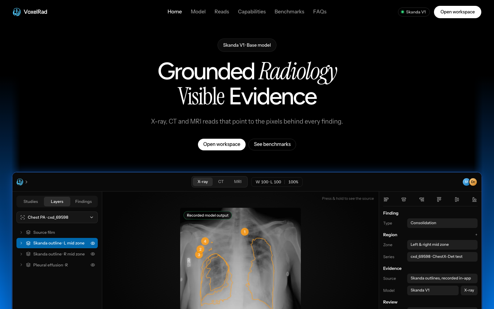
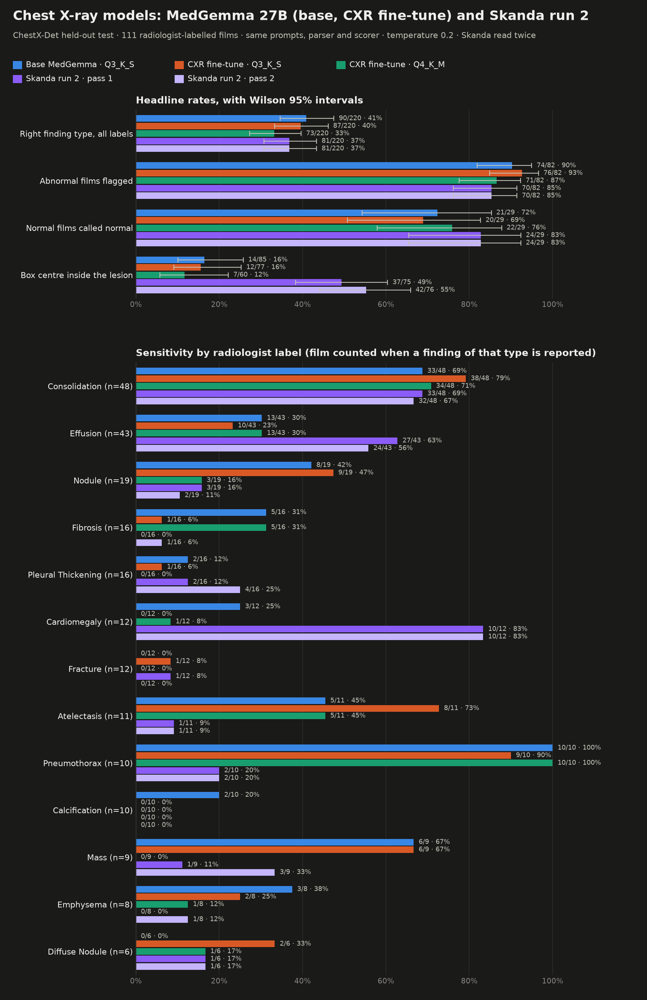
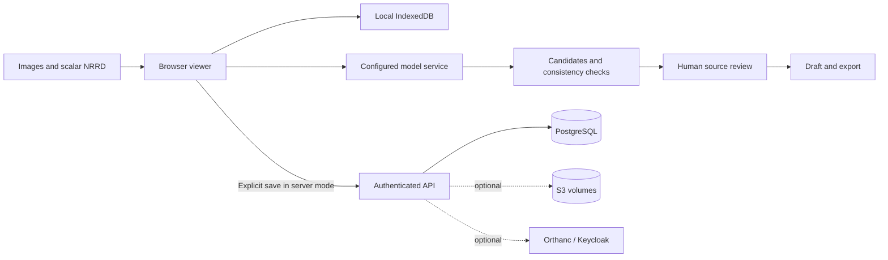

<div align="center">


# VoxelRad AI

### Grounded radiology. Visible evidence.

A browser workspace for X-ray, CT and MRI reading, where every model finding points back to the pixels behind it.

[](https://voxelradai.com)
[](https://github.com/Hitheshkaranth/VoxelRadAI_Terminal/releases)
[](#-quick-start)
[](app)
[](server)
[](#-evaluation-and-limitations)

[**Live site**](https://voxelradai.com) · [**Download beta**](https://github.com/Hitheshkaranth/VoxelRadAI_Terminal/releases/tag/v0.2.0-beta.2) · [Quick start](#-quick-start) · [Benchmarks](#-benchmarks) · [Docs](#-documentation)

<br>

<a href="https://voxelradai.com"></a>

<sub>The <a href="https://voxelradai.com">voxelradai.com</a> landing page, captured November 12, 2026. The overlay is recorded Skanda V1 output on a public ChestX-Det test film.</sub>

</div>

> [!IMPORTANT]
> VoxelRad AI is **research and review-support software. It is not a medical device.** Model findings are candidates and need review by a qualified reader. The benchmarks below are small, selected evaluations, not clinical validation.

## Contents

- [Highlights](#-highlights)
- [Quick start](#-quick-start)
- [Workspace tour](#-workspace-tour)
- [Benchmarks](#-benchmarks)
- [Review workflow](#-review-workflow)
- [Architecture](#-architecture)
- [Evaluation and limitations](#-evaluation-and-limitations)
- [Development](#-development)
- [Documentation](#-documentation)
- [Attribution](#-attribution)

## ✨ Highlights

| | |
| --- | --- |
| 🩻 **X-ray workspace** | Image stepping, pan/zoom, brightness/contrast, candidate overlays and per-finding review |
| 🧠 **CT and MRI** | Scalar NRRD import, axial/coronal/sagittal views, synchronized crosshairs, windowing and cine |
| 🧭 **Spatial context** | Optional voxel-derived 3D locator and source-plane navigation |
| 🎯 **Grounded findings** | Every candidate links to its source slice, outline or box, so you can compare it with the original image |
| 📝 **Review and reporting** | Accept or dismiss candidates, track coverage, draft from reviewed findings, sign and export |
| 🔐 **Server mode** | Sign-in, admin tools, saved studies in PostgreSQL, and share links that expire or can be revoked |
| 🔌 **Integrations** | Optional [Keycloak SSO](docs/keycloak.md), [private S3 volume storage](docs/s3-storage.md) and [Orthanc import](docs/orthanc.md). All are off until configured |
| 💻 **Local mode** | Studies stay in browser storage. Bring your own model service |

## 🚀 Quick start

### 1. Explore locally (no model needed)

```sh
git clone https://github.com/Hitheshkaranth/VoxelRadAI_Terminal.git
cd VoxelRadAI_Terminal/app
npm ci
npm run dev
```

Open **http://localhost:5173** and pick **CT** or **MRI** under *Sample scans*. Studies are kept in the browser only.

### 2. Connect a model

Run a compatible OpenAI-style model service on port **1234**, then choose the exact model ID in **Settings**:

```sh
curl http://localhost:1234/v1/models
```

The dev proxy forwards `/lmstudio/v1` to that service. The [Skanda reader guide](docs/reading-with-skanda.md) covers bf16 serving, hardware, modality inputs and outlines. Model weights are not included in this repo.

> [!NOTE]
> GGUF serving through LM Studio does not run Skanda's outline model. Use the bf16 setup for outlines.

### 3. Run with accounts and PostgreSQL

```sh
cp config.example .env   # set the DB password and bootstrap admin credentials
docker compose up -d --build
```

Open **http://localhost:8088**. For HTTPS, persistence and backups, see the [deployment guide](docs/deployment.md). For the hosted setup (Vercel and Neon), see [Vercel deployment](docs/vercel.md). To add SSO, S3 or Orthanc, layer on `compose.integrations.yaml`.

### Release packages

[**v0.2.0-beta.2**](https://github.com/Hitheshkaranth/VoxelRadAI_Terminal/releases/tag/v0.2.0-beta.2) ships a **source ZIP**, a prebuilt local-only **web ZIP** (serve it over HTTP) and **SHA256SUMS.txt**. `main` may be ahead of the beta. The login CT cine and the integrations are not in the beta packages.

## 🖼️ Workspace tour

<table>
  <tr>
    <td width="50%"><br><sub><b>Three-plane MRI.</b> Equal-width views with built-in plane and slice controls.</sub></td>
    <td width="50%"><br><sub><b>Full-width canvas.</b> Plane and layout controls at the top. Slice, playback, zoom and Display at the bottom.</sub></td>
  </tr>
  <tr>
    <td><br><sub><b>3D locator and review.</b> Navigation aid only, not validated segmentation.</sub></td>
    <td><br><sub><b>X-ray.</b> Public ChestX-Det film opened through the file picker.</sub></td>
  </tr>
</table>

<sub>CT and MRI views captured November 12, 2026 (X-ray November 10) with public teaching samples and no model running. These screenshots show layout and navigation, not diagnostic performance.</sub>

## 📊 Benchmarks

Chest X-ray, **ChestX-Det held-out test split**: 111 radiologist-labelled films, with the same prompts, parser and scorer for every model. Brackets are Wilson 95% intervals.

| Metric | **Skanda V1** | MedGemma 27B | MAIRA-2 |
| --- | :-: | :-: | :-: |
| Normal films called normal | **82.8%** <sub>[65.5–92.4]</sub> | 72.4% <sub>[54.3–85.3]</sub> | 72.4% <sub>[54.3–85.3]</sub> |
| Abnormal films flagged | 85.4% <sub>[76.1–91.4]</sub> | **90.2%** <sub>[81.9–95.0]</sub> | **90.2%** <sub>[81.9–95.0]</sub> |
| Right finding type (all 220 labels) | 40.5% <sub>[34.2–47.1]</sub> | **40.9%** <sub>[34.6–47.5]</sub> | 34.1% <sub>[28.1–40.6]</sub> |
| Box centre inside the reference box | **52.3%** <sub>[41.2–63.2]</sub> | 16.5% <sub>[10.1–25.8]</sub> | **52.3%** <sub>[40.4–64.0]</sub> |

<details>
<summary><b>Per-finding sensitivity chart</b></summary>
<br>

</details>

The numbers are generated from `score.py` output by [`benchmark/emit_landing.py`](benchmark/emit_landing.py), the same source the landing page uses. Reproduce them with the [benchmark guide](benchmark/README.md). The small per-label sample sizes produce wide intervals.

## 🔁 Review workflow

**X-ray.** Create a study, add a PNG, JPEG, WebP or uncompressed DICOM image, and analyze it. Check each candidate against the source, then accept or dismiss it. Draft the report and sign it. Amendments are kept in a history. A classifier heatmap is supporting evidence, not a confirmed lesion boundary.

**CT/MRI.** Open a sample or a scalar NRRD volume and set the plane and window. Then run an acquired-slice job, or choose current-slice analysis explicitly. Check coverage and any failed slices, go back to each candidate's source, and draft from the findings you accepted. Volume analysis sends one request per slice. It is not native whole-volume inference.

<details>
<summary><b>Keyboard shortcuts</b></summary>

| Key | Action |
| --- | --- |
| <kbd>Space</kbd> | Play / pause |
| <kbd>F</kbd> | Fit image |
| <kbd>P</kbd> / <kbd>W</kbd> | Pan / window |
| <kbd>M</kbd> | Single / three-plane layout |
| <kbd>H</kbd> / hold <kbd>Alt</kbd> | Toggle / temporarily hide overlays |
| <kbd>J</kbd> / <kbd>K</kbd> | Next / previous pending finding |
| <kbd>A</kbd> / <kbd>R</kbd> | Accept / reject selected finding |
| <kbd>?</kbd> | Shortcut help |

</details>

## 🏗️ Architecture



| Path | Responsibility |
| --- | --- |
| [`app/src/landing`](app/src/landing) | Public landing page, reading-room hero and benchmarks |
| [`app/src/components/viewer`](app/src/components/viewer) | Image rendering, volume navigation and review controls |
| [`app/src/components/shell`](app/src/components/shell) | Worklist, settings, sessions and administration |
| [`app/src/components/ui`](app/src/components/ui) | Editable shadcn/Radix primitives |
| [`app/src/lib/volumeJobs.ts`](app/src/lib/volumeJobs.ts) | Coverage, progress, retries and resume |
| [`server`](server) | Auth, study storage, sharing and migrations |
| [`api`](api) | Vercel serverless entry point |
| [`benchmark`](benchmark) | Scoring, plots and landing-page data generation |

Inference sends images to whichever model host you configure. In server mode, only studies you explicitly save are persisted. Hosted share links work as bearer links until they expire or are revoked. VoxelRad AI is not a PACS or a multi-tenant clinical archive.

## 🧪 Evaluation and limitations

- ✅ The release build and application tests pass, and all server tests pass. Browser QC covers the CT/MRI views, the popovers and the responsive layouts. See the [workspace verification](docs/validation/2026-11-10-scan-workspace.md), [platform QC](docs/validation/2026-11-10-platform-qc.md) and [swarm follow-up](docs/validation/2026-11-10-swarm-followup.md).
- ⚠️ Earlier labelled tests found large localization errors: five of six positive-slice GGUF boxes had zero overlap with the reference. The bf16 Skanda rerun improved selected MRI outlines, but CT tumour outlines remained poor. See the [failure report](docs/validation/2026-11-02-labeled-case-failure-report.md) and the [volume validation protocol](benchmark/volume-validation/README.md).
- ⏳ Still outstanding: full accessibility and physical-device testing, live hosted inference, geometric DICOM-series/PACS integration, MFA, multi-tenant isolation and durable server inference jobs. Real-provider acceptance of the integrations is also pending. The [capability manifest](server/capabilities.json) lists what is available and what is not.

## 🛠️ Development

```sh
# Frontend (app/)
npm test && npm run lint && npm run build

# API (server/)
npm ci && npm test

# Whole repo
npm test
```

The API integration harness writes synthetic records, so run it only against a disposable deployment ([server docs](server/README.md)). To package a tagged release, run `python scripts/package-release.py`. The output goes to `output/releases/`, which git ignores.

## 📚 Documentation

| Guide | |
| --- | --- |
| [Deployment](docs/deployment.md) · [Vercel](docs/vercel.md) | Self-hosted Compose and hosted setup |
| [Keycloak](docs/keycloak.md) · [S3 storage](docs/s3-storage.md) · [Orthanc](docs/orthanc.md) | Optional integrations |
| [Reading with Skanda](docs/reading-with-skanda.md) | Model serving, inputs and evidence |
| [Benchmarks](benchmark/README.md) | CXR scoring and reproduction |
| [Landing page design](docs/design/landing-page.md) · [element map](docs/design/visuvate-mapping.md) | Design notes |

## 🙏 Attribution

- Screenshots and samples use public Slicer teaching volumes and pydicom fixtures ([sample provenance](app/public/samples/provenance.json), [pydicom notice](app/public/samples/README.md)). Landing images are listed in [`app/public/landing/provenance.json`](app/public/landing/provenance.json). None of these are expert-labelled validation cases.
- The UI is built on [shadcn/ui](https://github.com/shadcn-ui/ui) ([MIT notice](app/src/components/ui/LICENSE)). [Libraries.dev](https://github.com/Jakubantalik/Libraries.dev) informed the choice of loading indicator.
- Fonts are self-hosted under the SIL Open Font License: [Figtree](app/public/fonts/Figtree-OFL.txt), [Instrument Sans](app/public/fonts/InstrumentSans-OFL.txt) and [Instrument Serif](app/public/fonts/InstrumentSerif-OFL.txt).

<div align="center">
<sub>Built for readers who want to see the evidence. <a href="https://voxelradai.com">voxelradai.com</a></sub>
</div>
