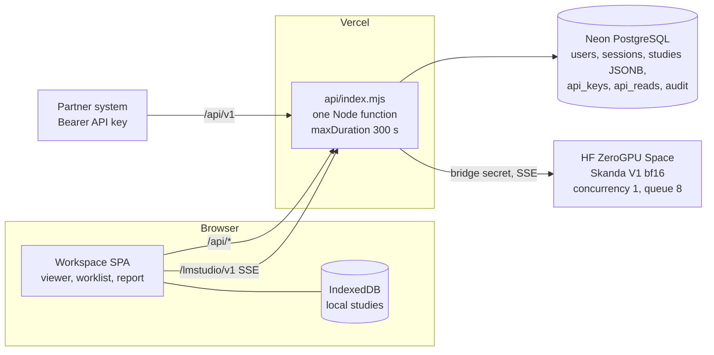
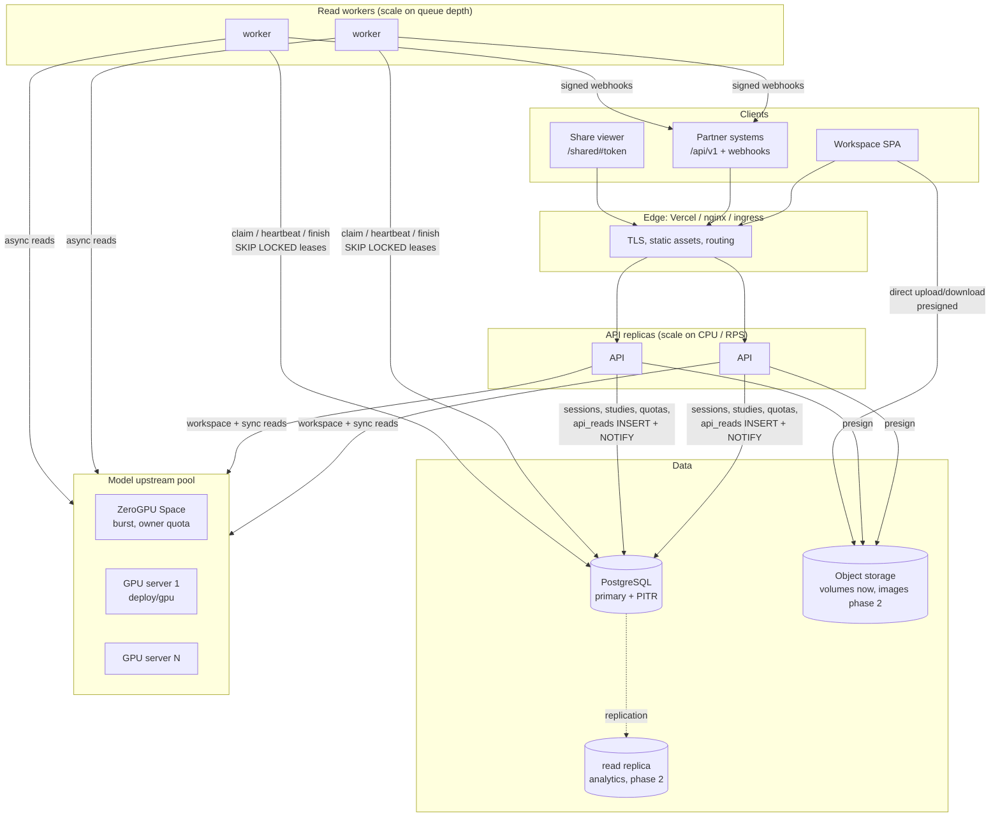
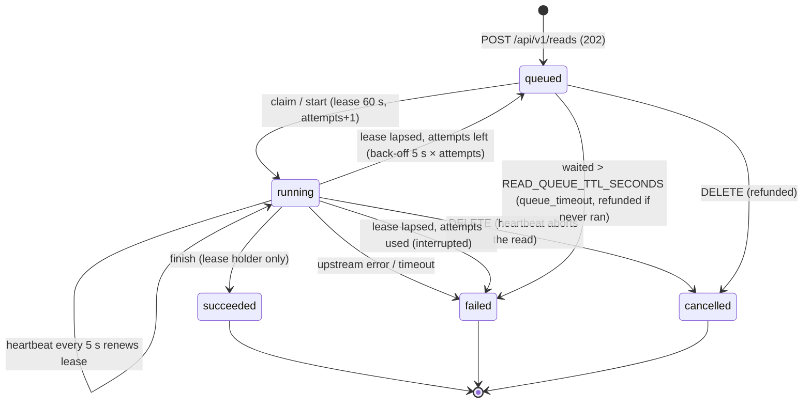

# Scaling RadGenis: architecture review and overhaul

*Reviewed 21 November 2026 against `main` at `66bc398`. Written from two seats: the system architect, who owns how
the platform behaves under load and failure, and the forward-deployed engineer (FDE), who installs it inside a
hospital or a partner's cloud and keeps it running there.*

This document covers how the platform was built, where it stops scaling, what this change does about that, and what
comes next. Every claim about current behaviour points to the code. Capacity figures come from measured read times
in the Skanda V1 model card (6.4 s per read on average) or are stated as assumptions.

---

## 1. Summary

**The first ceiling is GPU throughput, not the web tier.** Every read, from both the workspace and the public API, went
to one Hugging Face ZeroGPU Space that runs one read at a time and queues eight more
(`deploy/huggingface/space_app.py`: `demo.queue(default_concurrency_limit=1, max_size=8)`). A CT or MRI volume job
sends one read per acquired slice. In practice a single GPU serves roughly a dozen volume studies an hour, and the
Space's owner quota caps the day.

**The second ceiling was durability.** Asynchronous API reads ran inside the HTTP request that accepted them (Vercel
`waitUntil`, bounded by a 300 s function limit). If that function died, the read was lost and only marked failed ten
minutes later.

**Everything else scales horizontally already, with a few hot spots.** The API is stateless (sessions and rate limits
live in PostgreSQL), so replicas need no sticky sessions. The hot spots were these:

- the session check wrote a row on every authenticated request;
- every serverless cold start ran the migration lock;
- study images are stored inside JSONB rows;
- no metrics left the process.

**What this change ships:**

| # | Change | Where |
| --- | --- | --- |
| 1 | **Model upstream pool.** Several interchangeable GPU backends. Reads go to the least-loaded one, with a circuit breaker and fail-over only while no GPU can have run the read. | `server/src/modelPool.mjs`, `modelProxy.mjs` |
| 2 | **Durable read queue.** Async reads are leased rows (`FOR UPDATE SKIP LOCKED`), renewed by heartbeat, requeued when their executor dies, with back-pressure (`queue_full`) and a queue time limit that refunds reads that never ran. | `migrations/016_read_queue.sql`, `publicApi.mjs` |
| 3 | **Read workers.** A separate process type. Scale it with GPU count, independently of the API. Shuts down gracefully. | `server/src/worker.mjs` |
| 4 | **Dedicated GPU model server.** Same SSE contract as the Space, one per GPU. A full server returns 429 at once, so the API fails over. | `deploy/gpu/` |
| 5 | **Per-user storage allowance.** 10 GiB by default, adjustable per user. Covers scans, patient data, reports, analysis and feedback, enforced on study saves and volume uploads, and shown to the user. | `migrations/017_storage_quota.sql`, `storage.mjs`, `AccountStorage.tsx` |
| 6 | **Prometheus metrics** for the API and workers: HTTP, DB pool, upstream health, queue depth. | `server/src/metrics.mjs` |
| 7 | **Session check without a write per request**, and **migrations as a release step** (`MIGRATE_ON_START=false`, `npm run migrate`). | `index.mjs`, `migrateCli.mjs` |
| 8 | **Compose topology.** A `worker` service and a `compose.gpu.yaml` overlay for on-prem GPUs. | `compose*.yaml`, `app/deploy/models.conf` |

All defaults keep today's behaviour. `READ_EXECUTION` stays `inline` and a single `MODEL_UPSTREAM_URL` still works.
The hosted site changes only when its environment variables do.

---

## 2. The platform as found

There are three deployment shapes, all built from the same code:

| Shape | Web | API | Database | Model |
| --- | --- | --- | --- | --- |
| Hosted (radgenis.com) | Vercel static | Vercel function (`api/index.mjs`) | Neon | ZeroGPU Space over the bridge |
| Private install (`compose.yaml`) | nginx | Node container(s) | PostgreSQL 17 container | Host model service on :1234, reached by nginx |
| All-in-one Space (`deploy/huggingface`) | Gradio + FastAPI | Node child process | Bundled PostgreSQL, SQL dump to HF dataset | In-process ZeroGPU |

### Request paths that matter for scale

1. **Workspace read.** Browser → `/lmstudio/v1/chat/completions` → session check → daily cap (`login_attempts` upsert)
   → SSE piped from the upstream → browser. A CT/MR job repeats this once per acquired slice.
2. **API read, sync.** `/api/v1/chat/completions` → key check → cap → buffered or streamed read.
3. **API read, async.** `/api/v1/reads` → row in `api_reads` → 202 → the read runs in the same function via `waitUntil`
   → result stored, webhook sent. The client polls `GET /api/v1/reads/{id}`.
4. **Study save.** Full study JSON, including images as data URLs, upserted into `studies.payload` with a revision
   check, under 25 MB (4 MB on Vercel).

---

## 3. Capacity model and bottlenecks, ranked

### 3.1 GPU throughput (the binding constraint)

Measured: 6.4 s per read on average (7.0 s X-ray, 5.5 s CT, 7.3 s MRI; Skanda V1 confirmatory set, bf16).
`reader.lock` serialises reads on each GPU.

| Quantity | One GPU | Notes |
| --- | --- | --- |
| Peak reads/hour | ≈ 560 | 3,600 s ÷ 6.4 s at 100 % utilisation |
| Planning reads/hour | ≈ 350 | 60–65 % utilisation, which allows for queueing, cold starts and image transfer |
| X-ray studies/hour | ≈ 350 | 1 read per film |
| CT/MR volume studies/hour | ≈ 12 | **Assumes 30 acquired slices per job**; scale linearly with your slice count |
| ZeroGPU extras | − | Owner quota per day, `duration=45` booking per call, cold allocation, queue cap 8 (the 9th read is refused) |

**Sizing rule:** `GPUs = ceil(peak_hour_reads / 350)`, where
`peak_hour_reads = xray_studies + volume_studies × slices_per_job`, all at the busiest hour. Add one GPU (N+1) for
any site that needs reads during a GPU failure.

Example: a 300-bed hospital with 400 X-rays and 60 CT/MR studies a day sees, at its peak hour (≈ 15 % of the day),
60 X-ray reads plus 9 × 30 = 270 slice reads, which is 330 reads. That needs **one GPU, two for N+1**. The ZeroGPU
Space alone cannot carry it within its daily quota.

### 3.2 Durability of asynchronous reads (fixed here)

An async read lived only inside the accepting function. The function limit is 300 s, the read budget 230 s, and the
Space's own limit 180 s. A crash, deploy or eviction lost the read. Nothing retried it; the next sweep marked it
`interrupted` after 10 minutes. There was no back-pressure either: a burst of submissions became a burst of parallel
upstream calls against a queue of eight.

### 3.3 Database connections and write amplification

- **Connections:** `replicas × DB_POOL_SIZE` (default 10). On Vercel every warm instance holds its own pool, so 50
  warm instances could ask for 500 connections. Use Neon's pooled (`-pooler`) endpoint or PgBouncer in transaction
  mode, and keep `DB_POOL_SIZE` at 2–3 on serverless.
- **Session check:** the old `UPDATE sessions … RETURNING` wrote a new tuple version on every authenticated request,
  even when `last_used_at` did not change. A volume job of 30 slice reads produced 30 session writes. **Fixed:** the
  check is now a `SELECT`, and the write happens at most once a minute per session.
- **Rate limits and caps** use one upsert per read on `login_attempts`. That is fine up to thousands of reads a minute,
  since rows are per user per day, so there is no global hot row.
- **Migrations at boot:** each cold start took `pg_advisory_xact_lock` and checked every migration file. **Fixed:**
  `MIGRATE_ON_START=false` plus `npm run migrate` as a release step.

### 3.4 Image bytes in PostgreSQL

Studies keep images as data URLs inside `studies.payload` (JSONB, TOASTed), and share snapshots copy them again. A
10 GiB allowance per user multiplies quickly: 1,000 users at 20 % fill is 2 TB. That belongs in object storage, not in
the primary database's buffer cache, backups and point-in-time recovery. The S3 path already exists for volumes
(`objectStorage.mjs`: presigned upload, finalise, short-lived download). This change adds **accounting and
enforcement** now, so allowances are honest before the storage engine changes. Moving image bytes out of JSONB is
phase 2 (section 6).

### 3.5 Analytics queries

`/api/admin/metrics` and `/api/admin/reviews` unnest `payload->'images'->…->'findings'` across all studies. That
cost grows linearly with total data and competes with clinical traffic. Phase 2 moves these to a read replica or to
summary tables maintained at write time.

### 3.6 Observability

Before this change, metrics stopped at the process (`/api/admin/operations`, reset on restart). Nothing could tell
whether the queue was backing up or an upstream was failing. **Fixed:** `/metrics` on every API replica and worker
(section 5.4).

### 3.7 Tenancy

Studies are scoped by owner. Organisations exist only for API keys. Administrators see global totals
(`capabilities.json`: `multiTenantIsolation: false`). That is correct for one hospital per installation, which is what
the FDE deploys today. It is not correct for shared SaaS. Phase 3 covers it.

---

## 4. Target architecture

Principles:

- **Separate the three tiers by how they scale.** Web serves files and goes behind a CDN. API replicas are CPU-bound
  and stateless. Workers are bound by GPU capacity. The GPU pool is the expensive tier, so it gets the most explicit
  admission control.
- **PostgreSQL is the coordination point.** No Redis, Kafka or SQS is needed at this scale. One primary handles
  thousands of queue operations a second with `SKIP LOCKED`. Keeping a single stateful dependency is also what makes
  an on-prem install supportable. Add a broker only when queue traffic measurably competes with clinical queries.
- **Admission before spending.** Each layer refuses early and cheaply: `queue_full` before a read is counted, `429`
  from a full GPU server before anything runs, and fail-over only while no GPU can have taken the read.
- **Configuration, not forks.** SaaS, dedicated VPC and air-gapped on-prem are the same images with different
  environment variables.

---

## 5. What changed, in detail

### 5.1 Model upstream pool (`server/src/modelPool.mjs`)

- `MODEL_UPSTREAMS=https://space.hf.space/lmstudio,https://gpu-1.internal` (comma-separated). `MODEL_UPSTREAM_URL`
  still works alone. Plain `http` is allowed only for loopback or for hosts named in `MODEL_UPSTREAM_HTTP_HOSTS`
  (private service names such as `skanda-gpu`).
- **Ordering:** healthy upstreams first, least in-flight first, rotating among ties. Upstreams with an open circuit
  go last, so a total outage still gets tried rather than refused.
- **Circuit breaker:** three consecutive start failures open the circuit for 30 s, then one read may try it
  (half-open). An exhausted ZeroGPU quota counts as a failure, so the dedicated GPUs take over until the quota resets.
  A merely busy upstream (429 busy) does not count.
- **Fail-over rule:** on connection refused, 5xx, 401/403/404 (misconfigured) or 429, try the next upstream. **Do not**
  fail over on a header timeout, which may mean the read is already queued on that GPU, or on 400/413/422, which every
  upstream would refuse. A read is never run twice, and the existing refund rules keep their meaning.
- In-flight counts are released when the stream ends, however it ends (`releasing()` wraps the body).
- Verified with unit tests (fail-over from down, busy and quota; refund when everything is down; no fail-over on 413)
  and an end-to-end run against two real `deploy/gpu` server processes.

### 5.2 Durable read queue (`016_read_queue.sql`, `publicApi.mjs`)

- New columns: `attempts`, `lease_owner`, `lease_expires_at`, `available_at`. They are partial-indexed for the claim
  (`WHERE status='queued'`) and the lease sweep (`WHERE status='running'`).
- **Claims** use `FOR UPDATE SKIP LOCKED`, so any number of workers and API replicas can claim at once without
  waiting on each other or taking the same read.
- **Only the lease holder can finish a read.** A worker that lost its lease (paused, partitioned) cannot overwrite the
  result of the worker that retried it.
- **`READ_EXECUTION=inline`** (default, Vercel): the accepting request runs its own read as before. A read whose
  function died is requeued, then retried by a later `/api/v1` request (only retries, never fresh reads).
  **`READ_EXECUTION=worker`**: the API only stores the read and sends `NOTIFY voxelrad_reads`; workers do the rest.
- **Back-pressure:** `READ_QUEUE_LIMIT` (default 500) queued reads, then `503 queue_full` with `Retry-After: 30`,
  before the read is counted against the key's daily cap.
- Verified on PostgreSQL (PGlite): migrations 001–017 apply and re-apply; claim, `retriesOnly`, heartbeat, lease
  loss, requeue with back-off, attempt exhaustion, cancellation seen by the heartbeat, release, queue timeout with
  refund. `EXPLAIN` shows the claim using `api_reads_claim_idx`.

### 5.3 Read workers (`server/src/worker.mjs`) and GPU servers (`deploy/gpu`)

- `node src/worker.mjs` (or the `worker` Compose service) runs `READ_WORKER_CONCURRENCY` reads at once. Set it to
  about the number of GPUs that worker should keep busy. It wakes on `LISTEN` and falls back to polling every 2 s. It
  also sweeps every 15 s, so lapsed reads recover when no client is calling.
- **SIGTERM:** stop claiming, give running reads up to `READ_WORKER_DRAIN_SECONDS` (240), then release any left
  without using an attempt. `/healthz` turns 503 at once so orchestrators stop routing to it.
- `deploy/gpu/serve.py` is one Skanda V1 server per GPU. It uses the same bridge secret and SSE shape as the Space,
  holds at most `MAX_QUEUE` waiting reads (then returns a fast 429), times out after 180 s, and keeps the GPU reserved
  until a timed-out read really ends (a thread cannot be killed). Contract tests run in CI without a GPU.

### 5.4 Metrics (`server/src/metrics.mjs`)

`GET /metrics` with `Authorization: Bearer $METRICS_TOKEN`. It returns 404 when the token is unset. Neither nginx
nor Vercel routes it, so scrape replicas on the private network. Workers serve the same on `:9090/metrics`.

| Metric | Use |
| --- | --- |
| `voxelrad_http_requests_total{class}` / `_duration_ms_sum` / `_count` | Error rate and mean latency per replica |
| `voxelrad_db_pool_connections{state="waiting"}` | > 0 sustained means the pool is too small or queries too slow |
| `voxelrad_model_upstream_up{host}` | Alert when 0 for > 2 min |
| `voxelrad_model_upstream_in_flight{host}` | GPU saturation |
| `voxelrad_api_reads{status="queued"}` | **The autoscaling signal for GPU workers** |
| `voxelrad_worker_reads_active` / `_concurrency` | Worker saturation |

Suggested alerts: queued reads > 50 for 5 min (add GPUs); any upstream down for 2 min; 5xx > 2 % for 5 min; DB pool
waiting > 0 for 5 min.

### 5.5 Storage allowance (`017_storage_quota.sql`, `storage.mjs`, `AccountStorage.tsx`)

Each user has an allowance: `STORAGE_QUOTA_GB`, 10 GiB by default. An administrator can override it per user with
`PATCH /api/admin/users/:id {"storageQuotaBytes": n | null}`, which is audited as `user.storage_quota`.

| Counted as | Source |
| --- | --- |
| **Scans** | Images in saved studies (`studies.image_bytes`) plus uploaded CT/MR volumes (`volume_objects.size_bytes`) |
| **Patient data & reports** | The rest of each study: patient fields, report text, signed versions and addenda |
| **Analysis** | AI findings, boxes, measurements and the user's accept/dismiss decisions (`studies.analysis_bytes`) |
| **Feedback** | The user's dictation corrections and clips (`dictation_events`, by the user's keyed pseudonym) |

- Sizes are recorded when a study is written, so usage is an indexed sum rather than a JSONB scan. The migration
  backfills existing rows.
- **Enforcement:** a study save or volume upload that would exceed the allowance returns
  `413 storage_quota_exceeded` with a readable message. The check runs under the user-row lock, so concurrent saves
  cannot overshoot. Re-saving a study counts only the difference.
- **User access** is unchanged and owner-scoped: a user can open, download and delete their own scans, patient data
  and reports (and see the analysis on them). Dictation feedback is pseudonymous, never shown back, and cannot be
  deleted by the user. De-identified training cases are organisation data with their own retention and are not counted.
- **UI:** the sidebar shows "x of 10.7 GB used" with a meter in server mode, and **Settings → Account → Server
  storage** shows the breakdown, refreshed after every save, upload and deletion.

---

## 6. Roadmap

| Phase | Work | Why / exit criterion |
| --- | --- | --- |
| **1 (this change)** | Upstream pool, durable queue, workers, GPU servers, storage allowance, metrics, session fix, migrations as a release step | GPU capacity scales by adding servers; no lost async reads; allowance enforced and visible |
| **2: data plane** | Study images to object storage, content-addressed (`sha256`), presigned, deduplicated across share snapshots; `studies.payload` holds references only. PgBouncer or the Neon pooler. Read replica or summary tables for admin analytics. Make volume jobs use `/api/v1/reads`-style queued batches instead of N browser streams. | DB size grows with metadata, not pixels; p95 study save < 500 ms at 25 MB; analytics off the primary |
| **3: tenancy** | `organisations`, `memberships`, `org_id` on every row, PostgreSQL row-level security set per request (`SET app.org_id`). Per-organisation allowance, keys, audit export, and per-organisation upstream routing (dedicated GPUs per customer) | Shared SaaS without cross-tenant reads, proven by RLS tests |
| **4: model plane** | Batched slice inference in `skanda.serve` (many slices per forward pass); native volume inference; autoscaling GPU workers on `voxelrad_api_reads{status="queued"}` (KEDA or the cloud's equivalent); regional deployments for data residency | Cost per CT study down by the batching factor; queue wait p95 < 60 s at peak |

Explicitly not planned: a message broker or microservice split before phase 2 numbers justify it. The current
monolith-plus-workers shape fits the team size and the on-prem support burden.

---

## 7. Field deployment (FDE playbook)

### 7.1 Topologies

| | **Hosted SaaS** | **Dedicated VPC** | **On-prem / air-gapped** |
| --- | --- | --- | --- |
| Who runs it | VoxelRad | VoxelRad in the customer's cloud account | Hospital IT, with an FDE |
| Web + API | Vercel | Containers (ECS/AKS/GKE) behind the customer's ingress | `compose.yaml` on a VM or Kubernetes |
| Database | Neon (pooled) | Managed PostgreSQL with PITR | PostgreSQL 17 with WAL archiving |
| Model | ZeroGPU Space plus dedicated GPUs in `MODEL_UPSTREAMS` | `deploy/gpu` on the customer's GPU nodes | `compose.gpu.yaml` (no internet after weight download) |
| Async reads | `inline` | `worker` | `worker` |
| Data residency | Vercel `sin1` and Neon region | Customer's region | Customer's building |

### 7.2 Installation checklist (on-prem with GPU)

1. Size GPUs with the rule in 3.1, using the site's peak hour and slice counts. Reserve N+1 for reads that must
   continue during a GPU failure.
2. `cp config.example .env`; set `POSTGRES_PASSWORD`, `BOOTSTRAP_ADMIN_*`, `BRIDGE_SECRET` (`openssl rand -hex 32`),
   `HF_TOKEN` (read-only, revoke after the first download), and `MODEL_REVISION` pinned to a commit.
3. `docker compose -f compose.yaml -f compose.gpu.yaml up -d --build`. The first start downloads the weights into
   the `model-cache` volume.
4. For air-gapped sites, pre-load `model-cache` from a signed archive, then remove `HF_TOKEN`.
5. Put HTTPS in front of `web`; set `PUBLIC_ORIGIN` and `ALLOW_INSECURE_LOCALHOST=false`.
6. Set `STORAGE_QUOTA_GB` to the site's agreement. Check disk: users × allowance × expected fill, plus 30 % headroom
   for WAL and backups.
7. Set `METRICS_TOKEN`; scrape `api:8080/metrics` and `worker:9090/metrics`; load the alerts in 5.4.
8. Connect SSO (`compose.keycloak.yaml`, `docs/keycloak.md`) and PACS (`compose.orthanc.yaml`, `docs/orthanc.md`).
9. Acceptance: run `server/test/integration.mjs` against a disposable copy, then a supervised pilot with radiologist
   review of every finding.

### 7.3 Runbooks

| Symptom | Check | Action |
| --- | --- | --- |
| Reads slow, `api_reads{queued}` climbing | `voxelrad_model_upstream_in_flight`, worker `_active` vs `_concurrency` | Add a GPU server to `MODEL_UPSTREAMS`; raise `READ_WORKER_CONCURRENCY` only if GPUs are idle |
| `queue_full` returned to partners | Same as above | Capacity problem, not a bug. Raise `READ_QUEUE_LIMIT` only with more GPUs behind it |
| `upstream_up=0` for one host | `curl -H "X-VoxelRad-Bridge: …" host/healthz`; GPU server logs | Reads already fail over. Fix or remove the host; the circuit closes on the first success |
| ZeroGPU quota exhausted | Space log "quota" errors; that upstream's circuit open | Expected daily. Dedicated GPUs carry the load until 00:00 UTC |
| Users hit `storage_quota_exceeded` | `GET /api/admin/users` (`storageUsedBytes`) | Raise that user's allowance, or have them delete old studies or volumes |
| DB pool waiting > 0 | `voxelrad_db_pool_connections{state="waiting"}` | Use the pooled endpoint; lower `DB_POOL_SIZE` per replica on serverless; look for slow analytics queries |
| Worker restarts mid-read | Worker logs `worker.started` | Leased reads requeue within about 60 s and retry once (`READ_MAX_ATTEMPTS=2`) |

### 7.4 Rolling out this change on radgenis.com

1. Deploy as is. Migrations 016 and 017 are additive and backfill in place. Behaviour is unchanged.
2. Set `METRICS_TOKEN` if a scraper is available; otherwise rely on `/api/admin/operations`.
3. To add GPU capacity, start `deploy/gpu` on a GPU host with HTTPS and append it to `MODEL_UPSTREAMS` next to the
   Space URL.
4. Optionally run a worker on any always-on host with the same `DATABASE_URL`, then set `READ_EXECUTION=worker`
   on Vercel. Async reads stop depending on function lifetime.
5. Later: `MIGRATE_ON_START=false` plus a `npm run migrate --prefix server` release step.

---

## 8. Configuration reference (new)

| Variable | Default | Applies to | Meaning |
| --- | --- | --- | --- |
| `MODEL_UPSTREAMS` | (unset → `MODEL_UPSTREAM_URL`) | API, worker | Comma-separated model upstreams |
| `MODEL_UPSTREAM_HTTP_HOSTS` | (none) | API, worker | Hostnames allowed over plain HTTP (private network only) |
| `READ_EXECUTION` | `inline` | API | `worker` leaves async reads to read workers |
| `READ_QUEUE_LIMIT` | `500` | API | Queued reads before `queue_full` (0 = unlimited) |
| `READ_QUEUE_TTL_SECONDS` | `600` | API, worker | Longest a read may wait before failing (refunded if never run) |
| `READ_MAX_ATTEMPTS` | `2` | API, worker | Executions per read, counting a retry after a crash |
| `READ_WORKER_CONCURRENCY` | `2` | worker | Reads at once per worker |
| `READ_WORKER_POLL_MS` | `2000` | worker | Idle poll interval |
| `READ_WORKER_DRAIN_SECONDS` | `240` | worker | Grace period on SIGTERM |
| `WORKER_PORT` | `9090` | worker | `/healthz` and `/metrics`; 0 disables |
| `METRICS_TOKEN` | (unset → hidden) | API, worker | Bearer token for `/metrics` (16+ chars) |
| `MIGRATE_ON_START` | `true` | API, worker | `false` when `npm run migrate` runs as a release step |
| `STORAGE_QUOTA_GB` / `STORAGE_QUOTA_BYTES` | `10` GiB | API | Default per-user storage allowance |
| `MAX_QUEUE`, `READ_TIMEOUT_SECONDS`, `PORT` | `8, 180, 8000` | GPU server | Waiting reads, read timeout, listen port |

## 9. Verification

| Check | Result |
| --- | --- |
| Server unit and integration-style tests (`npm test --prefix server`) | 120 pass, including 14 new (pool, queue, worker, metrics, storage) |
| App tests, typecheck, lint | Pass, including the new `test-account-storage.ts` |
| Queue and quota SQL on PostgreSQL (PGlite): migrations, claims, leases, recovery, backfill, enforcement | Pass |
| GPU server contract tests (`deploy/gpu/test_serve.py`) | 6 pass |
| End to end: Node proxy → two `serve.py` processes, 3 concurrent reads | Two served in parallel, the third refused as `upstream_busy` without opening a circuit |
| `docker compose config` for base and GPU overlay | Valid |
| Not run here | A real GPU with Skanda weights, the GPU Docker image build, `nginx -t`, load tests at target scale. Run these during the first install. |
