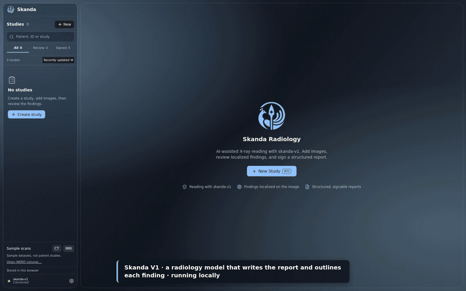
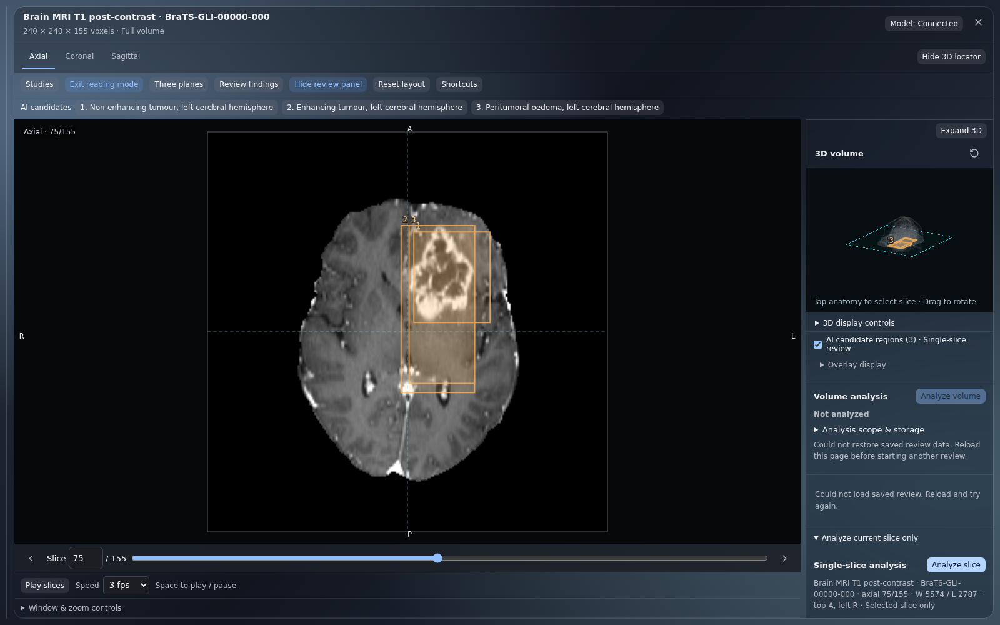
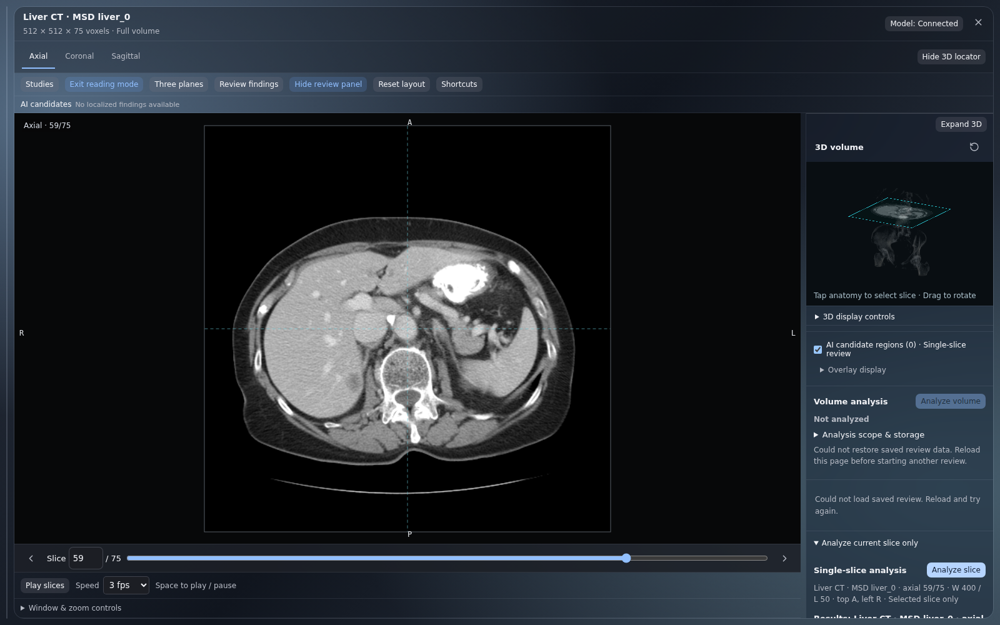
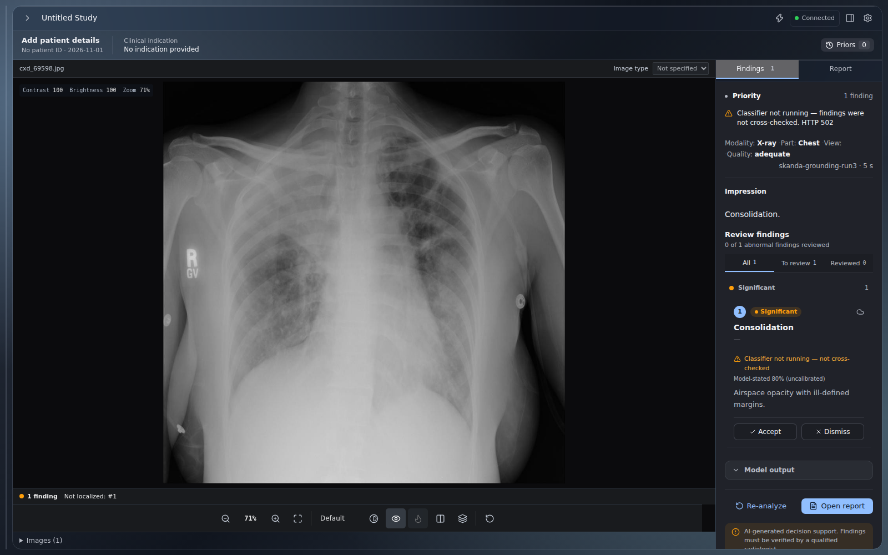
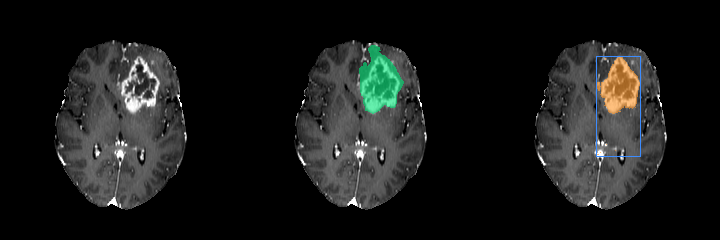
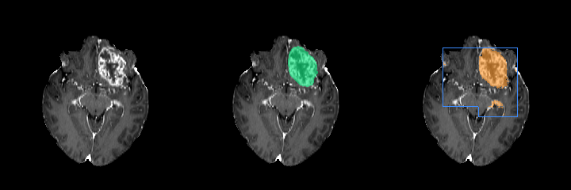
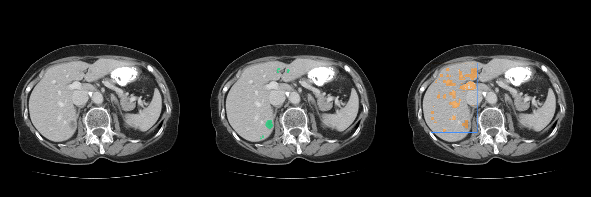

# Reading with Skanda (X-ray, CT, MRI)

[Skanda](https://github.com/Hitheshkaranth/skanda-grounding) is our own reader. It writes the report and draws an
**outline for each finding**, and its server measures sizes and HU from those outlines. The app treats any model whose
name starts with `skanda-` as Skanda. For X-ray it then sends Skanda's own prompt. For CT and MRI it sends the slice the
way Skanda was trained to see it: axial, native pixel grid, CT as lung / soft-tissue / bone windows plus raw HU and the
pixel spacing.

<a href="skanda-demo.mp4"></a>

<sub>Recorded from this app on 6 Nov 2026 with the Skanda server, Skanda V1, bf16, model name `skanda-v1` (GIF at 1.5×
speed; <a href="skanda-demo.mp4">MP4</a>, 3 min 18 s). Every case is from Skanda's held-out test split: ChestX-Det
films cxd_67598, cxd_41481 and cxd_40388, MSD hepatic vessel 025 (slice 25), LUNA16 c13665c0fe (slice 34) and SOOP
sub-47 DWI (slice 16). The TorchXRayVision cross-check was running. On the first film Skanda also reports effusions the
radiologists did not label.</sub>

### Which build to run

| Build | Precision | Memory | Outlines | X-ray | CT / MRI |
|---|---|---|---|---|---|
| **Skanda server** (`skanda/serve.py`, weights in the private Hugging Face repo [`hitheshkaranth/skanda-grounding`](https://huggingface.co/hitheshkaranth/skanda-grounding)) | **bf16, not quantised** | ~68 GB while reading, ~93 GB peak (measured on a DGX Spark, 128 GB unified) | ✅ one per finding | ✅ | ✅ with Skanda's native input, measured sizes and HU |
| GGUF in LM Studio (e.g. `skanda-grounding-q3-mixed`, 3-bit mixed) | Q3 | – | ❌ LM Studio cannot run Skanda's outline model (SAM 2) | names only, no locations | **boxes removed**: it writes coordinates Skanda was never trained to produce |
| FP8 / INT4 Skanda server | planned | ~38 / ~24 GB (estimated) | ✅ | not built or benchmarked yet | not built or benchmarked yet |

```sh
# on the GPU machine, in skanda-grounding (stop other large models first)
hf download hitheshkaranth/skanda-grounding --local-dir models/skanda-r3          # main = run 3 (59 GB)
run/serve_skanda.sh models/skanda-r3 skanda-grounding-run3                       # http://localhost:1234
```

Then set **Settings → model** to `skanda-grounding-run3`. The default base URL `/lmstudio/v1` reaches port 1234 through
the dev server's proxy. On another machine, use `http://<gpu host>:1234/v1`.

### What it does on the failure report's cases

The [labeled-case failure report](../docs/validation/2026-11-02-labeled-case-failure-report.md) tested the 3-bit GGUF in
LM Studio with the generic box prompt. We repeated the same films and slices with the Skanda server (run 3), using the
same pixels and reference masks, and scored them the same way. Outline Dice compares Skanda's outline with the
radiologist mask; the GGUF draws no outline, so it has no Dice.

| Case | Reference | GGUF in LM Studio (report) | Skanda server, run 3 |
|---|---|---|---|
| X-ray `cxd_69598` | atelectasis, consolidation, effusion, fibrosis | atelectasis; no box or outline | consolidation; **not localised** (no outline). In the app benchmark's first pass on the same film: effusion and consolidation on both sides, with boxes |
| CT 59 / 60 / 70 (liver tumour) | tumour | lesion named; box IoU 0 / 0 / 0 | lesion named in the right liver; outline Dice 0.14 / 0.20 / 0.01, because the outline follows enhanced vessels. On 59 and 60 the server **withholds** the outline (brighter than the tissue around it although the text says hypoattenuating) |
| CT 56 | no tumour | false liver lesion | **normal** ✓ |
| MRI 61 / 75 / 85 (glioma) | tumour | box IoU 0.07 / 0 / 0; sides contradictory | outline Dice **0.91 / 0.84 / 0.67**; left hemisphere every time ✓; oedema, non-enhancing and enhancing tumour named separately |
| MRI 97 | no tumour | normal | normal ✓ |

<table>
<tr>
<td width="33%"></td>
<td width="33%"></td>
<td width="33%"></td>
</tr>
<tr>
<td><sub>MRI 75: three regions from Skanda's outlines, on the tumour and on the correct side.</sub></td>
<td><sub>CT 59: the outline followed vessels, so the server withheld it and the panel says why.</sub></td>
<td><sub>X-ray: consolidation found, but no outline (run 3 omits the outline token on about 1 in 5 X-ray findings). The amber note is the optional TorchXRayVision cross-check, which was not running.</sub></td>
</tr>
</table>

<details>
<summary><b>Reference vs Skanda outlines (re-run images)</b></summary>

Each panel shows the slice, then the radiologist reference (green), then Skanda's outline (orange) and box (blue).
Scores: [`docs/validation/skanda-rerun/results.json`](../docs/validation/skanda-rerun/results.json).

 

</details>

**Status recorded during the November 2026 evaluation:**
- **X-ray outlines:** run 3 leaves out the outline token on about 21% of X-ray findings. At that evaluation, run 4 was being developed to retain it on every finding.
- **CT tumour outlines:** run 4 adds real liver-tumour outlines from CRLM and HCC-TACE-Seg.
- **Single MRI sequences:** Skanda was trained on FLAIR, T1 post-contrast and T2 together. The server rewrites claims about sequences that weren't sent, and the result says the read is outside its training data.
- **Uploaded NRRD volumes:** they open as modality "Volume", and Skanda needs CT or MRI (report fault F06).

